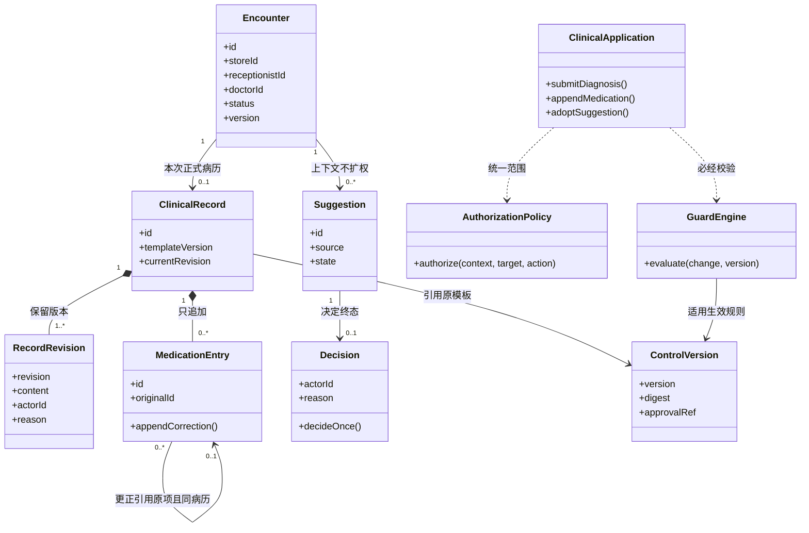

# 数据与接口设计

> 设计候选v0.1；基线SRS v1.0。逻辑类/表与HTTP契约供评审，尚未建库、实现或锁定框架版本。

## 1. 数据对象、键与历史

对外引用使用不含宠物身份的随机标识；时间由服务端记录并以UTC保存、界面按时区显示。ID与时间不是客户端自报权限。业务键和外键需要数据库约束；变长病历内容可用模板校验的JSON内容保存，不能用JSON灵活性绕过字段/权限。

| 对象 | 关键内容/关联 | 约束与投影 |
| --- | --- | --- |
| Store/Account/Session | 门店；账号角色/门店/状态/口令哈希；服务端会话的账号、期限、撤销状态 | 账号只由受控演示初始化准备，无公开注册/改派功能；每请求核验当前身份，业务不信staff/superuser。口令不以明文写库或日志 |
| Encounter | 宠物标识、本次基本资料快照、主诉、原接待账号、接诊医生、门店、时间、状态、版本 | 归属服务端固定；误建不删除。宠物标识关联不加载其他接诊；资料更正保留前后版本 |
| ClinicalRecord/RecordRevision | 关联Encounter、固定引用模板、当前版本指针；每版诊断/检查/采纳内容及责任信息 | 首次正式提交创建病历；无正式病历时仍可按权限读接待上下文。旧版内容不覆盖，当前指针变化不销毁历史；诊断必有 |
| MedicationEntry | 病历、追加项/更正项、原项引用、内容、真实账号/时间/理由、操作关联 | 原项不可更新/删除；更正引用必须同病历。新增和更正是服务端路由模式，不接受客户端指定“覆盖” |
| Suggestion/Decision | 接诊上下文、可关联病历、来源、建议；一份终态决定及实际医生/理由/采纳内容 | 首次可先关联Encounter的病历上下文，写入时建立Record关联；不新增草稿业务。新决定仅Pending转终态，同次重试不重复决定/写入 |
| Demand/Candidate/Approval/ActivePolicy | 输入及版本、候选内容/摘要、真实审批、所属门店生效指针 | 候选改内容产生新版本；批准绑定具体摘要；真实人工审批后才手动启用；示例文件不直接成为ActivePolicy |
| Evaluation/Hit/Alert | 独立提交引用、模板/规则版本、命中规则/字段、告警、医生处理状态与记录 | 命中唯一键为(attempt_id,rule_id,rule_version,field)；两规则同字段不合并，新独立提交分别保存；管理只聚合，临床命中值不进管理投影 |
| Outbox/DeliveryReceipt | 事件/告警关联、待发/待核对/确认、消费收据 | outbox与告警可靠持久，消息确认与业务处理独立；事件ID唯一去重，重投不新建告警 |
| OperationResult | 可信账号、权限键、目标、同一操作标识、内容摘要、执行状态/结果引用 | 唯一键为(actor_id,permission,operation_id)；摘要包括服务端固定模式、规范目标引用、业务输入和期望版本，同键换模式/目标/内容均409。先复核当前授权，再返回结果；不缓存可越权取回的病历全文 |
| AuditEvent/AuditTarget | 事件、时间、事件所属店、真实账号/角色、动作、结果、标准原因、目标关联集合 | 每次实际读/导出审计可按病历和操作者查；列表/批量导出目标逐一可关联；管理只取C-06字段 |
| WorkPlan/ExecutionMeta/Review | 工作项、阶段、计划版本、同维实际元数据/依据、差异及人工结论 | 不使用临床正文比较；来源不足不可比较；复核绑定计划/实际版本，不抹历史 |

处方独立不可变项与普通诊疗版本分开，避免“只追加”被当前JSON覆盖实现破坏。RecordRevision保存模板引用和字段含义所需版本；导出按原版本解释并明确更正链。归属类字段、临床内容、治理定义和脱敏元数据分别序列化，不返回一个通用大对象。

## 2. 基于职责的类图

图解决“谁拥有历史、谁负责授权与写前判定”的设计问题；类名表示候选职责，不是宣称已有ORM代码。MedicationEntry的自关联只表达更正原项；不可把更正设计为原项的覆盖方法，也不把三种账号画成权限继承。

## 3. 事务、索引与并发

索引优先覆盖Encounter(store_id,receptionist_id/id)、Encounter(store_id,doctor_id/id)、病历/版本关联、AuditEvent(store_id,actor_id,time)、AuditTarget(target_id,event_id)、Alert(record_id,state)、Outbox(status,next_attempt)、OperationResult(actor_id,permission,operation_id)。索引是候选，不是已测最优；索引数量/执行计划及锁等待须预研。

列表按数据库归属谓词查询并按稳定键分页，不全表取回再在内存过滤。诊疗、用药、采纳和误建均在显式事务中检查同一目标的状态/版本；采用目标行锁加期望版本比较，避免误建与新增治疗竞态。重复结果可在授权后先作只读核对，但这不是并发裁决：事务内争取OperationResult唯一键/行后，必须再次比较摘要和结果。已有完成结果则返回原结果引用；同键异内容拒绝；正在执行则有界等待或返回待核对，不再次执行。冲突/死锁按数据库事务回滚后重试，不能在失效事务中继续提交。

统一锁顺序为OperationResult唯一键/行→门店策略指针→Encounter→临床目标→审计关联；治理路径也遵循先操作、后策略指针、再候选/批准对象的顺序，不反向取锁。门店PolicyHead在受控初始化时建立：临床提交对它取共享读锁并固定本次生效版本，多个临床请求可并行持共享锁；启用事务对同一指针取排他锁后校验批准并切换。锁持有至本次事务结束，使启用和临床提交有可说明的先后；不让每个临床请求排他锁同店指针而全店串行。具体MySQL/PostgreSQL锁语句由所选适配层实现并预研，不能用ORM普通快照读冒充锁定读。没有有效生效版本时按需求拒绝依赖该策略的临床变更。

MySQL候选要求事务表使用InnoDB，PostgreSQL候选使用相应事务能力；正式迁移/DDL不混入业务事务。读取审计和业务必需审计在响应前完成，不能放异步回调补写。错误/拒绝事件与医疗回滚分开：已确认护栏命中在拒绝事务中可靠保存Hit/Alert/Outbox，无需把违规医疗内容写入正式病历。

## 4. 接口清单与权限绑定

接口名称是候选，操作范围/结果以基线为准。全部受保护路由必须登记权限解析器和响应投影；未知/漏挂默认拒绝并留痕，离线门禁扫描应使构建失败。登录/会话退出属于身份基础能力，不新增医院角色或公开注册；OpenAPI契约离线生成，不因调试默认公开临床接口。

| 目标/方法与路径 | 权限键 | 输入/输出关键契约 |
| --- | --- | --- |
| POST /api/encounters | encounter.create | 最小接待资料＋同店医生；归属取可信会话；输出本次接诊标识 |
| GET /api/encounters/create-options/doctors | encounter.create，doctor_options模式 | 同店医生最小标识/显示名；Q-CREATE-AUX→R-CREATE-AUX，无全体人员目录 |
| POST /api/encounters/create-options/pet-reference-check | encounter.create，verify_pet_ref模式 | 只核验给定已知宠物标识可否关联；不搜索、不返旧接诊/主人/共享资料 |
| GET /api/encounters、/{id} | encounter.read | 仅该前台接待列表/资料，不含临床内容 |
| POST /api/encounters/{id}/corrections | encounter.correct | 内容、原版本、理由；保留旧值，不接收归属改派 |
| POST /api/encounters/{id}/misregistration | encounter.mark_error | 理由、原版本；标记后禁止新治疗，历史保留 |
| GET /api/clinical/encounters、/{id} | clinical.read | 该医生负责范围；关联接待只读；病历读取审计成功才返回 |
| POST /api/clinical/encounters/{id}/diagnosis | clinical.diagnosis.write | 新增/更正诊疗、期望版本与必要理由；首建仍须诊断；正式变更必经护栏 |
| POST /api/clinical/records/{id}/medications | medication.record，append模式 | 药品/用量/单位齐全；新增独立项；误建旧单拒绝 |
| POST /api/clinical/medications/{id}/corrections | medication.record，correct模式 | 同病历原项、纠错内容/理由；追加关联项，不覆盖 |
| POST /api/clinical/suggestions/{id}/adoption | clinical.suggestion.adopt | 拟采纳内容/理由；实际医生自动关联；Pending且校验/写入/审计都成功才终态 |
| POST /api/clinical/suggestions/{id}/decline | clinical.suggestion.decline | 理由可选；留建议/来源/决定，不写正式病历；终态新决定拒绝 |
| GET /api/clinical/alerts、POST /{id}/handling | clinical.alert.handle | 当前医生告警；查看不关闭；处理保存真实结果后才改业务状态 |
| POST /api/governance/candidates | governance.candidate.generate | 非正文需求包＋版本/来源；完整/缺项/冲突报告；不自动启用 |
| GET /api/governance/candidates、/{id} | governance.candidate.review，read模式 | Q-GOVERNANCE→R-GOVERNANCE；本店候选、历史定义/版本、校验和差异，供人工评审读取 |
| POST /api/governance/candidates/{id}/review | governance.candidate.review | 具体摘要、真实结论/理由；批准≠启用 |
| POST /api/governance/candidates/{id}/activation | governance.candidate.activate | 获批且内容未变；手动启用，失败不换原指针 |
| GET /api/reports/store-summary | report.store_summary.read | 本店时间范围/获准维度；聚合不下钻；空集合与故障区分 |
| GET /api/audit/metadata | audit.metadata.read | 本店事件，按病历/操作者两视角；C-11跨店拒绝仅请求者店 |
| POST /api/exports/clinical | export.clinical | 获准范围、用途；完整CSV、版本/更正链、必需审计先于字节 |
| POST /api/exports/guard-detail | export.guard_detail | 医生获准命中明细；范围/时间留痕，不额外强制用途 |
| POST /api/exports/guard-summary | export.guard_summary | 管理本店规则/状态数量；无宠物身份/命中值/正文 |
| POST /api/collaboration/assignments | collaboration.assignment.write | 本店计划和执行元数据；同维比较；无来源不可比较 |
| GET /api/collaboration/assignments、/{id} | collaboration.assignment.write，read模式 | Q-ASSIGNMENT→R-ASSIGNMENT；取得本店计划/实际版本、差异依据及复核历史，无临床跳转 |
| POST /api/collaboration/assignments/{id}/review | collaboration.assignment.review | 具体计划/实际版本与真实结论；旧复核不覆盖新版本 |

查询列表和详情共享同一业务目标，但各实际请求均独立鉴权/审计。内部的同一操作结果核对接口必须解析原操作的权限与目标、校验原账号及当前范围；只返回可核对结果引用，读取临床内容仍走受控读取并记新审计。它不是新的全角色结果查询口或第四类用户目标。

## 5. 错误与结果未知

| 结果类别 | 候选HTTP/稳定原因码 | 不变量 |
| --- | --- | --- |
| 身份失效 | 401 AUTH_REQUIRED | 不回数据；脱敏安全事件，未知身份不凭空归店 |
| 越权/未登记权限 | 403 SCOPE_DENIED / PERMISSION_UNREGISTERED | 记录请求者、目标引用、原因；不泄漏目标存在性/正文；漏挂另阻断发布 |
| 内容/版本/终态冲突 | 409 OPERATION_CONTENT_CONFLICT / VERSION_CONFLICT / DECISION_FINAL | 同标识异内容不执行；已终态新决定不改原决定；同次合法重试核对原结果 |
| 普通无效输入 | 422 INPUT_INVALID / TEMPLATE_INVALID | 明确字段/模板问题；不得据此吞掉已经判定的运行护栏命中 |
| 生效护栏命中 | 422 GUARD_REJECTED | 原业务不变，Hit/Alert/待发依据及拒绝可核对；目标字段信息仅向有权医生返回 |
| 必需设施不可用 | 503 POLICY_UNAVAILABLE / AUDIT_UNAVAILABLE / PERSISTENCE_UNCONFIRMED | 不假成功、不假装已留痕；违规仍拒绝，未知结果可核对 |

原因码为设计候选，完整端点—错误码—条件—用例对账在实现契约中补齐。重复请求可能返回原成功或原拒绝，不把终态重复误当全新决定。超时/断连可查询或以同一操作重试核对，不重新建第二笔。

## 6. CSV与显示

CSV使用UTF-8，逗号/引号/换行按标准转义并保持原值；清楚区分病历数、命中数与多行更正造成的CSV行数。正式采纳与未采纳登记分开，未采纳内容不混入正式病历导出。生成完整授权集合、重新核权、必要审计持久成功后才开始提供；不以返回任务ID代替完成，不在中途静默截断。

第六阶段大集合实测发现逐病历查询历史/用药会形成N+1。候选实现采用共享父锁之后批量读取完整授权集合的历史/用药，按病历分组保留原排序；不先取无权集合、不在锁前读临床子项、不省略AuditTarget。4000份实验查询从8010降至12，集合/版本/更正链及并发锁回归通过；完整HTTP单次约776ms，性能仍未达标，不能据此认定任意导出规模可用。详见[大范围导出证据](../10_验收证据/06_B方案技术预研/10_大范围导出与并发一致性.md)。

界面明确已保存、被阻断、设施故障、结果待核对、服务端就绪和接收中断。管理只看到允许元数据，临床字段不通过前端隐藏处理。三角色页面布局和字段编码属于后续详细界面设计，不改变基线可用性和支持浏览器条件。
