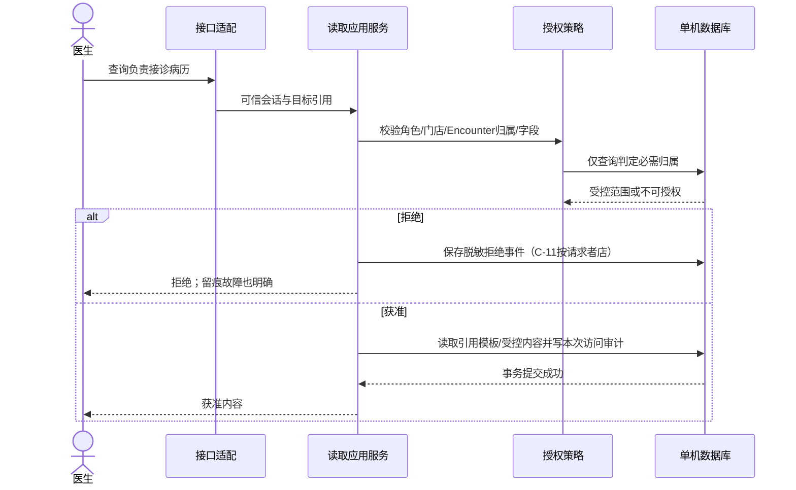
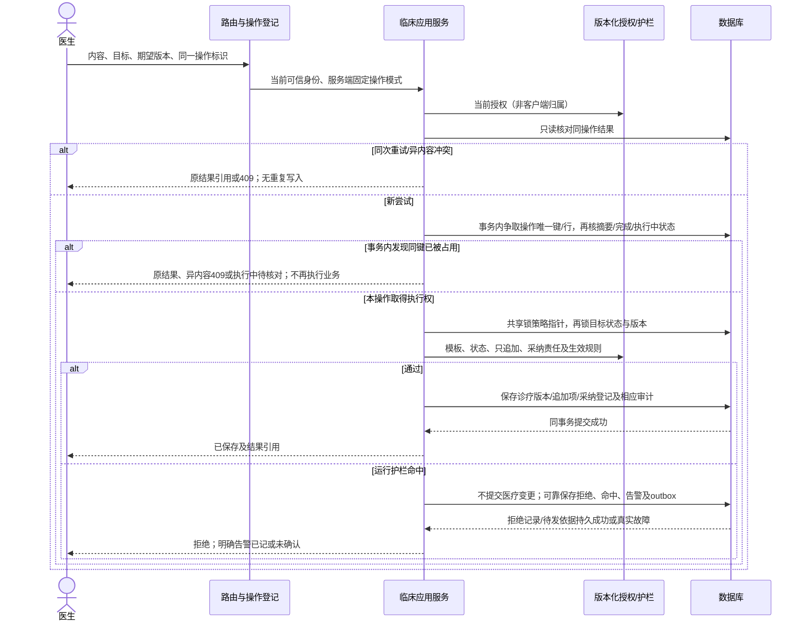
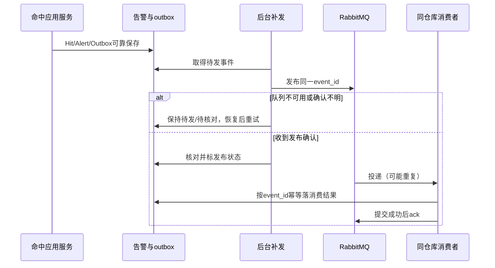
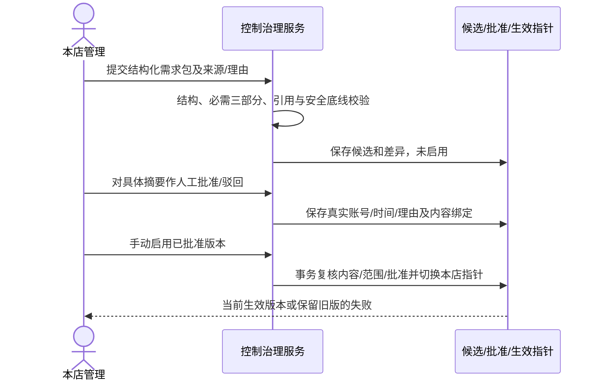

# 关键流程、时序与失败设计

> 设计候选v0.1。依据SRS v1.0；这里的对象/调用用于解释怎样落实场景，尚未实现或运行验证。

## 1. 统一读取及审计



图解决“审计必须发生在受保护数据响应前”的顺序问题。列表审计关联本次实际返回的病历集合，详情和重新下载分别记本次访问。管理审计查询使用独立元数据投影，不调用图中的临床全文读取路径。

## 2. 诊疗、用药与建议采纳



图解决写入/审计原子性和拒绝留痕不被医疗回滚吞掉的问题。候选优先在任何医疗变更前完成护栏判定：命中后该事务只持久拒绝/命中/告警/outbox及操作结果，不写医疗业务后再一起回滚。DB故障导致事务失效时先回滚，必要失败记录/恢复依据用明确的独立边界保留，不能沿用已失效事务。无法可靠保存就报告PERSISTENCE_UNCONFIRMED，不能仅凭日志打印算已留告警。

统一锁顺序见03数据设计。误建标记也锁同一Encounter，避免“检查正常→前台误建→医生新增”竞态。用药更正只新增关联项；采纳登记与正式入病历同事务成功才终态。不采纳仍核当前身份/归属/建议状态，但不调用正式病历写入或强制采纳理由。

## 3. 告警判定、待发与医生处理

```text
on_runtime_guard_hit(trusted_context, attempt, hits):
  reject medical mutation without overwriting the original
  in a reliable rejection transaction:
    for each unique (attempt_id, rule_id, rule_version, field):
      keep Hit + Alert(open) and correlate rejection event
      insert Outbox(event_id, alert_id, pending)
    save the operation outcome and commit
  if persistence is unconfirmed: report real fault, never assert saved

deliver_pending():
  claim durable pending events with bounded re-entry protection
  publish persistent event references to a durable binding, require routing checks
  wait for publisher confirmation and handle unroutable returns
  uncertain confirmation or unroutable return -> retain recoverable state
  confirmation only marks publication; without a durable consumer receipt
    do not declare delivery complete; reconcile/retry the same event_id

consume_event(event):
  atomically save receipt/event result if event_id is not already consumed
  acknowledge consumption only after that transaction succeeds
  duplicates -> reuse receipt; never create a new Hit/Alert

handle_alert(doctor, alert, actual_result):
  authorize by the server-owned record/Encounter and current role
  save actor + time + actual_result then mark business state handled
```



设一次固定检查器判定R规则、F事实，朴素上界O(RF)，附加条件节点G及集合/变长值比较I另计为O(RF＋G＋I)（见01）；字典对本轮命中去重期望O(H)。批量待发B条、索引检索与各条确认开销另计，不把网络等待宣称为O(1)耗时。发布确认、消费收据、医生业务处理分别记录；只有发布确认不称已消费送达，队列确认不关闭业务告警。未路由/确认不明/缺消费收据保留恢复依据，核对与重试不新增命中/告警。消息只有标识/元数据，不携带临床正文。

## 4. 审批和手动启用



生成成功、人工批准、手动启用分别有结果，不画成一个隐式自动过程。内容变更产生新候选和新批准，初始化文件也不能绕开实际管理操作；需求v1.0定稿不是该图中的运行时Approval。

## 5. 完整导出与中断

```text
export_authorized_csv(actor, kind, scope, purpose):
  authorize original data range and field projection
  for clinical export require scope + purpose; guard exports use their own contract
  read a consistent authorized dataset and render the complete UTF-8 CSV
  recheck current authorization before exposing the artifact
  persist required access/export audit and range metadata
  only then begin returning file bytes
  client measures until the full response arrives
```

内存或临时文件缓冲在预研中按完整导出规模选择，不新增截断上限或“只导当前页”。大集合目标与审计关联可批量写入，但不能因为数据量大省略审计。生成失败无临床字节；响应中断后不能撤回已经传出的片段，界面不冒称完整接收。重试或再下载重新核权并按实际读取记审计。

## 6. 人机分工及维护性

对同工作项/阶段/维度比较计划与实际元数据，不读取临床正文；缺来源显示不可比较，已有明确差异提示真实管理复核。复核绑定计划/实际版本，更新后重新比较；不采纳/审批/处理事件由各应用服务产生元数据，AI建议来源方案另在TBR-04闭合。

新增规则或模板形成新的控制包候选并走上述治理，不修改已有模板含义。维护性试验记录实际规则文件、模块、迁移/脚本/测试和文档差异及人时；统计范围在正式协议提前说明，不通过隐藏辅助改动宣称满足≤1规则文件＋1模块及≤1人日。
