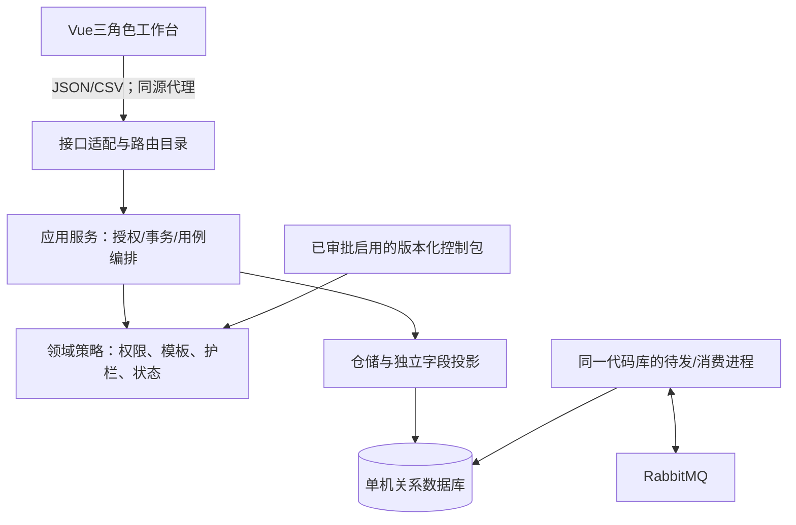
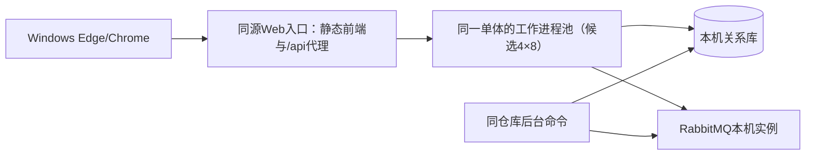

# VetRules架构候选与设计说明

> 版本：设计候选v0.3；日期：2026-10-21。输入：已冻结的SRS-VET-001 v1.0（FE95C5BF…243DAE8）。
> 状态：本文件为2026-10-21的候选比较与预研快照，表格和图中的Vue/Caddy属于当时的方案假设。当前实际实现、回归与课程口径性能结果见[系统设计报告](22_系统设计报告.md)及[测试报告](../06_测试与实测报告.md)；本文件不改需求。

## 1. 约束与设计目标

系统采用前后端分离的单体分层结构；同一机器运行一个关系数据库实例和消息队列。告警发布/消费可作为同一代码库的后台进程运行，不拆独立业务服务，不建集群或多地域。规则控制文件先行，所有正式病历变更经同一应用服务入口；所有读取、列表、导出经相同授权原则并履行各自审计。

三角色、按次归属、不可覆盖用药、建议终态和C-11审计归属直接来自基线。字段/规则可扩展不代表管理能修改系统安全底线或读取临床正文；管理的治理模型与临床模型分开。任务书推荐Django+MySQL+消息队列，但属于推荐而非锁定。

## 2. 两组候选比较

两方案都采用Vue 3/TypeScript前端、REST契约和RabbitMQ；前端组织为三角色工作台，同一受控API，界面隐藏不代替授权。Vue是待验证的实现选择，不是新增需求。组件具体受支持版本及锁文件在预研后确定。

| 维度 | A：FastAPI＋SQLAlchemy＋PostgreSQL | B：Django/DRF＋MySQL（InnoDB），已优先预研 |
| --- | --- | --- |
| 性能机制与风险 | 可按I/O模型选择同步或异步；会话须每请求/任务独立。异步本身不证明280ms达标；仍受连接池、审计写入、锁争用、CSV大小影响 | 采用显式短事务、连接预算和索引；同步请求/工作进程与连接量须实测。不能用内置框架代替360并发和完整导出测量 |
| 开发与维护成本 | 类型校验/接口表达直接；账号、治理、权限入口、持久化和事务边界需要自行组合并检查 | 内置身份、口令哈希、ORM和迁移可减少拼装，贴近任务书推荐；DRF权限/序列化仍须按本题定制，禁止直接开放默认管理后台 |
| 运维成本 | 需安装和维护Python、Node构建环境、PostgreSQL、RabbitMQ及Erlang | 同样有Python/Node及数据库/MQ；Windows上MySQL、RabbitMQ/Erlang和服务配置仍有成本，不称为“零部署成本” |
| 可维护性 | 通过框架中立的应用服务、仓储和控制包适配降低耦合；不能散落SQL/策略判断 | ORM/迁移较集中；不能把所有逻辑塞入View/Serializer，也不以Django staff/superuser替代三角色政策 |
| 工具匹配 | Python后端可承接ruff、pytest、bandit等；契约/性能仍须另测 | 同样可承接题定Python检测类别；真实适用版本/替代说明在测试方案逐项落实 |
| 主要失效点 | 把必要commit放在yield依赖响应后清理；共享Session；假定异步一定更快 | 把必要审计放on_commit回调；流式内容在视图事务外临时读取；非InnoDB表或长事务 |
| 当前证据 | 官方机制说明，尚无本机预研结果 | 业务切片完整回归40项记录、MQ恢复、4000份导出及统一入口16项；4×8统一入口持续在途短测P95约820—837ms，仍未到280ms |

用户已选择B优先预研：组件职责相对集中，便于课程过程解释和维护。当前关键机制有支持，但60及360客户端时延仍超过目标；先定位单机入口、SQL/事务/连接与同机发压影响，再决定最终方案。若仍不可行，按相同口径比较A，保留失败与选择理由。框架吞吐宣传或“Hello World”基准不能替代本题混合授权负载。

官方机制见[技术依据](D:/大三/课程/软件设计与开发/大作业/00_来源摘录/06_架构候选官方依据.md)，本轮实际兼容版本及隔离安装见[预研环境](../10_验收证据/06_B方案技术预研/02_环境与官方版本依据.md)。实验锁定Python3.12.14、Django5.2.18、DRF3.16.1、MySQL8.4.13、RabbitMQ4.2.5及Erlang27.3.4.19；正式版本锁与部署仍需性能收口后确定。没有安装Windows服务或修改系统PATH。

最新部署候选为单机Caddy统一入口及同一后端单体的4个Waitress工作进程、每进程8线程，共享同一MySQL/MQ；没有拆成微服务。Caddy v2.11.7仅在本机回环HTTP实验中实跑，admin/自动HTTPS关闭不移植成正式安全配置。实际来源、启停和测量见第六阶段14/15。候选与测试结果分开：统一入口能运行且部分角色/会话契约通过，不代表正式负载或最终技术栈已批准。

## 3. 分层、模块及依赖方向

| 模块 | 单一职责/输入输出 | 允许依赖 |
| --- | --- | --- |
| identity | 登录、会话核验；输出可信账号/角色/门店上下文 | 账号/会话仓储、标准口令算法 |
| controls | 需求包→候选校验、人工审批和启用指针；输出具体版本的只读策略 | 候选/审批/模板仓储、结构校验器 |
| encounters | 接待建档、资料版本、误建状态与固定归属 | 统一授权、接诊仓储、审计 |
| clinical | 诊疗、用药追加/更正、建议决定的用例编排 | 统一授权、控制包/护栏、临床仓储、审计/告警仓储 |
| guards_alerts | 无副作用规则判定；命中、告警处理和投递状态 | 规则快照、告警/待发仓储、队列适配 |
| audit_exports | 访问/拒绝留痕、管理脱敏投影、完整CSV生成 | 授权、只读投影、审计仓储；不反向调用clinical |
| work_registry | 同工作项/阶段/维度的计划与实际元数据比较、人工复核 | 事件元数据投影、分工仓储；不读取临床正文 |

接口层不直接调用ORM获取全文；仓储不决定业务权限；规则引擎不调用clinical提交数据。clinical调用其他模块的狭窄接口，其他模块不反向依赖clinical，避免循环。队列只传事件/告警标识和必要路由元数据，不携带主诉、处方或建议正文。

## 4. 网络与部署候选

开发期使用前端开发代理；交付时构建静态资源，Web入口代理/api到后端。前端与后端有清晰HTTP接口，不在后端模板中拼业务页面。数据库和MQ不向浏览器开放。服务端口、可用内存、工作进程、连接池、安装位置和复现方式先记录本机条件再确定。

候选优先检查容器或原生安装哪种在当前Windows机器可复现；不能擅自安装服务、申请管理员权限或以容器不可用豁免队列故障要求。RabbitMQ/Erlang受支持版本和安装/数据路径限制必须核实，中文工作区本身不等于需要搬走用户项目。

## 5. 核心一致性与安全决策

| 问题 | 候选设计 | 验证与禁止做法 |
| --- | --- | --- |
| 身份与范围 | 服务端会话取得账号/角色/门店，数据库接诊提供固定归属；每目标使用登记权限键 | 不信payload里的actor/store/doctor；staff/superuser不获业务特权 |
| 读取审计 | 用例内完成授权、受控投影和必需审计提交，再构造响应 | 不把必需审计放响应后清理或on_commit回调；列表/详情/重新下载均覆盖 |
| 临床写入 | 同一事务锁定目标状态/版本和适用生效策略，校验后提交业务及相应审计 | 变更或审批绑定版本冲突则拒绝；不能先检查后在另一事务无条件覆盖 |
| 运行护栏命中 | 不写医疗业务；独立提交拒绝、告警和待发依据 | 告警不能随医疗事务回滚丢失；保存不可靠如实故障，不报告已记告警 |
| 队列故障 | 数据库outbox持久待发，后台补发，发布确认与消费确认分开，消费落库后确认 | 允许至少一次传输，业务按事件去重；不承诺传输exactly-once，不以送达关闭告警 |
| 完整导出 | 完整授权集合生成后复核权限和持久审计，再开始临床字节；缓存文件重新获取也再授权/留痕 | 不边读无审计数据边串流；不截断、只导当前页或只测受理时延 |
| 元数据隔离 | 管理查询直接从脱敏投影获得字段，不先加载临床实体再删字段 | 标准化原因而非自由文本；来源引用不提供全文跳转；C-11按事件所属店 |
| 版本扩展 | 稳定关系字段＋模板校验的版本化内容；单包规则/模板变更形成新候选 | 不覆盖旧模板/用药，不自动把历史迁移为新版；维护性仍须实际改动/投入试验 |

## 6. 后续需决策与出口

本轮控制格式、权限、数据/接口及关键时序仍为候选，不将设计覆盖写成全部实现。用户已选B优先预研，实际结果及未达标项见第六阶段；先按[07前置任务](07_B方案性能收口与实现前置任务.md)定位性能并补正式控制编译门禁，再形成最终取舍。TBR-04建议来源和TBR-05正式测量协议仍按需求阶段约定收口。

架构或控制结构变动如果改变基线业务必须走需求变更；纯技术调整记录ADR和影响范围。下一阶段实现采用逐切片、独立回归、版本留痕和可恢复回滚，不一次性生成整套未经设计复核的代码。
