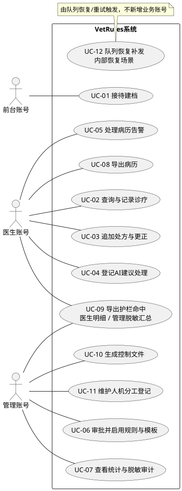
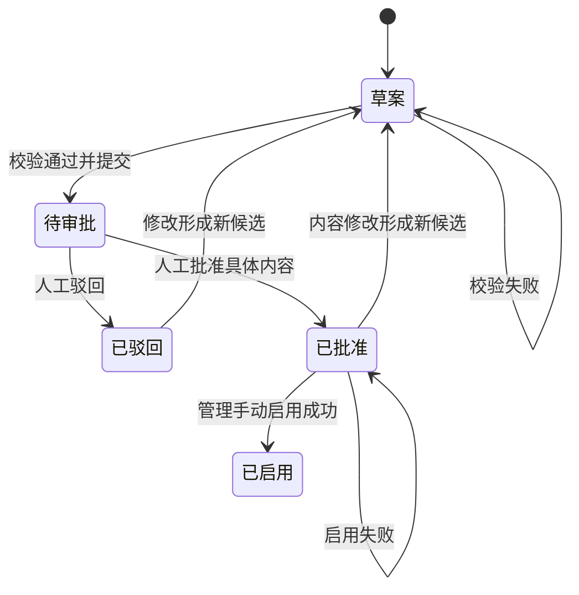
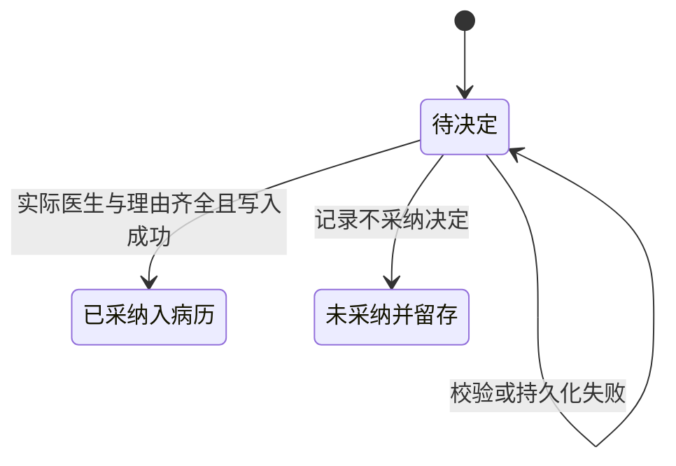
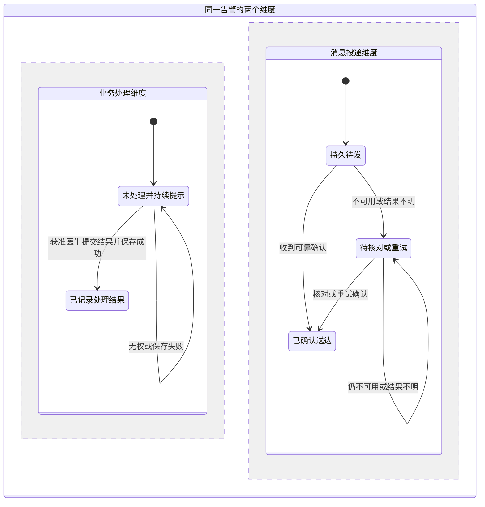

# 社区宠物医院门诊病历控制文件与护栏规则引擎需求规格说明书

> 文档编号：SRS-VET-001；版本：v0.4；状态：需求细化评审草案，未冻结、非最终定稿。
> 日期：2026-10-19。本文定义VetRules系统应提供的行为与约束，作为后续设计、实现和验收的输入；不记录开发人员任务分工、代理安排或个人总结。
> 来源标记：【T】T22任务书；【S】已确认可信的课堂录音汇总；【C】项目方已确认的演示业务约定；【P】待审提案。标记为P的条款不因写入本文而自动生效。

## 1. 文档目的、依据与状态

### 1.1 目的与读者

本文为课程项目明确系统目标、业务边界、操作角色、数据范围、功能、质量要求和验收依据。读者包括需求评审、设计、开发、测试与课程评阅人员。项目参与者不是系统的运行角色。

### 1.2 依据与引用

- 【T】[T22学生版任务书](../../../T22_%E9%97%A8%E8%AF%8A%E6%8A%A4%E6%A0%8F%E8%A7%84%E5%88%99_%E5%AD%A6%E7%94%9F%E7%89%88%E4%BB%BB%E5%8A%A1%E4%B9%A6.docx)，§3—7、§9—12；对应[文本摘录](D:/大三/课程/软件设计与开发/大作业/00_来源摘录/01_T22任务书_文本摘录.md)。
- 【S】[大作业要求完整汇总](D:/大三/课程/软件设计与开发/大作业/大作业要求（完整汇总）.docx)，采用其课程通用要求，T29参数与整理者经历不适用于本题。
- 【C】已确认约定：自由选型；按一次接诊隔离、建档后归属固定、首版无转诊/换班/跨店调阅；管理仅本店汇总和脱敏审计、医生处理其负责病历的告警；澄清角色措辞、保留三类内部角色；管理生成/提交本店规则和模板草案、人工审批后手动启用，管理维护/复核本店人机分工登记，每步关联真实账号、时间与理由。真实决定见[早期过程记录](../../07_AI%E4%BD%BF%E7%94%A8%E7%95%99%E7%97%95/01_%E9%9C%80%E6%B1%82%E9%98%B6%E6%AE%B5%E5%8D%8F%E4%BD%9C%E8%AE%B0%E5%BD%95.md)及[本轮记录](../../07_AI%E4%BD%BF%E7%94%A8%E7%95%99%E7%97%95/03_%E9%9C%80%E8%A7%84%E7%BB%93%E6%9E%84%E4%BF%AE%E8%AE%A2%E4%B8%8E%E8%B0%83%E7%A0%94%E8%AE%B0%E5%BD%95.md)。
- 需规结构与质量采用本项目裁剪的[编写和审查口径](../../00_%E6%9D%A5%E6%BA%90%E6%91%98%E5%BD%95/03_%E9%9C%80%E8%A7%84%E8%A7%84%E8%8C%83%E8%B0%83%E7%A0%94%E4%B8%8E%E5%AE%A1%E6%9F%A5%E5%8F%A3%E5%BE%84.md)。外部指南只辅助写作，不新增课程义务或宣称标准认证。

### 1.3 版本与适用性

v0.2是需求讨论稿，其中的协作过程留在07/10目录。v0.3将产品需求与开发过程分开，澄清“医生账号—接诊—宠物病历”关系，补充上下文、用例、逻辑数据、接口及状态要求。历史v0.2冻结快照保留，不以v0.3覆盖。

v0.4补齐12个用例的详细场景、权限/字段的可评审提案、关键状态转换和失败结果。补齐场景不等于未决权限已获批准；既有快照继续保留，P项和TBR以本稿明确状态为准。

本轮已确认治理职责、导出权限及最小字段；仍有更正/状态/失败语义提案、导出完成边界与支持环境待审，不能称为最终SRS或全面编码基线。需求冻结条件见§13；冻结后仍允许经记录、评审和影响分析的受控变更。

## 2. 业务背景、目标与范围

### 2.1 背景与目标

【T】五家社区宠物医院门店需要集中管理接诊信息、宠物病历和护栏规则，解决记录分散、访问范围不清、AI建议责任不明、处方变更无痕和历史版本混用等问题。

系统目标为：规则及控制文件先行；在服务端执行角色、门店和接诊归属约束；AI建议经人工采纳登记后才能进入病历；病历变更、访问、导出与护栏命中均可追溯。其中护栏命中既应能告警，也应可导出，不能只实现病历导出。【T§3】

### 2.2 本期范围

包含控制文件生成与校验、病历字段/模板版本、系统内人机分工登记、处方用药追加更正、行级隔离、AI建议采纳登记、护栏告警/处理/导出、病历导出和访问审计。

【T】部署和实现边界为前后端分离的单体分层结构，单机数据库与本题中间件；不做业务服务拆分、集群编排、多地域部署。

【C】首版不提供转诊、换班、建档后改派或跨店调阅；不增加宠物主人登录端。收费、库存采购、预约排班及完整医院信息系统不在当前任务要求内，不作为默认扩展。

【S】允许模拟/合成数据，但须提供采集与等价性说明；不要求真实上线、答辩或现场评审，本地可运行和可复现实测仍须满足。

### 2.3 外部关系与依赖

前台、医生和管理账号通过界面使用系统。宠物主人向医院人员提供到院信息，宠物接受诊疗；二者都不是本期新增的登录账号。系统使用持久存储及消息中间件保存记录、传递告警；这些是运行依赖，不是第四类业务角色。

AI建议可以来自演示数据或模型接口，来源方案尚待明确。AI建议源不拥有病历直接写入权，也不代替医生作最终采纳决定。

## 3. 术语、操作角色与记录归属

### 3.1 术语

| 术语 | 本文含义 |
| --- | --- |
| 宠物/诊疗对象 | 接受诊疗的动物，是病历描述对象，不是登录账号 |
| 宠物主人 | 医院客户和信息提供者；本期没有主人端登录权限 |
| 前台账号 | 医院接待人员使用的系统账号，不指课程开发者 |
| 医生账号 | 宠物医院诊疗人员使用的系统账号，不指医生自己的就医身份 |
| 管理账号 | 具有统计、已确认治理操作权限的系统账号；不具有病历全文超级权限 |
| 一次接诊 | 一次到院接待与后续诊疗记录关联的业务单元；同一宠物复诊不自动开放历史全文 |
| 接待人员归属 | 一次接诊由哪个前台账号建立/接待的记录关系 |
| 接诊医生归属 | 一次接诊由哪个医生账号负责诊疗的记录关系 |
| 接诊信息 | 到院基本资料、时间和主诉等接待范围信息；具体字段及必填性须由模板明确 |
| 宠物病历 | 某次接诊的诊疗记录；全文包含的临床字段由相应模板版本解释 |
| 控制文件 | 定义护栏、字段模板、规范和质量门禁等约束的受控输入 |
| 采纳 | 医生对一条AI建议登记采纳人和理由后，将获准内容纳入病历的行为 |
| 审计 | 对访问、导出或拒绝等事件的记录，不等同于病历全文副本 |

正文用明确账号和归属表达权限，不用“本人”“我方”指代业务主体。任务书原文中的“本人接诊”解释为当前登录医生负责的接诊，绝不指学生开发者或医生作为患者的病历。

### 3.2 三类角色的基本边界

- 【T】系统应仅允许前台账号读写其负责接待的宠物接诊信息，不向前台账号提供病历全文。
- 【T】系统应仅允许当前登录医生账号读写其在所属门店负责接诊的宠物病历；对其他医生负责的病历或其他门店病历的请求，系统应拒绝并记录。
- 【T】系统应允许管理账号读取统计口径，拒绝管理账号读取病历全文。
- 【C】管理统计与脱敏审计限于该管理账号所属门店；管理审批规则和模板，医生处理其负责病历的告警。
- 【C】一次接诊建档成功后，门店、接待前台和接诊医生归属固定；首版不提供变更这些归属的业务入口。

## 4. 业务规则与权限要求

### 4.1 业务规则

| 编号 | 系统应遵循的规则 | 来源 |
| --- | --- | --- |
| BR-01 | 权限判断应同时考虑可信登录身份、角色、门店、接待/接诊归属、操作和可见字段，不以页面按钮或客户端自报身份作为授权依据 | T FR-05/§6；具体判定形式为需求分解 |
| BR-02 | 同一宠物在不同接诊中出现，不使新接待前台或新接诊医生自动获得其他接诊的全文权限 | C 按次隔离 |
| BR-03 | 处方、用药、剂量内容只追加；修正保留原记录，新增更正及关联、人、时间和理由 | T FR-04 |
| BR-04 | 字段和模板变更保留版本及审批，病历按其引用的版本解释，不能因当前模板升级改变旧病历含义 | T FR-02/AC-02 |
| BR-05 | AI建议未完成采纳人和理由登记时不得进入正式病历；未采纳建议仍须保留 | T FR-06 |
| BR-06 | 护栏变更未经人工评审不得生效；安全红线的业务含义不能由AI生成后自动确认为有效 | T §3/§6/§12 |
| BR-07 | 每次病历读取和导出写入访问审计；病历写入与相应访问审计同事务提交 | T FR-08/§5 |
| BR-08 | 越权、无权限校验、明文口令入库和SQL注入尝试必须拒绝并记录，拒绝记录不包含原始口令或全文泄漏 | T §5；脱敏为安全落实要求 |
| BR-09 | 重复提交不产生重复业务，失败允许重试；重启不丢失已提交病历与审计 | T §5 |
| BR-10 | 采纳、更正、审批和导出记录中的责任身份应能核对到实际获准执行该操作的账号，不能以请求自报另一个账号转移责任；可信身份关联方法留设计 | T FR-04/05/06/08的责任留痕要求分解 |

### 4.2 操作与数据范围矩阵

A=允许且受行/字段范围限制；D=拒绝；P=待审权限细则。以下矩阵不替代后续逐接口权限契约。

| 操作/数据 | 前台账号 | 医生账号 | 管理账号 | 来源/说明 |
| --- | --- | --- | --- | --- |
| 接待建档、接诊信息读写 | A：该账号接待的本店本次接诊 | A：只读该医生负责接诊的关联接待资料，不修改前台字段或读取其他接诊 | D：不通过统计权限进入明细 | T/C；字段见C-06 |
| 病历全文读写 | D | A：本店且该医生负责的接诊病历 | D | T FR-05 |
| 处方/用药/剂量追加与更正 | D | A：在获准病历范围内，只追加 | D | T FR-04/05 |
| AI建议采纳与未采纳登记 | D | A：关联该医生负责的病历 | D：不读建议原文 | T FR-06；C 管理边界 |
| 病历告警处理 | D | A：关联该医生负责的病历 | D：不借处理获取临床明细 | C 职责方向 |
| 本店聚合统计 | D | D：首版不另设统计入口 | A：本店汇总、不下钻全文 | T/C |
| 规则/模板生成、提交、审批与启用 | D | D | A：本店草案经人工审批后手动启用，每步留痕；不读临床全文 | C 治理流程 |
| 脱敏审计查询 | D | D：首版不另设审计入口 | A：本店，按C-06字段脱敏 | C；须支持按病历和操作者检索 |
| 病历导出 | D | A：本店该医生负责的病历，登记范围与用途 | D | T/C；格式与完成边界待审 |
| 护栏命中/告警导出 | D | A：本店该医生负责病历的命中明细 | A：本店按规则/处理状态汇总数量，无宠物身份/临床命中值/正文 | T/C；记录操作者、范围、时间 |
| 人机分工表维护与复核 | D | D | A：本店登记与复核，每步留痕 | C 治理流程；不增加临床查看权限 |

P项是显式缺口，不能实现时默认为全角色可用。最终矩阵须覆盖列表、详情、查询、导出、告警与审计入口；所有范围外请求均应拒绝并记录。

### 4.3 本轮确认的权限与最小字段

本节集中列出C-04治理、C-05导出与C-06最小字段的已确认约定。AI建议字段曾单独澄清为系统中医生账号的功能，随后确认；不是对课程开发者或个人报告的额外要求。

**C-04 治理流程与登记职责。【C】** 管理账号生成/提交所属门店的规则和模板候选，人工查看校验结果后审批，再手动启用；管理维护并复核本店的人机分工登记。生成通过不等于已审批，已审批不等于已启用；每步关联真实操作账号、时间与理由。当前未额外规定提交与审批必须由两个不同账号完成，不宣称存在双人分离制度。不得借治理操作读取病历全文或把候选输出自动确认为医疗制度。

**C-05 导出与查询权限。【C】** 医生可导出其在本店负责接诊的病历，以及这些病历关联的护栏命中明细；管理只导出本店按规则/处理状态汇总的命中数量，不导出宠物身份、临床命中值、病历内容或病例级明细；前台不开放导出。病历导出登记范围与用途；命中导出登记操作者、范围和时间，不额外强制填写用途。两类导出都在服务端校验范围并留可追踪记录，结果不得超过该账号获准读取的数据。管理按病历或操作者检索审计时，仅显示C-06确认的脱敏字段；医生统计与审计查询不另授入口。

**C-06 最小字段与可见性。【C】** 以下为已确认的课程演示字段，不是已取得的真实医院表单。字段长度、编码格式、物理类型留设计；不将演示字段说成医院认可的医疗规范。

| 字段组 | 必填/生成方式及状态 | 前台 | 接诊医生 | 管理 |
| --- | --- | --- | --- | --- |
| 接诊标识、门店、接待账号、接诊时间 | 必有；系统生成/关联可信身份，时间由系统记录 | 本店该账号接待范围可读，不任意改归属 | 仅该医生负责接诊的关联信息可读 | 只聚合统计；不提供接诊明细列表 |
| 接诊医生标识 | C：建档时必有，在同店医生中选择，服务端验证；建档后固定 | 建档前选择，之后只读 | 仅该医生负责的接诊可读，不自行接管他人记录 | 不借统计修改归属 |
| 宠物标识、种类、到院主诉 | C：必填；标识可由系统建立或关联，字段由版本模板约束 | 该账号接待范围内读写主诉/基本信息；归属不变 | 只读关联接诊资料，诊疗结论另记病历 | 不显示主诉和宠物身份 |
| 宠物称呼 | C：可选；年龄/性别/联系方式不列入首版必填 | 接待范围内读写 | 关联接诊可读 | 不显示 |
| 诊断/检查说明 | C：正式提交至少有诊断说明；检查说明可选 | 不读写 | 获准病历内读写；诊疗修改的留痕策略另审，不套用接待字段修改 | 不显示 |
| 处方、用药、剂量 | T/C：无用药时不强制造处方；建立用药项时药品、用量及单位成组必有；只作记录完整性，不作临床剂量正确性判断 | 不读写 | 仅获准病历内追加；更正必有关联/理由 | 不显示 |
| AI建议、采纳决定和责任记录 | T/C：建议保留来源；采纳时自动关联实际医生账号并必填理由；不采纳时保留建议和决定，理由可选 | 不显示 | 关联病历内登记，责任身份不可任意改为他人 | 不显示建议或采纳理由正文 |
| 管理脱敏审计 | C：显示事件号、时间、门店、操作者标识/角色、动作、结果、标准化原因及无正文目标引用 | 无入口 | 无独立入口 | 仅本店；目标引用支持按病历检索，不提供病历跳转、主诉/诊断/处方/命中值，也不返回可能夹带临床内容的自由文本理由或导出用途正文 |
| 管理汇总 | C：所选时间内接诊数、告警数；告警可按规则编号、处理状态汇总已处理/未处理数 | 无入口 | 无独立统计入口 | 仅本店汇总；不下钻记录明细；接诊总数不套用告警规则维度 |

【C】按次保存当时资料，修改共享宠物基本资料不能静默改写其他接诊的历史。医生只读该医生负责接诊的关联接待资料，不取得全部宠物历史或前台字段修改权。【P】接诊基本信息的更正保留操作者和时间；具体诊疗更正策略另审。这不放松处方/用药/剂量原内容不可覆盖的题定要求。诊疗字段、接待字段和审计字段分开投影，不能通过读取一个通用数据对象绕过角色边界。

## 5. 功能需求

### FR-01 护栏控制文件生成与红线校验

- FR-01.1【T】系统应从病历和处方需求输入生成包含安全红线、编码规范、质量门禁的控制文件。
- FR-01.2【T】系统应对规则缺项或与红线冲突的输入报错，生成过程不得通过。
- FR-01.3【P】生成失败应保留可定位原因，不替换已生效版本，不以隐藏默认规则掩盖缺项；具体发布机制属于设计。

### FR-02 病历字段与模板控制

- FR-02.1【T】系统应按控制文件解释病历字段、必填项和模板。
- FR-02.2【T】系统应保存字段增删及模板版本和审批记录。
- FR-02.3【T】模板更新后，系统应继续按旧病历引用的原版本解释该病历，不覆盖历史定义。

### FR-03 人机角色重划登记

- FR-03.1【T】系统应逐工作项登记哪些工作由AI执行，哪些由人负责定义、决策和守门。
- FR-03.2【T】系统应在登记分工与记录的实际执行分工不一致时提示复核。
- FR-03.3【P】比较依据为系统已取得的实际执行记录，不宣称系统能自动识别所有未登记的现实行为；记录来源及复核结果字段表达待细化。维护/复核账号已按C-04确定为所属门店管理，不再列为未决权限。

此功能是系统提供的登记与提示能力；本课程主代理和子代理的聊天任务分工不作为系统的登录角色定义。

### FR-04 处方与用药追加留痕

- FR-04.1【T】系统应保存处方、用药和剂量记录，所有业务操作均不得覆盖原内容；不预留未经确认的特殊覆盖入口。
- FR-04.2【T】系统应以新增更正记录表达修改，保留与原记录关联的操作者、时间和理由。

### FR-05 三角色行级与字段隔离

- FR-05.1【T/C】系统应按§3—4的账号、门店和接待/接诊归属范围提供允许的数据。
- FR-05.2【T】系统应拒绝前台读取病历全文、管理读取病历全文、跨角色或跨门店的越权病历请求。
- FR-05.3【T】系统应为拒绝事件保存请求者、目标记录和拒绝原因。
- FR-05.4【T】病历读取应经过统一权限入口；未挂权限校验的接口须被扫描检出并阻断发布，实际调用须拒绝并记录。

### FR-06 AI建议人工采纳记录

- FR-06.1【T】系统应在建议进入病历前登记采纳人及采纳理由。
- FR-06.2【T】系统应拒绝缺少采纳记录的建议写入病历。
- FR-06.3【T】系统应保留未采纳建议的登记，以便复盘建议质量；未采纳内容不进入病历。
- FR-06.4【C】系统应标识建议来源，不能将演示数据展示为真实模型效果；实际选择演示或模型接口仍待定。

### FR-07 护栏命中、告警与导出

- FR-07.1【T】系统应在护栏命中时生成包含规则编号、命中字段、处理人和处理结果的告警记录。
- FR-07.2【T】系统应在后台持续提示未处理告警，记录处理人和处理结果。【需求分解】新告警应能明确表示尚未处理，不填造已完成的处理人或结果；实际处理后再关联真实操作账号和结果。字段空值及状态编码留待数据契约明确。
- FR-07.3【T】消息队列不可用时，系统应将命中告警持久保存在本地待发，恢复后补发。
- FR-07.4【T§3/C】系统应支持护栏命中记录的导出；角色与脱敏范围按§4，不以该能力绕过病历隔离。

### FR-08 病历导出与访问审计

- FR-08.1【T】病历导出应登记导出人、范围和用途，并遵守原数据权限范围。
- FR-08.2【T】系统应记录每次病历读取与导出的访问审计，并支持按病历和按操作者两种视角检索。
- FR-08.3【P】列表、详情和导出等实际读取入口均纳入审计边界；审计不可用时如何拒绝数据返回、拒绝事件如何跨业务回滚保存，应在接口契约与设计中明确。

## 6. 用例与业务场景

### 6.1 用例清单

| 用例 | 角色/触发者 | 业务目标 | 关联需求 |
| --- | --- | --- | --- |
| UC-01 接待建档 | 前台账号 | 建立本店一次接诊及归属 | FR-02/05 |
| UC-02 查询与记录诊疗 | 医生账号 | 读取并填写该医生负责的宠物病历 | FR-02/05/08 |
| UC-03 追加处方与更正 | 医生账号 | 留存处方/用药/剂量及更正 | FR-04/05 |
| UC-04 登记AI建议处理 | 医生账号 | 采纳或不采纳建议，保留责任记录 | FR-06 |
| UC-05 处理病历告警 | 医生账号 | 处理其负责记录的告警 | FR-07/05 |
| UC-06 审批并启用规则与模板 | 管理账号 | 人工审查版本并留结论，批准后手动启用 | FR-01/02 |
| UC-07 查看统计与脱敏审计 | 管理账号 | 本店统计、按病历/操作者检索脱敏审计 | FR-05/08 |
| UC-08 导出病历 | 医生账号 | 导出本店该医生负责病历，登记范围/用途 | FR-08 |
| UC-09 导出护栏命中 | 医生账号/管理账号 | 医生导出获准命中明细，管理仅本店脱敏汇总 | FR-07.4 |
| UC-10 生成控制文件 | 管理账号 | 对本店需求输入生成并校验候选控制文件 | FR-01 |
| UC-11 维护人机分工登记 | 管理账号 | 登记本店分工并复核差异 | FR-03 |
| UC-12 队列恢复补发 | 系统检测到可恢复投递条件 | 补发持久待发事件 | FR-07/NFR-05 |

用例角色按§4已确认权限分配，不增加第四种用户。登录/身份核验是人工操作用例的共同前置能力；其方式与公开接口例外在接口设计中定义。

### 6.2 关键用例说明

| 要素 | UC-01 接待建档 |
| --- | --- |
| 角色/目标 | 前台账号建立一次宠物接诊，不建立临床全文访问权 |
| 前置/触发 | 前台已取得有效身份；开始新接待登记 |
| 输入/输出 | 输入宠物基本资料、主诉与必要接诊信息；输出接诊标识和该次归属 |
| 主场景 | 按有效模板填报；系统验证字段、门店和归属；成功建档 |
| 异常 | 必填缺失、无效模板、越范围指派、重复提交；返回明确失败或幂等结果，不创建冲突记录 |
| 后置 | 建档成功后归属固定；后续不能经改派取得他人或跨店数据。字段按C-06及相应模板版本 |

| 要素 | UC-02 查询与记录诊疗 |
| --- | --- |
| 角色/目标 | 当前登录医生查询/记录其负责的宠物病历 |
| 前置/触发 | 有效医生身份、目标接诊已建档；请求打开或提交病历 |
| 输入/输出 | 输入接诊/病历标识及诊疗字段；获准时返回相应版本内容或提交结果 |
| 主场景 | 验证门店和接诊医生归属；按引用模板解释/校验；获准读取写入审计，写病历与相应审计同事务提交 |
| 异常 | 非负责医生、跨店、无权字段、模板不可解释、审计或写入失败；拒绝/失败语义可定位，不伪成功 |
| 后置 | 成功内容可追溯，越权事件含请求者/目标/原因；失败数据一致性按NFR-04验证 |

| 要素 | UC-03 追加处方与更正 |
| --- | --- |
| 角色/目标 | 当前登录医生在其负责的本店宠物病历中记录处方、用药和剂量，或追加更正 |
| 前置/触发 | 医生有该病历权限；选择新增用药项或对既有项更正 |
| 输入/输出 | 新增内容，或原项引用、更正内容及理由；输出新记录标识和关联，不返回覆盖原项的成功结果 |
| 主场景 | 校验权限、版本与记录完整性；新增独立项；更正时关联原项并保存真实操作者、时间和理由；写入与相应审计同时提交 |
| 异常 | 无权病历、原项不属于该病历、字段缺失、理由缺失、规则拒绝、重复请求或事务失败；不改原项，不产生半条更正 |
| 后置 | 原内容仍可查询，新项和更正链可追踪；失败后的业务状态不变化，必要拒绝/失败事件另按安全契约保留 |

| 要素 | UC-04 登记AI建议处理 |
| --- | --- |
| 角色/目标 | 医生处理与其接诊病历关联的建议 |
| 前置/触发 | 建议已取得并标明来源；医生选择采纳或不采纳 |
| 输入/输出 | 建议、决定及采纳理由；责任身份关联实际获准操作账号，不由任意自填他人账号代替；输出登记结果，获准采纳内容才能进入病历 |
| 主场景 | 核对病历权限后分支：采纳时登记采纳人和理由、校验后关联写入病历；不采纳时仅保留建议及决定的登记，不将建议写入病历 |
| 异常 | 选择采纳但无法取得可信采纳身份或缺少理由、无权限、版本不符或重复提交；不得绕过登记直接写建议。未采纳理由的必填性不从此分支推定 |
| 后置 | 采纳和未采纳建议均可追踪；未采纳理由可选，不能因此丢弃未采纳建议 |

| 要素 | UC-05 处理病历告警 |
| --- | --- |
| 角色/目标 | 医生账号处理与该医生负责病历关联的告警 |
| 前置/触发 | 已产生命中告警，医生请求查看或处理；权限范围符合§4 |
| 输入/输出 | 告警标识与实际处理结果；输出仍待处理或已记录处理的明确状态 |
| 主场景 | 命中后先显示未处理提示；获准医生完成处理并登记结果；系统关联真实处理账号，保留处理记录 |
| 异常 | 无权处理、无效告警或处理记录保存失败；不得假填处理成功，未解决事件仍保持可见 |
| 后置 | 告警状态与实际处理记录一致；队列投递状态不代替业务处理状态 |

| 要素 | UC-06 审批并启用规则与模板 |
| --- | --- |
| 角色/目标 | 管理账号审批候选规则/模板，不读取真实临床全文 |
| 前置/触发 | 存在候选版本，管理请求审查 |
| 输入/输出 | 候选定义、版本差异、来源与评审结论；输出审批记录 |
| 主场景 | 管理查看完整性和红线校验结果后人工审批；关联实际账号、结论、时间与理由；批准后管理手动启用对应候选，每步留痕；生效规则只引用通过审批的内容 |
| 异常 | 规则缺项/冲突、无权审批、版本引用错误；失败候选不应当作有效版本；人工审批后仍需管理手动启用 |
| 后置 | 保留审批与版本历史；模板更新不破坏旧病历解释 |

| 要素 | UC-07 查看统计与脱敏审计 |
| --- | --- |
| 角色/目标 | 管理账号查询本店统计，或按病历/操作者两个视角检索本店脱敏审计 |
| 前置/触发 | 管理身份有效；选择统计或审计查询，字段投影按C-06 |
| 输入/输出 | 时间、规则/处理状态、病历引用或操作者等合法筛选；输出获准聚合值或脱敏审计元数据 |
| 主场景 | 场景A：计算本店所选口径的汇总，不返回明细；场景B：验证查询门店及字段后，按所选视角返回脱敏事件信息；目标引用不能转换为病历全文权限 |
| 异常 | 跨店筛选、请求临床字段/下钻全文、身份无效、非法条件或审计读取失败；明确拒绝或失败，不静默扩大范围 |
| 后置 | 结果可与本店受控数据核对，管理不能由统计、审计或告警侧取得被禁止的全文/临床值 |

| 要素 | UC-08/09 导出 |
| --- | --- |
| 角色/目标 | 权限矩阵明确允许导出的账号，仅导出获准数据，不产生额外临床权限；不能据此推定三类角色均有导出权 |
| 前置/触发 | 角色与范围已由权限矩阵定稿；提交导出请求 |
| 输入/输出 | UC-08须提供病历范围和用途；UC-09提供范围和筛选，记录操作者、范围和时间，不额外强制用途。医生输出获准命中明细，管理只输出脱敏汇总；两者按C-05 |
| 主场景 | 验证行与字段范围；记录导出信息；产生可核对结果 |
| 异常 | 两类导出均拒绝超范围、无权限请求并报告生成失败；UC-08用途缺失应拒绝，不能将该题定条件无标记扩张到UC-09。导出不得绕过统一权限入口 |
| 后置 | 病历导出及访问审计可检索；命中导出记录可追踪，符合C-05边界；具体文件格式/大小/完成条件仍待定 |

| 要素 | UC-10 生成控制文件 |
| --- | --- |
| 角色/目标 | 管理账号把本店病历/处方需求输入转为候选控制文件；职责按C-04 |
| 前置/触发 | 输入来源和作用范围可识别；提交生成请求，不能以既有角色登录自动取得生成权 |
| 输入/输出 | 需求输入、规则/字段/模板定义及版本关联；输出校验通过的候选或定位到缺项/冲突的失败报告 |
| 主场景 | 验证触发权限和输入；检查红线、规范、质量门禁及引用；保存有效候选，等待人工审批；不因生成通过自动启用 |
| 异常 | 缺项、红线冲突、无效引用、跨店范围、重复内容冲突或生成中断；输出失败，不替换当前有效版本，不回退隐藏默认规则 |
| 后置 | 可从输入追到候选/错误；失败保留原有效配置；候选经管理人工审批后手动启用，受UC-06约束 |

| 要素 | UC-11 维护人机分工登记 |
| --- | --- |
| 角色/目标 | 管理账号登记并复核本店工作项的AI执行与人工定义/决策/守门分工；职责按C-04 |
| 前置/触发 | 工作项可识别；创建分工、登记已取得的实际执行信息，或处理差异提示 |
| 输入/输出 | 工作项、预定分工、实际执行来源/方式及复核说明；输出一致、待复核或已留结论的状态 |
| 主场景 | 保存登记和来源；比较已记录的计划/实际分工；不一致时持续标记待复核；获准人员查看差异并记录结论，不能把AI审查自动当成人工批准 |
| 异常 | 无维护权、跨店、工作项缺失、实际执行信息不足或保存失败；无法比较时明确显示缺资料，不误报一致；不暴露临床内容 |
| 后置 | 原分工、实际记录、差异及真实复核可追踪；复核不抹去先前差异，未复核项不自动显示已解决 |

| 要素 | UC-12 队列恢复补发（内部恢复场景） |
| --- | --- |
| 角色/目标 | 系统在队列恢复或重试触发时投递本地持久待发告警；不新增人工业务角色 |
| 前置/触发 | 已有告警和待发事件；队列不可用、恢复可用或投递结果不明 |
| 输入/输出 | 告警/事件关联和持久待发状态；输出仍待发、投递结果或可追踪的消费处理结果 |
| 主场景 | 队列不可用时保存告警与待发项；恢复后补发；接收端识别同一事件的重复投递，不重复产生业务处理；发送成功但本地未标记时允许安全重试 |
| 异常 | 持续不可用、发送/确认中断、补发期间重启、重复消费；待发记录不丢失，不能把发送尝试记成已送达或已处理 |
| 后置 | 该发事件可核对到达；未处理告警仍提示，消息投递成功与医生处理告警是两个不同状态；具体调度/确认协议留设计 |

12个用例均已有详细场景；UC-08/09共享导出表但保留不同输入/失败条件，UC-12是内部恢复场景。基本权限与字段已确认，状态/失败细则中的P项仍待审，场景齐全不等于需求已冻结。

### 6.3 业务用例图

图中仅有三类内部操作账号；宠物主人没有登录关联线。UC-09对医生为获准命中明细，对管理为本店脱敏汇总；UC-12为系统内部恢复场景，没有虚构第四个人工角色。

下列PlantUML是同一参与关系的文本图源；上图由本地绘图脚本按UML参与者、系统边界和用例符号绘制，未声称由PlantUML编译。线条表示参与关系，不表示步骤先后。

## 7. 逻辑数据与状态要求

### 7.1 逻辑数据字典草案

下表描述业务信息，不是数据库建表语句；已确认的字段必填性和脱敏投影按§4.3，类型长度、编码及契约表达留设计，不再把已确认的业务字段当作未决项。

| 数据对象 | 需要表达的信息与关联 | 来源及待明确项 |
| --- | --- | --- |
| 账号及角色范围 | 账号标识、角色、所属门店、可信身份核验结果 | 为FR-05授权所需；口令不得明文入库，认证方案待设计 |
| 宠物及一次接诊 | 宠物标识、基本资料、主诉、接诊标识、时间、门店、接待前台、接诊医生 | T/C；字段按C-06，不自动加入主人联系方式 |
| 病历 | 病历标识、接诊关联、所用模板版本、诊疗字段及操作者/时间关联 | T FR-02/05；临床字段按模板定义，不虚构治疗制度 |
| 模板及字段版本 | 版本、字段定义/必填项、变更、审批和历史解释依据 | T FR-02/AC-02 |
| 规则及控制文件 | 规则编号、判定输入/口径、红线/规范/门禁内容、来源、版本、评审与生效 | T FR-01/§12；不编造临床红线数值 |
| 处方/用药/剂量及更正 | 原内容、更正内容、关联、操作者、时间、理由 | T FR-04，只追加 |
| AI建议登记 | 建议内容和来源、病历关联、采纳/未采纳状态、采纳人和理由 | T FR-06；演示/真实来源待定 |
| 命中告警及处理 | 告警/规则标识、命中字段、关联记录、处理人、结果及待处理状态 | T FR-07；管理不可通过值或正文泄露取得全文 |
| 访问/导出审计 | 操作者、病历关联、访问/导出事件；拒绝含目标及原因；病历导出含范围与用途，命中导出留操作者/范围/时间 | T/C；管理只看C-06脱敏投影，不返回用途正文 |
| 人机分工登记 | 工作项、登记分工、记录到的实际分工、差异和复核 | T/C；管理维护与复核，实际执行记录来源及核对方式待设计 |
| 告警待发事件 | 告警关联、持久待发与恢复后投递状态 | T NFR；事件去重与状态编码属设计 |

### 7.2 状态转换与失败结果

以下状态是业务可观察状态，不预设数据库枚举或队列协议。题定行为标T，已确认职责标C，尚待整体评审的补充语义标P；图中的成功转换也须满足表中条件。

| 对象及来源 | 触发与条件 | 成功结果 | 失败/不足时 |
| --- | --- | --- | --- |
| 规则/模板候选，T/C；内容绑定细则P | 管理提交本店候选，校验完整性与红线；管理人工审批具体版本后手动启用 | 草案→待审批→已批准→已启用；每步保留账号、时间、理由 | 校验失败不进入待审批；驳回不启用；保存/启用失败不替换原有效版本；候选内容变化不得沿用旧内容的批准，须重新校验审批 |
| AI建议，T/C；提交失败语义P | 医生处理其负责病历的建议；采纳须有实际账号与理由，正式病历符合模板/权限 | 采纳登记与病历写入成功后才显示已采纳入病历；不采纳只保留建议和决定，理由可选 | 缺理由、越权、护栏拦截或写入失败均不得显示已入病历；失败不删除建议，不以仅保存采纳意图冒充写入成功 |
| 告警业务处理，T/C；失败保持语义P | 获准接诊医生提交实际处理结果 | 未处理→已处理；关联实际处理账号、结果与时间 | 未操作、无权、缺结果或保存失败仍未处理并持续提示；消息送达不改变业务处理状态 |
| 告警投递，T；确认/未知语义P | 对持久待发事件尝试投递，并核对结果 | 待发→已确认送达；恢复后补发，重复事件不产生重复业务 | 不可用或结果不明保持可恢复的待发/待核对状态；发送尝试不等于送达，重启不丢待发记录 |
| 人机分工核对，T/C；状态细则P | 管理登记工作项及有来源的实际执行记录，比较计划与实际分工，复核差异 | 有据可比较时输出一致/待复核；管理保存真实结论后标记已复核，保留差异历史及其适用的登记/实际记录版本 | 缺实际资料显示不可比较；缺复核记录不显示已复核；保存失败保留原状态；登记或实际记录改变须重新比较，旧结论不自动适用于新内容，不把AI审查当真实人工复核 |

规则/模板每个候选的流程如下；校验失败及内容修改仍需走重新校验，不自动覆盖已启用定义。

已启用版本的修改形成另一个候选，原生效版本在新版本启用成功前继续有效；历史定义保留。该图描述单个候选流程，不表示改草案会停用旧版本。

告警须用两个独立状态维度表达。同一告警可以“已送达、未处理”，也可能医生已处理而发送确认尚待核对；二者不能互相覆盖。

### 7.3 跨状态不变量

- 【T/C】接诊归属一经成功建档即固定；界面变更、请求参数或复诊不能间接改写历史归属。
- 【T】病历引用的模板版本可恢复解释；处方/剂量更正不覆盖原内容。
- 【T/C】AI建议未完成责任登记不得进入病历；不采纳建议仍保留。
- 【T】告警业务处理、消息传输分开核对；故障待发和已提交病历/审计重启后仍保留。
- 【P】同一操作的客户端结果必须与实际持久化结果相符；不能以超时推定回滚，也不能以发送过推定送达。

## 8. 界面与接口需求

### 8.1 人机界面

系统应有可运行前端界面并按角色提供允许操作。前台看到接待范围，医生看到其负责的诊疗与告警，管理看到本店汇总、脱敏审计和规则模板审批。未处理告警持续提示。界面不能因隐藏按钮而代替服务端权限校验。

【P】具体页面组织、反馈文案、输入校验呈现和兼容浏览器范围待界面方案确认；不预先规定布局框架。

### 8.2 服务与数据边界

| 交互 | 输入/输出要求 | 失败语义 |
| --- | --- | --- |
| 身份与访问 | 可信账号身份、角色和范围；输出允许数据或明确拒绝 | 未登录/身份无效、无权限与服务器失败应可区分；拒绝响应不泄露无权对象的临床内容 |
| 接诊/病历写入 | 标识、版本、获准字段及必要采纳/更正信息；输出成功结果 | 缺项、版本无效、权限失败、冲突或持久化失败不伪报成功；处方更正不能降级为覆盖 |
| 规则生成/审批 | 需求输入、候选定义与审批信息；输出候选或审批结果 | 缺项、红线冲突、无权审批有可定位原因；批准须对应具体候选内容，陈旧批准不得启用修改后内容 |
| 导出/审计查询 | C-05范围和用途条件、C-06筛选字段与可信身份；输出授权结果 | 超范围、无权字段、审计/导出失败有明确结果；生成失败不报告成功或泄露部分临床数据 |
| 告警与消息 | 命中事件、待发状态、处理结果；输出可追踪状态 | 中间件不可用不丢告警，重复投递不重复处理 |
| 人机分工登记 | 登记及实际执行记录；输出差异提示或复核结果 | 缺失关联、无维护权限及无法比较的记录应可说明 |

【S/P】全部接口失败条件须在后续契约中落实为错误码并逐项关联测试。具体URL、JSON结构、数据库事务写法、消息协议和类/函数属于设计，不在本稿擅自冻结。接口必须满足这里的行为边界和任务书锁定约束。

**补充失败语义提案【P】。** 下表把“失败可重试、重复幂等、审计一致”细化为可评审行为；不预定请求键位置、事务实现或具体错误码。

| 情况 | 系统应反馈及保留的结果 | 验证关注 |
| --- | --- | --- |
| 同一操作重复、内容相同 | 重新核验当前身份和数据范围后返回可核对结果，不新增重复业务；返回病历数据仍须记录本次读取审计 | 连续/并发重试；权限失效后不得借缓存取得旧授权数据 |
| 同一操作标识、内容不同 | 明确内容冲突，不把新内容覆盖原结果，也不冒充已成功执行新操作 | 比较原记录、冲突反馈及业务条数 |
| 可以确定事务未提交 | 报告失败，可重试；病历与相应审计不出现半提交 | 数据和审计一致回滚；采纳分支不能仅凭意图记录显示入病历成功 |
| 超时/断连，提交结果暂时不明 | 显示结果待核对，通过查询或同一操作重试取得最终结果，不暗示已回滚或重新创建一笔 | 提交前后断连、重复请求与最终一笔业务结果对照 |
| 病历读取/导出所需审计写入失败 | 不返回受保护数据或成功文件，不报告“已留痕”；写入场景仍按同事务要求处理 | 故障时无临床数据外发，不伪造成功审计 |
| 拒绝事件记录设施故障 | 继续拒绝原越权/攻击请求，不能放行；明确记录故障，恢复/补记方式在设计中说明 | 拒绝与故障可核对；不能因业务回滚吞掉拒绝事件而宣称留痕完成 |
| 本次目标/候选在读取与提交之间变化 | 明确本次内容版本冲突，要求核对；不沿用已变更内容的批准。仅发布新模板不构成旧病历原版操作的冲突，不能强制旧病历迁移新模板 | 历史模板解释与批准内容对应；仅模板最新版本变化不误拦旧版记录 |

中间件故障仅影响传输恢复，不豁免告警持久留存；空结果、无权限、不可比较与基础设施失败应在业务反馈中区分。具体审计故障保存途径及重试上限不在需求中自行指定。

### 8.3 AI建议来源接口

真实模型接入不是任务书明示强制项，也尚未选择演示来源。无论来源如何，建议均应进入登记与人工采纳边界，不赋予建议源直接写病历的权限。来源方案在集成设计前明确并如实标识。

## 9. 非功能需求

| 编号 | 约束或指标 | 验证要点/待明确边界 |
| --- | --- | --- |
| NFR-01 容量 | 5门店、约6000宠物、约2万病历 | 数据可重建，角色/记录归属和分布透明；模拟数据附采集与等价性说明 |
| NFR-02 性能 | 360并发下查询、护栏校验、导出P95≤280ms；AC-06同时涉及接诊/写入 | 五类分项样本与时延、环境、计时边界和导出范围作为本项目透明测量方案，详细协议待审 |
| NFR-03 持续负载 | 360并发持续10分钟接诊、写入与导出无失败，吞吐≥800次/分钟 | 同一正式窗口保留原始数据和复现命令；不以账号数替代实际负载，不隐藏超时与错误 |
| NFR-04 一致性 | 病历写入与相应访问审计同事务提交 | 故障时不出现病历成功审计丢失；拒绝记录与回滚关系须在设计中明确 |
| NFR-05 恢复与幂等 | 队列不可用时本地待发并恢复补发；重复提交幂等、失败可重试；重启不丢已提交病历/审计 | 队列停用/恢复、发送后未确认、重复提交/消费、重启测试 |
| NFR-06 安全 | 越权/无权限校验/明文口令入库/SQL注入尝试拒绝并记录；查询参数化 | 统一权限入口、发布阻断、合法文本与攻击区分、拒绝日志脱敏，不以自报身份授权 |
| NFR-07 维护性 | 新增一条规则或一类模板≤1规则文件+1模块，人日≤1 | 变更与投入可追踪，不能凭估算宣称达标 |
| NFR-08 工程质量 | 有效代码3200—4800行，覆盖率≥80%、全量用例通过；覆盖全部接口错误码及负向场景 | 统计范围、排除项、覆盖率类型、端点/错误码/条件/用例对账透明 |

所有数字来自T22或已采信课程要求，不使用T29指标。当前没有任何指标已达标的实测结论。兼容性和界面可用性的具体支持范围尚待定义，不虚构额外响应时间、保留年限或可用率。

## 10. 既定设计约束与交付约束

【T】控制文件先于代码且不可绕过；病历读取经统一权限入口并写审计；规则变更有人工评审。前后端、后端服务、存储和至少一个常规中间件均在交付范围内。消息队列失效待发与补发条款不能因选择定时器而自动豁免。

【T/C】具体语言、框架、数据库和消息组件自由选型；architecture.md至少有2组候选的性能、成本和可维护性比较。设计必须提供权限矩阵、行级判定伪代码与复杂度、护栏判定口径和告警处理伪代码。代码与数据库物理结构不在本稿预定。

【T】验收交付还包括提示词演进、≥12条人工修改对照、≥5处上下文到代码对应、≥3条真实幻觉、人机边界与课件映射、规则/权限来源及评审生效记录。它们属于项目交付约束，具体执行分工与原始问答放过程材料，不混入业务角色。

第9节指定检测类别及工具的适用方案在测试计划中逐项承接。确需替代时说明等效性；不因本文未写具体安装命令而省略检测，也不把工具清单误做成新的业务功能。

## 11. 验收与追踪

| 验收项 | 本稿需求/用例 | 预期证据 |
| --- | --- | --- |
| AC-01 | FR-01，UC-10 | 控制文件和红线清单；合法、缺项、冲突生成结果 |
| AC-02 | FR-02/BR-04，UC-02/06 | 版本、审批、升级后旧病历按旧版解释 |
| AC-03 | FR-05/BR-01/02，UC-02 | 其他院区医生、非负责医生、前台/管理全文请求拒绝及记录 |
| AC-04 | FR-05.4/NFR-06 | 漏挂权限样本、扫描发现、发布阻断和调用拒绝记录 |
| AC-05 | FR-06，UC-04 | 采纳人和理由、无登记拒绝、未采纳留存 |
| AC-06 | NFR-01/02/03，UC-01/02/08 | 360并发10分钟、P95及吞吐、无失败、原始数据与命令；另覆盖§5导出要求 |
| AC-07 | FR-08/BR-07，UC-07/08 | 读取/导出审计、两视角查询、事务验证 |
| AC-08 | NFR-08、§10 | 覆盖率、全量用例结果与开发AI留痕 |
| T§3目标4（补充追踪） | FR-07.4，UC-09 | 护栏命中导出及其授权/脱敏边界，不由病历导出替代 |
| FR-03 | UC-11、§5 FR-03 | 工作项登记、实际执行记录、差异提示及复核；缺资料不得报一致 |
| FR-04 | UC-03、BR-03/10 | 原记录与更正关联、真实操作者/时间/理由，业务接口不可覆盖 |
| FR-07.1/07.2 | UC-05 | 未处理持续提示、实际处理账号/结果、处理与投递状态不混淆 |
| NFR-04 | UC-02、BR-07 | 病历与审计提交/回滚一致，拒绝记录与失败语义可核对 |
| NFR-05队列恢复 | UC-12、FR-07.3、§7.2 | 队列停用本地待发，恢复后补发且不重复业务处理；投递与医生处理分别核对 |
| NFR-05幂等/重试 | UC-01/02/04及后续契约 | 连续/并发重复不重复业务，失败重试结果可核对 |
| NFR-05重启持久性 | §7逻辑数据、UC-02/12 | 重启前后已提交病历/审计及待发项的对照 |
| NFR-06四类安全拒绝 | FR-05、BR-08、§8 | 越权、漏挂权限、明文入库、注入请求拒绝且有脱敏记录 |
| NFR-07维护性 | UC-06/10、FR-01/02 | 新规则及新模板分别的变更文件清单、实际投入和回归结果 |

需求到详细设计、代码和测试的具体位置在相应产物形成后回填，不虚构尚不存在的代码或测试编号。检查方法可为审查、演示、测试或分析，实际测量指标须有实测数据。

## 12. 假设、待定事项与风险

| ID | 未决内容 | 当前处理及影响 | 必须闭合的阶段 |
| --- | --- | --- | --- |
| TBR-01（已闭合） | 草案提交/生成、审批启用、人机分工维护/复核职责 | 已按真实回答落实C-04、矩阵、UC-06/10/11；不扩为临床权限 | 已闭合；内容绑定等失败细则另见TBR-06 |
| TBR-02（最小字段已闭合） | 接诊/诊疗字段、医生关联资料、审计脱敏与汇总指标、建议处理字段 | 已按真实回答落实C-06；第三点经单独澄清和确认，不是课程开发者任务 | 最小字段已闭合；非处方更正策略留TBR-07 |
| TBR-03（部分闭合） | 病历及护栏命中的格式、大小与完成边界 | 角色/范围已按C-05确认，不再询问；文件格式、筛选/大小、全量生成还是异步受理等可观察完成含义尚待方案评审 | 权限/接口基线冻结前 |
| TBR-04 | AI建议真实模型或演示来源 | 两种均须采纳登记及真实来源标识；未默认为已确认 | 集成方案定稿前；核心采纳需求可先冻结 |
| TBR-05 | 并发、导出大小、覆盖率与有效行数的测量细则 | 先提出透明可复现实验协议，保留题定目标；不把统计选择变成擅自降指标 | 正式测试方案冻结前 |
| TBR-06（部分闭合） | UI支持范围、状态及接口错误语义 | 12用例及图已补；§7—8细化提案待整体评审，浏览器/屏幕支持范围仍待界面方案 | 需求基线冻结前 |
| TBR-07 | 接诊基本资料和非处方诊疗内容的更正策略 | 处方/用药/剂量只追加已题定；其他字段更正须明确历史保留及审计行为，不能套用或绕过只追加条款 | 相应写入接口设计前；需求基线冻结前 |

真实临床剂量或药物禁忌规则未由任务书给出，不将AI建议编成已获医院认可的医疗规则。演示规则须标注来源和审批性质。任何未决权限不得以“管理全权”或“登录即可访问”补齐。

## 13. 需求基线冻结与变更

本稿完成结构修订并不代表定稿。冻结为v1.0前应满足：来源与目标条款完整；术语、角色、范围无歧义；关键业务与数据/接口权限已确认；用例及图足够完整且相互一致；全部FR/NFR/AC与目标级要求可追踪；阻塞TBR关闭；真实项目负责人确认具体版本作为设计输入并留存版本和哈希。

代理审查只能提供质量意见，不代替该确认，也不代表真实老师或医院认可。冻结后如修改，应记录理由、受影响需求/设计/实现/测试及新版本，不维护多个互相矛盾的“最终版”。
