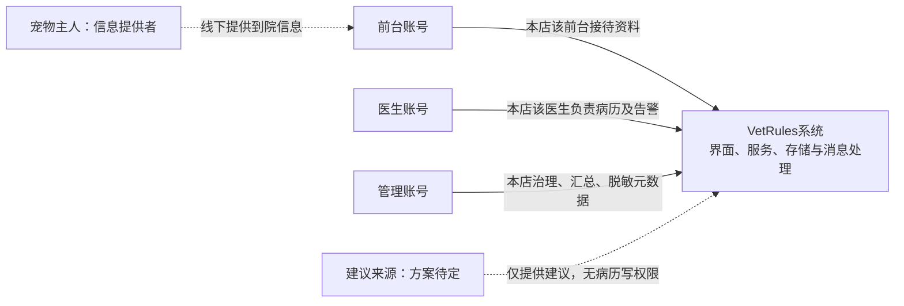
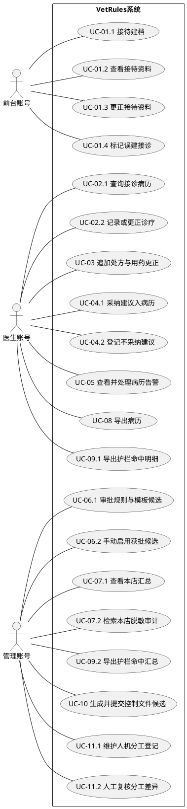
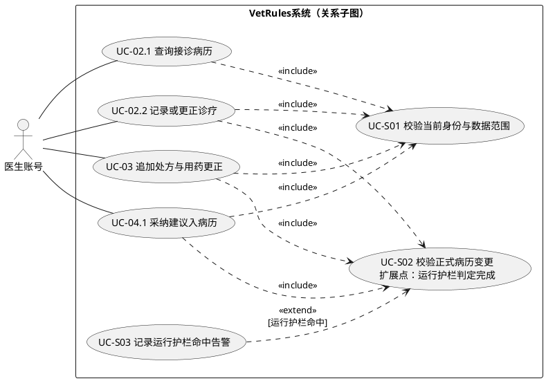
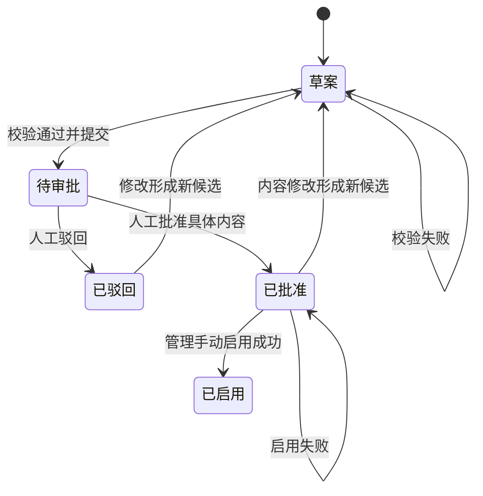
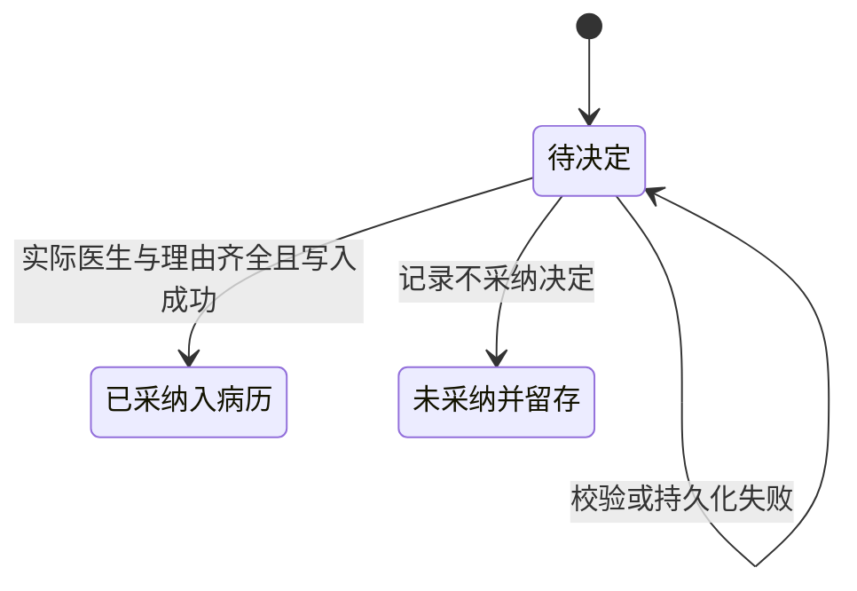
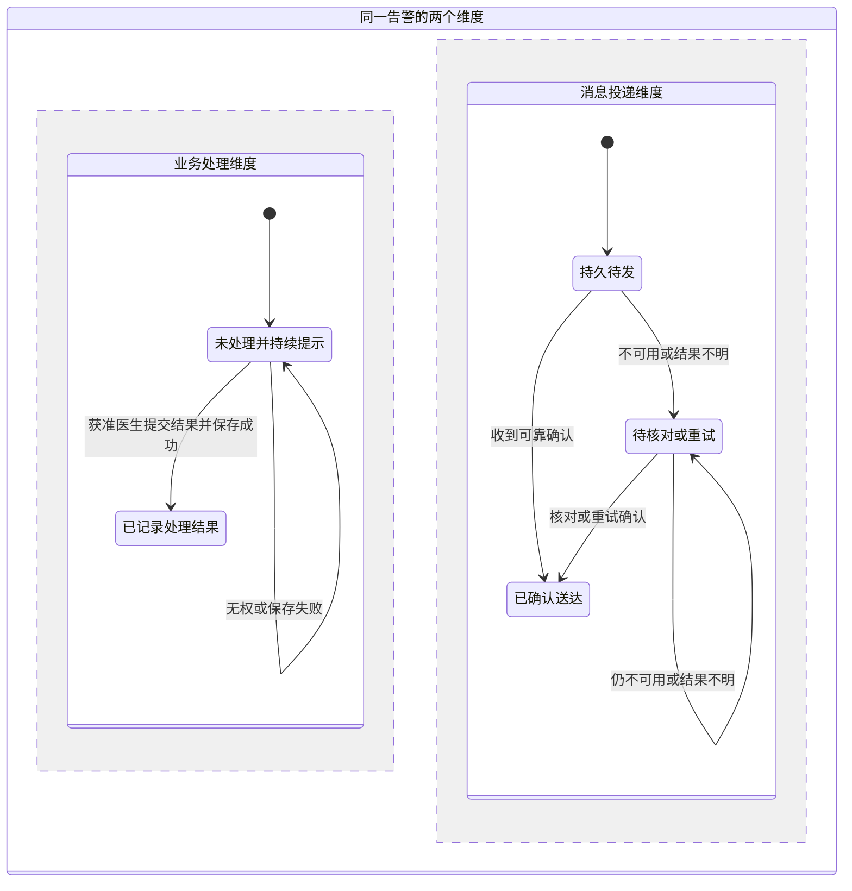

# 社区宠物医院门诊病历控制文件与护栏规则引擎需求规格说明书

> 文档编号：SRS-VET-001；版本：v0.7；状态：课堂原文复核修订稿，未冻结。
> 日期：2026-10-20。本文定义VetRules系统的角色、数据、行为、质量及验收边界，作为后续设计输入。
> 来源标记：【T】T22任务书；【S】已确认可信的课堂录音汇总；【L】直接核读的课堂原始转写（写作/审查口径，不据此新增业务）；【C】项目方已确认的演示业务约定；【P】待审提案。标记为P的条款不因写入本文而自动生效。

## 1. 文档目的、依据与状态

### 1.1 目的与读者

本文为课程项目明确系统目标、业务边界、操作角色、数据范围、功能、质量要求和验收依据。读者包括需求评审、设计、开发、测试与课程评阅人员。项目参与者不是系统的运行角色。

### 1.2 依据与引用

- 【T】[T22学生版任务书](../../../T22_%E9%97%A8%E8%AF%8A%E6%8A%A4%E6%A0%8F%E8%A7%84%E5%88%99_%E5%AD%A6%E7%94%9F%E7%89%88%E4%BB%BB%E5%8A%A1%E4%B9%A6.docx)，§3—7、§9—12；对应[文本摘录](D:/大三/课程/软件设计与开发/大作业/00_来源摘录/01_T22任务书_文本摘录.md)。
- 【S】[大作业要求完整汇总](D:/大三/课程/软件设计与开发/大作业/大作业要求（完整汇总）.docx)，采用其课程通用要求，T29参数与整理者经历不适用于本题。
- 【L】[课堂原文定位与审查口径](../../00_%E6%9D%A5%E6%BA%90%E6%91%98%E5%BD%95/04_%E8%AF%BE%E5%A0%82%E9%9C%80%E8%A7%84%E8%AE%B2%E8%A7%A3_%E5%8E%9F%E6%96%87%E5%AE%9A%E4%BD%8D%E4%B8%8E%E5%AE%A1%E6%9F%A5%E5%8F%A3%E5%BE%84.md)：原始转写、精确定位及适用于本题的解释见L-01—13；重点落实边界、用例图/清单/场景、参与线与用例关系。
- 【C】已确认约定：自由选型；按一次接诊隔离、建档后归属固定、首版无转诊/换班/跨店调阅；管理仅本店汇总和脱敏审计、医生处理其负责病历的告警；澄清角色措辞、保留三类内部角色；管理生成/提交本店规则和模板草案、人工审批后手动启用，管理维护/复核本店人机分工登记，每步关联真实账号、时间与理由。真实决定见[早期过程记录](../../07_AI%E4%BD%BF%E7%94%A8%E7%95%99%E7%97%95/01_%E9%9C%80%E6%B1%82%E9%98%B6%E6%AE%B5%E5%8D%8F%E4%BD%9C%E8%AE%B0%E5%BD%95.md)及[本轮记录](../../07_AI%E4%BD%BF%E7%94%A8%E7%95%99%E7%97%95/03_%E9%9C%80%E8%A7%84%E7%BB%93%E6%9E%84%E4%BF%AE%E8%AE%A2%E4%B8%8E%E8%B0%83%E7%A0%94%E8%AE%B0%E5%BD%95.md)。
- 需规结构与质量采用本项目裁剪的[编写和审查口径](../../00_%E6%9D%A5%E6%BA%90%E6%91%98%E5%BD%95/03_%E9%9C%80%E8%A7%84%E8%A7%84%E8%8C%83%E8%B0%83%E7%A0%94%E4%B8%8E%E5%AE%A1%E6%9F%A5%E5%8F%A3%E5%BE%84.md)。外部指南只辅助写作，不新增课程义务或宣称标准认证。

### 1.3 版本与适用性

v0.2为讨论稿；v0.3—v0.5逐步补充产品结构、详细用例、状态、字段及导出等细则。v0.5复核发现核心行为仍有缺口；v0.6依据08号独立复核及项目方“边界明确、角色清晰”的意见修订，保留已确认业务约定。v0.7在此基础上按课堂原文细化目标、编号步骤、失败场景和用例关系；没有据课堂例题追加医院业务或新权限。

当前以本文为唯一工作稿，历史版本及修订过程在07/10目录保留。P项须有真实确认后才生效；当前阻塞项见§12，冻结条件见§13。本文的需求陈述与AI文档复核均不代表系统已实现、性能达标或真实医院认可。

### 1.4 导读、编号与来源对照

| 阅读目的 | 位置 |
| --- | --- |
| 系统做什么、依赖什么 | §2范围、上下文、运行条件 |
| 谁使用、谁不是用户、能看什么 | §3角色卡与归属；§4权限、字段、红线 |
| 系统如何响应正常和异常操作 | §5功能、§6用例、§7状态、§8接口边界 |
| 怎样验证及何时定版 | §9质量指标、§10交付约束、§11验证追踪、§12—13待定与变更 |

FR=功能需求；NFR=非功能需求；AC=任务书验收条件；UC=用例（组号保留，独立目标可细分子编号）；UC-S=共用/条件行为；SC=用例内场景；BR=业务规则；SR=红线/校验条款；TBR=待闭合事项。C-xx为已确认约定的稳定引用号，DEC-xx为过程记录中的真实决策号，两者不是同一编号体系，不要求连续或同号。T条款的“需求分解”表示将来源义务展开为可验证行为，不据此新增医院制度。

| 当前约定号 | 内容 | 真人决定来源 |
| --- | --- | --- |
| C-04 | 本店规则/模板治理、人机分工维护复核 | DEC-06 |
| C-05 | 医生明细导出、管理脱敏汇总导出、前台无导出 | DEC-07 |
| C-06 | 最小字段、管理脱敏投影、建议处理字段 | DEC-08（建议处理经单独澄清确认） |
| C-07/08/09 | 普通更正/误建、完整CSV、桌面兼容及状态/失败细则 | DEC-09 |
| C-10 | 独立提交分别保存命中/告警，同次重试与重投不增 | DEC-10 |

上述决策的原始问答见§1.2过程引用；C编号的空缺不用于推定存在未记录的历史决定。

### 1.5 交付必要性与验证顺序

任务书T、采信课程S和已经确认的本期C均在交付范围内。先验证权限/规则入口、版本、事务与审计等基础约束，再验证完整业务与告警导出，最后在完整系统上做正式负载和维护性实测。该顺序表示实现依赖和风险，不降低任何FR/NFR/AC的交付必要性；具体批次由项目计划承接。运行时规则的阻断行为见§5 FR-07，不由开发先后顺序决定。

## 2. 业务背景、目标与范围

### 2.1 背景与目标

【T】五家社区宠物医院门店需要集中管理接诊信息、宠物病历和护栏规则，解决记录分散、访问范围不清、AI建议责任不明、处方变更无痕和历史版本混用等问题。

系统目标为：规则及控制文件先行；在服务端执行角色、门店和接诊归属约束；AI建议经人工采纳登记后才能进入病历；病历变更、访问、导出与护栏命中均可追溯。其中护栏命中既应能告警，也应可导出，不能只实现病历导出。【T§3】

### 2.2 本期范围

包含控制文件生成与校验、病历字段/模板版本、系统内人机分工登记、处方用药追加更正、行级隔离、AI建议采纳登记、护栏告警/处理/导出、病历导出和访问审计。

| 范围类别 | 本期边界 |
| --- | --- |
| 本期必须交付 | FR-01—08、题定质量/交付要求及C-04—10，覆盖前端、后端、存储和中间件 |
| 已确认不提供 | 主人端、转诊/换班/改派、跨店调阅、收费/库存/排班、任意删除病历或重绑历史 |
| 任务书明确排除 | 微服务拆分、集群编排、多地域部署 |
| 后阶段选择与落实 | AI建议来源、技术组件、接口具体格式、正式负载与统计协议；不得改变已定授权和题定数值 |

【T】部署和实现边界为前后端分离的单体分层结构，单机数据库与本题中间件；不做业务服务拆分、集群编排、多地域部署。

【C】首版不提供转诊、换班、建档后改派或跨店调阅；不增加宠物主人登录端。收费、库存采购、预约排班及完整医院信息系统不在当前任务要求内，不作为默认扩展。

【S】允许模拟/合成数据，但须提供采集与等价性说明；不要求真实上线、答辩或现场评审，本地可运行和可复现实测仍须满足。

### 2.3 外部关系与依赖

前台、医生和管理账号通过界面使用系统。宠物主人向医院人员提供到院信息，宠物接受诊疗；二者都不是本期新增的登录账号。系统使用持久存储及消息中间件保存记录、传递告警；这些是运行依赖，不是第四类业务角色。

AI建议可以来自演示数据或模型接口，来源方案尚待明确。AI建议源不拥有病历直接写入权，也不代替医生作最终采纳决定。

图中的存储、队列及自动处理均位于VetRules内部，不是额外用户；内部组件及通信协议在设计说明展开。

### 2.4 已知条件、依赖与不成立时的影响

| 条件/依赖 | 当前依据与边界 | 不成立时影响及承接 |
| --- | --- | --- |
| 演示数据与容量 | S允许模拟数据；T规定五店、约6000宠物及约2万病历 | 数据量不足影响NFR-01—03，需补造数及等价性说明；不冒充真实医院调研 |
| 单机运行环境 | T限定单机数据与分层单体；机器是否足以达标尚需预研 | 影响事务/恢复/性能；记录资源、瓶颈与实测，不能假设“资源足够”即通过 |
| 账号与归属来源 | 账号角色/门店及接诊归属必须在服务端可核验 | 无可信身份或范围资料时拒绝受保护操作；不能仅依赖线下制度或客户端自报 |
| 建议来源 | TBR-04在集成前明确；已取得建议必须有来源与人工采纳边界 | 未选来源不授予自动写病历权，也不把模拟源说成真实模型效果 |
| 浏览器和桌面条件 | C-09已定Windows桌面Edge/Chrome基准 | 相应支持环境不可用影响兼容验收；测试报告记录实际环境和限制 |
| 队列及审计设施 | 队列会故障是题定恢复场景，审计是受保护读写的前提 | 按NFR-04/05和§8处理；不得因设施故障放宽权限或虚报留痕 |

360并发是题定验收负载，不由虚构的医院员工数推导。账号分布、请求占比、单次导出规模等是待说明的实验参数，具体值在TBR-05协议冻结。

### 2.5 业务衔接与责任交接

以下是业务过程导读，不是软件架构或内部调用顺序；步骤中的目标详见§6。三类账号各有权限，流程衔接不自动转移数据归属。

| 业务环节 | 角色与输入 | 系统可观察结果及下一环节 |
| --- | --- | --- |
| 规则准备与治理 | 管理提交本店非临床需求，人工审查候选后手动启用 | 输出生效规则/模板及版本历史；生成、批准、启用分别留痕，失败保留原生效配置 |
| 到院接待 | 前台收集宠物基本资料和主诉，选择同店接诊医生 | 建立本次接诊并固定归属；该医生可进入诊疗，前台仍仅看接待资料，主人不因此成为系统账号 |
| 诊疗与建议决定 | 负责医生读取获准病历，填写诊疗、追加用药或决定是否采纳建议 | 每次正式变更必经状态/模板/生效护栏校验；成功保存及审计后返回结果；违规拒绝，命中告警保留待处理；不采纳只登记决定 |
| 告警与后续核对 | 负责医生处理原告警；管理查看本店汇总/脱敏审计、复核人机分工；有权账号发起导出 | 业务处理状态、消息投递状态分别可查；管理不接收临床正文，导出仍按原行/字段范围；故障、重试和误建按§7—8处理 |

## 3. 术语、操作角色与记录归属

### 3.1 术语

| 术语 | 本文含义 |
| --- | --- |
| 宠物/诊疗对象 | 接受诊疗的动物，是病历描述对象，不是登录账号 |
| 宠物主人 | 医院客户和信息提供者；本期没有主人端登录权限 |
| 前台账号 | 医院接待人员使用的系统账号，不指课程开发者 |
| 医生账号 | 宠物医院诊疗人员使用的系统账号，不指医生自己的就医身份 |
| 管理账号 | 具有统计、已确认治理操作权限的系统账号；不具有病历全文超级权限 |
| 一次接诊 | 一次到院接待与后续诊疗记录关联的业务单元；同一宠物复诊不自动开放历史全文 |
| 接待人员归属 | 一次接诊由哪个前台账号建立/接待的记录关系 |
| 接诊医生归属 | 一次接诊由哪个医生账号负责诊疗的记录关系 |
| 接诊信息 | 到院基本资料、时间和主诉等接待范围信息；具体字段及必填性须由模板明确 |
| 宠物病历 | 某次接诊的诊疗记录；全文包含的临床字段由相应模板版本解释 |
| 控制文件 | 定义护栏、字段模板、规范和质量门禁等约束的受控输入 |
| 采纳 | 医生对一条AI建议登记采纳人和理由后，将获准内容纳入病历的行为 |
| 审计 | 对访问、导出或拒绝等事件的记录，不等同于病历全文副本 |

正文用明确账号和归属表达权限，不用“本人”“我方”指代业务主体。任务书原文中的“本人接诊”解释为当前登录医生负责的接诊，绝不指学生开发者或医生作为患者的病历。

### 3.2 三类角色的基本边界

- 【T】系统应仅允许前台账号读写其负责接待的宠物接诊信息，不向前台账号提供病历全文。
- 【T】系统应仅允许当前登录医生账号读写其在所属门店负责接诊的宠物病历；对其他医生负责的病历或其他门店病历的请求，系统应拒绝并记录。
- 【T】系统应允许管理账号读取统计口径，拒绝管理账号读取病历全文。
- 【C】管理统计与脱敏审计限于该管理账号所属门店；管理审批规则和模板，医生处理其负责病历的告警。
- 【C】一次接诊建档成功后，门店、接待前台和接诊医生归属固定；首版不提供变更这些归属的业务入口。

### 3.3 用户角色卡

| 角色 | 主要任务与操作特点 | 可读/可改数据 | 明确责任边界 |
| --- | --- | --- | --- |
| 前台账号 | 建立接诊、核对宠物及同店医生、修正接待资料；需清楚识别归属及误建反馈 | 该账号接待的本店本次接诊基本资料；按C-07纠错/标记误建 | 不读诊断、处方、AI建议或病历全文；不改医生诊疗、不处理临床告警、不导出 |
| 医生账号 | 记录诊疗、追加用药/更正、决定建议采纳、处理未完成告警；需区分保存成功、被阻断及结果待核对 | 该医生负责的本店接诊病历及其历史、建议、告警；关联接待资料只读 | 只对获准病历作临床决定；不审批规则模板，不取得其他医生/门店的病历 |
| 管理账号 | 维护本店非临床规则需求、审批启用、维护复核人机分工，检查汇总与脱敏审计 | 本店规则/模板定义、分工元数据、聚合统计、C-06审计投影 | 管理是业务治理角色，不是数据库超级用户；复核分工或审批规则不授予诊断/处方/建议正文访问权 |

角色的操作特点是本期界面与流程要求，不是已调研的医院学历、人员规模或每日流量。权限判定以实际登录账号及其可信角色/门店为准；身份相同不代表拥有全部业务操作。

### 3.4 用户、相关方、自动执行与项目参与者

| 主体 | 与系统的关系 | 权限含义 |
| --- | --- | --- |
| 宠物及主人 | 宠物是记录对象，主人是医院客户和线下信息提供者 | 本期无主人登录入口，不因与病历有关而自动取得系统账号 |
| AI建议源 | 提供内容及来源标识，具体接入方案待定 | 无独立业务账号，不直接批准、启用或写正式病历 |
| 规则引擎、任务调度、队列消费者 | 按已确认规则自动校验、传输与恢复 | 是系统执行方式，不是第四类业务用户；不能替代必须由人的采纳/审批记录 |
| 学生、教师、开发代理与测试人员 | 项目建设及评审参与者 | 过程材料放07/10；不列入产品运行权限矩阵，也不因开发身份取得临床后台入口 |

管理复核只使用工作项、阶段、角色类型、实际账号、时间、来源/事件引用和结果等脱敏执行信息；临床正文、建议原文、采纳理由和用药更正正文不返回管理。缺少可比较依据时显示不可比较，不能通过开放病历全文补齐。

## 4. 业务规则与权限要求

### 4.1 业务规则

| 编号 | 系统应遵循的规则 | 来源 |
| --- | --- | --- |
| BR-01 | 权限判断应同时考虑可信登录身份、角色、门店、接待/接诊归属、操作和可见字段，不以页面按钮或客户端自报身份作为授权依据 | T FR-05/§6；具体判定形式为需求分解 |
| BR-02 | 同一宠物在不同接诊中出现，不使新接待前台或新接诊医生自动获得其他接诊的全文权限 | C 按次隔离 |
| BR-03 | 处方、用药、剂量内容只追加；修正保留原记录，新增更正及关联、人、时间和理由 | T FR-04 |
| BR-04 | 字段和模板变更保留版本及审批，病历按其引用的版本解释，不能因当前模板升级改变旧病历含义 | T FR-02/AC-02 |
| BR-05 | AI建议未完成采纳人和理由登记时不得进入正式病历；未采纳建议仍须保留 | T FR-06 |
| BR-06 | 护栏变更未经人工评审不得生效；安全红线的业务含义不能由AI生成后自动确认为有效 | T §3/§6/§12 |
| BR-07 | 每次病历读取和导出写入访问审计；病历写入与相应访问审计同事务提交 | T FR-08/§5 |
| BR-08 | 越权、无权限校验、明文口令入库和SQL注入尝试必须拒绝并记录，拒绝记录不包含原始口令或全文泄漏 | T §5；脱敏为安全落实要求 |
| BR-09 | 重复提交不产生重复业务，失败允许重试；重启不丢失已提交病历与审计 | T §5 |
| BR-10 | 采纳、更正、审批和导出记录中的责任身份应能核对到实际获准执行该操作的账号，不能以请求自报另一个账号转移责任；可信身份关联方法留设计 | T FR-04/05/06/08的责任留痕要求分解 |

### 4.2 操作与数据范围矩阵

A=允许且受行/字段范围限制；D=拒绝。本稿权限表均已明确为A/D；每个具体接口仍须落实相同的数据与操作限制。

| 操作/数据 | 前台账号 | 医生账号 | 管理账号 | 来源/说明 |
| --- | --- | --- | --- | --- |
| 接待建档、接诊信息读写 | A：该账号接待的本店本次接诊 | A：只读该医生负责接诊的关联接待资料，不修改前台字段或读取其他接诊 | D：不通过统计权限进入明细 | T/C；字段见C-06 |
| 病历全文读写 | D | A：本店且该医生负责的接诊病历 | D | T FR-05 |
| 处方/用药/剂量追加与更正 | D | A：在获准病历范围内，只追加 | D | T FR-04/05 |
| AI建议采纳与未采纳登记 | D | A：关联该医生负责的病历 | D：不读建议原文 | T FR-06；C 管理边界 |
| 病历告警处理 | D | A：关联该医生负责的病历 | D：不借处理获取临床明细 | C 职责方向 |
| 本店聚合统计 | D | D：首版不另设统计入口 | A：本店汇总、不下钻全文 | T/C |
| 规则/模板生成、提交、审批与启用 | D | D | A：本店草案经人工审批后手动启用，每步留痕；不读临床全文 | C 治理流程 |
| 脱敏审计查询 | D | D：首版不另设审计入口 | A：本店，按C-06字段脱敏 | C；须支持按病历和操作者检索 |
| 病历导出 | D | A：本店该医生负责的病历，登记范围与用途 | D | T/C；CSV及完成边界见C-08 |
| 护栏命中/告警导出 | D | A：本店该医生负责病历的命中明细 | A：本店按规则/处理状态汇总数量，无宠物身份/临床命中值/正文 | T/C；记录操作者、范围、时间 |
| 人机分工表维护与复核 | D | D | A：本店登记与复核，每步留痕 | C 治理流程；不增加临床查看权限 |

本表未明确允许的操作默认拒绝并记录。列表、详情、查询、更正、告警、审计和导出均须执行相同的服务端范围校验；已有角色不作为新增接口自动获权的依据。后续出现待审权限时，在获得明确允许前保持拒绝。

前台建档时选择同店医生，仅取得选择所需的最小候选标识，不因此获得医生接诊列表或人员完整档案。关联已知宠物标识不自动载入其他接诊资料；本期没有授予全店宠物档案检索、旧病历合并读取或按宠物编号跨归属读取的权限。新接诊成功建立后仍按该次前台/医生归属隔离。

### 4.3 已确认的权限与最小字段

本节集中列出C-04治理、C-05导出与C-06最小字段的已确认约定。AI建议字段曾单独澄清为系统中医生账号的功能，随后确认；不是对课程开发者或个人报告的额外要求。

**C-04 治理流程与登记职责。【C】** 管理账号生成/提交所属门店的规则和模板候选，人工查看校验结果后审批，再手动启用；管理维护并复核本店的人机分工登记。生成通过不等于已审批，已审批不等于已启用；每步关联真实操作账号、时间与理由。当前未额外规定提交与审批必须由两个不同账号完成，不宣称存在双人分离制度。不得借治理操作读取病历全文或把候选输出自动确认为医疗制度。

**C-05 导出与查询权限。【C】** 医生可导出其在本店负责接诊的病历，以及这些病历关联的护栏命中明细；管理只导出本店按规则/处理状态汇总的命中数量，不导出宠物身份、临床命中值、病历内容或病例级明细；前台不开放导出。病历导出登记范围与用途；命中导出登记操作者、范围和时间，不额外强制填写用途。两类导出都在服务端校验范围并留可追踪记录，结果不得超过该账号获准读取的数据。管理按病历或操作者检索审计时，仅显示C-06确认的脱敏字段；医生统计与审计查询不另授入口。

**C-06 最小字段与可见性。【C】** 以下为已确认的课程演示字段，不是已取得的真实医院表单。字段长度、编码格式、物理类型留设计；不将演示字段说成医院认可的医疗规范。

| 字段组 | 必填/生成方式及状态 | 前台 | 接诊医生 | 管理 |
| --- | --- | --- | --- | --- |
| 接诊标识、门店、接待账号、接诊时间 | 必有；系统生成/关联可信身份，时间由系统记录 | 本店该账号接待范围可读，不任意改归属 | 仅该医生负责接诊的关联信息可读 | 只聚合统计；不提供接诊明细列表 |
| 接诊医生标识 | C：建档时必有，在同店医生中选择，服务端验证；建档后固定 | 建档前选择，之后只读 | 仅该医生负责的接诊可读，不自行接管他人记录 | 不借统计修改归属 |
| 宠物标识、种类、到院主诉 | C：必填；标识可由系统建立或关联，字段由版本模板约束 | 该账号接待范围内读写主诉/基本信息；归属不变 | 只读关联接诊资料，诊疗结论另记病历 | 不显示主诉和宠物身份 |
| 宠物称呼 | C：可选；年龄/性别/联系方式不列入首版必填 | 接待范围内读写 | 关联接诊可读 | 不显示 |
| 诊断/检查说明 | C：正式提交至少有诊断说明；检查说明可选 | 不读写 | 获准病历内读写；更正保留旧版及实际账号/时间/理由，见C-07 | 不显示 |
| 处方、用药、剂量 | T/C：无用药时不强制造处方；建立用药项时药品、用量及单位成组必有；只作记录完整性，不作临床剂量正确性判断 | 不读写 | 仅获准病历内追加；更正必有关联/理由 | 不显示 |
| AI建议、采纳决定和责任记录 | T/C：建议保留来源；采纳时自动关联实际医生账号并必填理由；不采纳时保留建议和决定，理由可选 | 不显示 | 关联病历内登记，责任身份不可任意改为他人 | 不显示建议或采纳理由正文 |
| 管理脱敏审计 | C：显示事件号、时间、门店、操作者标识/角色、动作、结果、标准化原因及无正文目标引用 | 无入口 | 无独立入口 | 仅本店；目标引用支持按病历检索，不提供病历跳转、主诉/诊断/处方/命中值，也不返回可能夹带临床内容的自由文本理由或导出用途正文 |
| 管理汇总 | C：所选时间内建档接诊数、误建数、告警数；告警可按规则编号、处理状态汇总已处理/未处理数 | 无入口 | 无独立统计入口 | 仅本店汇总；不下钻记录明细；接诊总数不套用告警规则维度；含误建/重建，不称为去重就诊人数 |

【C】按次保存当时资料，修改共享宠物基本资料不能静默改写其他接诊的历史。医生只读该医生负责接诊的关联接待资料，不取得全部宠物历史或前台字段修改权。普通资料及诊疗更正按C-07保留前后版本、实际账号、时间和理由。这不放松处方/用药/剂量原内容不可覆盖的题定要求。诊疗字段、接待字段和审计字段分开投影，不能通过读取一个通用数据对象绕过角色边界。

### 4.4 普通资料更正【C-07，已确认】

本方案处理已经保存的普通资料，不增加转诊、改派、删除病历或重新绑定历史病历的功能。

| 对象 | 谁可以更正及范围 | 保存成功应能看到什么 | 不允许或失败时 |
| --- | --- | --- | --- |
| 种类、主诉、宠物称呼 | 原接待前台，仅该账号接待的本店本次接诊 | 新值及原值历史；实际账号、时间、更正理由，接诊按次资料与历史可核对 | 不改其他接诊资料，不改接诊编号、门店、前台/医生归属；并发旧版本提交报冲突 |
| 诊断、检查说明 | 原接诊医生，仅其负责的本店病历 | 新版本和旧版本关联、实际账号、时间及理由；写入和审计同事务，仍按原模板解释 | 不覆盖处方/用药/剂量，不允许前台/管理借更正取得临床内容；保存失败保留旧版本 |
| 处方、用药、剂量 | 按FR-04及UC-03 | 只新增关联更正记录，原内容一直保留 | 不因普通字段允许更新就开放原用药覆盖 |

界面可以展示最新有效版本，但获准账号仍能核对历史，历史不向其他角色或其他接诊扩大开放。更正理由是自由文本，只向有权查看相应内容的账号显示；管理审计只看C-06的脱敏元数据，不显示前后临床值或理由正文。

**误建档处理：** 宠物编号不能直接改成另一只宠物，误关联不自动迁移已有诊疗内容。原接待前台可对其负责接诊登记错误标记和差错理由，必要时建立正确新接诊并记录新旧引用；关联引用不增加读取其他账号或其他门店记录的权限。标记后旧接诊保留历史，原医生的合法读取范围及读取审计要求不变，但业务状态不允许新增诊疗或采纳入病历。原医生可追加已有内容的纠错说明；既存处方/用药/剂量的纠错仍按FR-04追加关联更正，不新增独立治疗项，并可处理既有告警；前台不得更改临床内容。错误标记不自动撤销原处方或关闭告警，不提供删除或解除标记入口。首版统计“接诊数”表示实际建立的接诊条数（包含误建及重建），误建条数另作脱敏汇总，不能冒称已排除误建的真实就诊人数。这是限于误建的更正分支，不扩展为通用取消、退款或审批制度。

### 4.5 最小红线与校验判定口径

以下SR编号用于追踪本稿已有义务，不是新编临床规则，也不是最终控制文件语法。T/C义务本身来源不变；表的分组和具体缺项/冲突示例已经整体确认【C】。设计阶段将其落实为有版本、来源、评审和生效记录的控制文件及检测门禁。

| 条款 | 依据 | 校验对象与触发条件 | 必须观察到的结果 |
| --- | --- | --- | --- |
| SR-01 数据范围 | FR-05、BR-01/02、C-05/06 | 规则或请求允许前台/管理读病历全文、医生读非负责/跨店病历，或管理汇总带临床正文 | 候选冲突生成失败；运行请求拒绝且记录请求者、目标与原因，不泄露正文 |
| SR-02 必填与模板 | FR-02、C-06 | 缺当前记录引用模板要求的字段；引用版本不存在；升级把旧记录强行按新版解释 | 明确缺失字段/无效版本；拒绝不符合模板的提交，历史按原版解释 |
| SR-03 只追加 | FR-04 | 定义或调用允许直接覆盖原处方、用药、剂量；更正缺原项关联/实际操作者/时间/理由 | 冲突候选失败或运行操作拒绝；原项不变，更正只能新增并可追溯 |
| SR-04 人工采纳 | FR-06、C-06 | 定义允许建议直写，或实际采纳缺真实账号/理由；不采纳建议被丢弃 | 候选失败或提交拒绝；采纳经记录才入病历，不采纳留登记 |
| SR-05 人工评审与版本 | FR-01/02、BR-06、C-04 | 无审批即可启用、生成成功自动生效、审批内容和启用内容不相符 | 拒绝未经人工审批的启用；管理手动启用具体已批准内容，旧版历史保留 |
| SR-06 审计与导出 | FR-08、NFR-04、C-05/06 | 定义允许病历读写/导出无审计；病历导出缺范围/用途；命中导出超出已确认角色投影 | 候选冲突失败或实际请求拒绝；写入与审计一致，读取/导出可追踪，不扩权 |
| SR-07 权限入口门禁 | FR-05.4、AC-04 | 受保护接口漏挂权限校验，或绕过统一授权入口 | 扫描检出并阻断发布；实际调用拒绝并记录，不能只隐藏页面按钮 |
| SR-08 口令与查询安全 | NFR-06、BR-08 | 试图明文口令入库、拼接SQL执行注入 | 拒绝并脱敏记录；查询参数化。正常主诉中的引号不因含特殊字符自动判作攻击 |
| SR-09 告警恢复与幂等 | FR-07、NFR-05 | 规则试图允许队列故障丢告警，或重复提交产生重复业务 | 候选约束冲突失败；已持久告警可补发，业务处理与投递各自可核对 |
| SR-10 控制文件完整性 | FR-01、AC-01 | 安全红线、编码规范或质量门禁任一必需部分缺失/引用错误 | 生成失败并定位缺项；不能用隐藏默认值补成通过 |

**生成验收样例：** 合法输入含完整三部分及可追溯版本；删去采纳红线或质量门禁条目属于缺项；把管理全文访问设为允许、把无采纳登记直写设为允许，属于与既定红线冲突。失败须定位条款或字段，不产生可启用候选，不替换现有有效版本。

生成校验失败记录、接口安全拒绝记录、运行时护栏命中告警是不同事件对象，不能以有其中一种日志冒充其他对象已实现。运行时确认为护栏命中的事件仍按FR-07生成可追踪告警；关联病历的临床告警由该病历接诊医生处理。本表不自行授予管理读取临床告警正文或处理临床告警的权限。

### 4.6 版本、校验与记录边界

| 对象 | 本期约束 |
| --- | --- |
| 历史字段与模板版本 | 解释旧病历时使用该病历引用的原定义，按其字段及必填口径校验对应内容；不静默迁移至新模板 |
| 当前授权与安全策略 | 每次操作核验当前可信账号、角色、门店、归属及获准操作；引用旧病历或旧模板不豁免当前安全限制 |
| 本次运行护栏依据 | 使用适用于目标模板/操作且已人工批准生效的规则，关联实际采用的控制文件及规则版本；缺有效规则、引用冲突或无法执行校验时拒绝写入，不回退隐藏默认配置 |
| 留痕关系 | 记录本次目标/接诊引用、操作、模板及规则版本、校验结果；医疗写入成功与相应审计同事务。阻断时原记录不变，拒绝及命中告警仍须可核对，不能随业务回滚全部消失 |

本稿SR中已确定为拒绝的条件须阻断相应操作。当前没有获批的“仅提示且允许违反既定红线写入”规则，也不为展示分级而新增提示型业务。若以后确有仅提示规则需求，应单独说明来源、条件、放行范围并受控变更；不得改写题定必须拒绝的边界。

## 5. 功能需求

### FR-01 护栏控制文件生成与红线校验

- FR-01.1【T】系统应从病历和处方需求输入生成包含安全红线、编码规范、质量门禁的控制文件。
- FR-01.2【T】系统应对规则缺项或与红线冲突的输入报错，生成过程不得通过。
- FR-01.3【C】生成失败应保留可定位原因，不替换已生效版本，不以隐藏默认规则掩盖缺项；具体发布机制属于设计。
- FR-01.4【T，需求分解】系统应接受可识别、可追溯的非临床需求输入，关联提交管理账号、门店、输入版本及候选结果，按§7.4给出完整、缺项、冲突的可核对输出。表单/文件等载体与生成算法留设计。

### FR-02 病历字段与模板控制

- FR-02.1【T】系统应按控制文件解释病历字段、必填项和模板。
- FR-02.2【T】系统应保存字段增删及模板版本和审批记录。
- FR-02.3【T】模板更新后，系统应继续按旧病历引用的原版本解释该病历，不覆盖历史定义。
- FR-02.4【C】系统应按C-07处理普通接待/诊疗字段的更正，保留前后版本、实际账号、时间及理由，且不改变既定归属或处方只追加规则。
- FR-02.5【C】系统应按C-07记录误建标记与差错说明，限制旧单新增诊疗/采纳，保留原医生读取、已有内容纠错和告警处理能力；重建引用不扩大权限。

### FR-03 人机角色重划登记

- FR-03.1【T】系统应逐工作项登记哪些工作由AI执行，哪些由人负责定义、决策和守门。
- FR-03.2【T】系统应在登记分工与记录的实际执行分工不一致时提示复核。
- FR-03.3【C】比较依据为系统已取得的实际执行记录，不宣称系统能自动识别所有未登记的现实行为；记录来源及复核结果字段表达留设计。维护/复核账号已按C-04确定为所属门店管理，资料不足及内容变化的状态按§7。

此功能是系统提供的登记与提示能力；本课程主代理和子代理的聊天任务分工不作为系统的登录角色定义。

- FR-03.4【T，需求分解】系统应对同一工作项、阶段及同一责任维度比较登记分工与有依据的实际执行信息，展示差异及依据引用。内容生成方式、录入者和人工决定分别表达；只知道人工录入不能推断人工生成。
- FR-03.5【T/C，需求分解】一致、待复核、不可比较及复核历史按§7.5表达；自动比较只产生核对结果或提示，人工复核仍由本店管理账号完成。返回管理的证据限脱敏执行元数据。

### FR-04 处方与用药追加留痕

- FR-04.1【T】系统应保存处方、用药和剂量记录，所有业务操作均不得覆盖原内容；不预留未经确认的特殊覆盖入口。
- FR-04.2【T】系统应以新增更正记录表达修改，保留与原记录关联的操作者、时间和理由。

### FR-05 三角色行级与字段隔离

- FR-05.1【T/C】系统应按§3—4的账号、门店和接待/接诊归属范围提供允许的数据。
- FR-05.2【T】系统应拒绝前台读取病历全文、管理读取病历全文、跨角色或跨门店的越权病历请求。
- FR-05.3【T】系统应为拒绝事件保存请求者、目标记录和拒绝原因。
- FR-05.4【T】病历读取应经过统一权限入口；未挂权限校验的接口须被扫描检出并阻断发布，实际调用须拒绝并记录。

### FR-06 AI建议人工采纳记录

- FR-06.1【T】系统应在建议进入病历前登记采纳人及采纳理由。
- FR-06.2【T】系统应拒绝缺少采纳记录的建议写入病历。
- FR-06.3【T】系统应保留未采纳建议的登记，以便复盘建议质量；未采纳内容不进入病历。
- FR-06.4【C】系统应标识建议来源，不能将演示数据展示为真实模型效果；实际选择演示或模型接口仍待定。

### FR-07 护栏命中、告警与导出

- FR-07.1【T】系统应在护栏命中时生成包含规则编号、命中字段、处理人和处理结果的告警记录。
- FR-07.2【T/C】系统应在接诊医生工作台持续显示该医生负责病历的未处理告警；管理只见本店脱敏计数。新告警标识未处理，实际处理后关联真实处理账号和结果。字段空值及状态编码留数据契约明确。
- FR-07.3【T】消息队列不可用时，系统应将命中告警持久保存在本地待发，恢复后补发。
- FR-07.4【T§3/C】系统应支持护栏命中记录的导出；角色与脱敏范围按§4，不以该能力绕过病历隔离。
- FR-07.5【T，需求分解】系统应在诊断/检查写入、更正、处方/用药/剂量追加与更正、AI建议采纳入病历等正式病历变更前，执行§4.6规定的授权、状态、模板与生效规则校验；所有这些路径均不得旁路校验。
- FR-07.6【T/C，需求分解】触发已定阻断条件时，系统应拒绝提交并保持原业务内容不变；属于运行时病历护栏命中的，生成可追踪未处理告警并保留必要拒绝记录。普通输入格式错误、身份拒绝与护栏命中分别归类，不以校验失败日志替代题定告警。
- FR-07.7【T/C，需求分解】校验通过后，系统才允许在相同前置条件下提交病历和相应审计；提交失败不报告成功，结果未知按§8核对。必需告警、拒绝记录或其恢复依据未能可靠保存时，明确报告留痕故障及未确认结果；仍拒绝违规写入，不虚报告警已保存。队列不可用但告警与本地待发已持久成功时，按恢复流程补发，不等于留痕失败。
- FR-07.8【C】系统应按C-10区分独立提交的命中/告警、同次请求重试及同一消息重投，提供可核对的命中数、告警数和未处理数。

### FR-08 病历导出与访问审计

- FR-08.1【T】病历导出应登记导出人、范围和用途，并遵守原数据权限范围。
- FR-08.2【T】系统应记录每次病历读取与导出的访问审计，并支持按病历和按操作者两种视角检索。
- FR-08.3【C】列表、详情和导出等实际读取入口均纳入审计边界；所需审计不可用时不返回受保护数据，写入按同事务要求处理。拒绝事件与业务回滚保存方式在设计说明，不能虚报留痕完成。
- FR-08.4【C】系统应按C-08提供完整CSV导出，保留版本及更正含义，区分服务端就绪、完整接收与中断，不静默截断。

## 6. 用例与业务场景

### 6.1 用例清单与粒度

【L】按系统外部角色的可独立触发目标分解；UC-01—12保留为追踪组，子编号展开原有功能。§11引用组号表示覆盖该组全部子目标，不表示一个请求必须依次执行组内全部操作。以下20个人工目标来自已确认范围，不是套用课堂例题的用例数量指标。处方追加/更正保留为UC-03的两个场景；建议采纳与不采纳分列，避免把正式写入校验错误强加给不采纳登记。

| 组号 | 可操作目标 | 角色/结果接收者 | 关联需求 |
| --- | --- | --- | --- |
| UC-01 | UC-01.1 接待建档 | 前台账号 | FR-02/05 |
| UC-01 | UC-01.2 查看接待资料 | 前台账号 | FR-02/05、C-06 |
| UC-01 | UC-01.3 更正接待资料 | 原接待前台账号 | FR-02.4/05、C-07 |
| UC-01 | UC-01.4 标记误建接诊 | 原接待前台账号 | FR-02.5/05、C-07 |
| UC-02 | UC-02.1 查询接诊病历 | 负责该接诊的医生账号 | FR-02/05/08 |
| UC-02 | UC-02.2 记录或更正诊疗 | 负责该接诊的医生账号 | FR-02/05/07/08、C-07 |
| UC-03 | UC-03 追加处方与用药更正 | 负责该接诊的医生账号 | FR-04/05/07 |
| UC-04 | UC-04.1 采纳建议入病历 | 负责该接诊的医生账号 | FR-06/07 |
| UC-04 | UC-04.2 登记不采纳建议 | 负责该接诊的医生账号 | FR-06 |
| UC-05 | UC-05 查看并处理病历告警 | 负责该接诊的医生账号 | FR-07/05 |
| UC-06 | UC-06.1 审批规则与模板候选 | 本店管理账号 | FR-01/02、C-04 |
| UC-06 | UC-06.2 手动启用获批候选 | 本店管理账号 | FR-01/02、C-04 |
| UC-07 | UC-07.1 查看本店汇总 | 本店管理账号 | FR-05/07、C-06/07/10 |
| UC-07 | UC-07.2 检索本店脱敏审计 | 本店管理账号 | FR-08、C-06 |
| UC-08 | UC-08 导出病历 | 负责该接诊的医生账号 | FR-08、C-05/08 |
| UC-09 | UC-09.1 导出护栏命中明细 | 负责该接诊的医生账号 | FR-07.4、C-05/08 |
| UC-09 | UC-09.2 导出护栏命中汇总 | 本店管理账号 | FR-07.4、C-05/08 |
| UC-10 | UC-10 生成并提交控制文件候选 | 本店管理账号 | FR-01、C-04、§7.4 |
| UC-11 | UC-11.1 维护人机分工登记 | 本店管理账号 | FR-03、C-04、§7.5 |
| UC-11 | UC-11.2 人工复核分工差异 | 本店管理账号 | FR-03、C-04、§7.5 |

UC-12是内部恢复场景，不计入人工目标。登录是取得有效身份的前置能力；逐次授权检查不是要求每个操作重新登录。宠物主人、AI建议源、数据库、消息组件、开发人员均不新增为本表的医院操作账号。

### 6.2 逐用例场景说明

表中“步骤”按业务可观察顺序编号，不预定内部函数、数据库表或接口URL。SC-N为正常场景，SC-A为替代/拒绝，SC-F为设施故障或未知结果；完整编号是“用例号/SC-…”。各表共同遵守以下契约：

| 共同场景 | 条件与输入 | 系统结果及后置 |
| --- | --- | --- |
| SC-AUTH | 身份无效、角色/门店/归属/字段不符，包括直接请求隐藏功能 | 在返回受保护数据或变更前拒绝；记录请求者、目标和标准化原因，不泄漏临床正文；必要记录保存失败如实报告，仍不放行 |
| SC-RETRY | 同一提交重试、同标识异内容、同一消息重投 | 同意图不重复业务；异内容冲突明确拒绝；不同独立提交按C-10另留命中/告警；重新读取仍产生本次访问审计，不能借幂等跳过当前授权 |
| SC-UNKNOWN | 请求超时或断连，客户端未获最终结果 | 显示结果待核对；不能推定回滚或已成功，按§8.2通过查询或同一操作重试核对最终结果；不得重新创建第二笔业务 |
| SC-GUARD | 正式病历变更命中运行护栏 | 按FR-07.6/07.7拒绝，原业务不变；保存命中告警、拒绝及必要恢复依据，失败如实报告；未构成生效运行护栏命中的普通输入错误、身份拒绝不混作运行护栏告警；模板必填缺失若实际触发生效护栏，仍按命中留告警 |
| SC-FAIL | 读取审计、写入/相应审计或必要留痕不可用 | 病历读取所需审计失败不返回受保护内容；业务与相应审计不半提交；告警/拒绝保存与医疗回滚区分；无可靠留痕时不虚报已保存，按§7—8核对 |

共同契约是各表的组成部分，不把授权成功等同于状态/护栏通过。未特别允许的操作默认拒绝。获准空列表/零汇总是合法结果，与无权限、读取失败分别显示。

#### UC-01组：前台接待

| 要素 | UC-01.1 接待建档 |
| --- | --- |
| 角色/触发/前置 | 前台账号开始新接待；有本店有效身份和可用模板 |
| 输入 | 宠物编号、种类、主诉、同店接诊医生；称呼可选；系统取得真实接待账号、门店、接诊编号和时间，按C-06 |
| 输出与接收者 | 前台得到新接诊标识、归属、保存状态；不是病历全文或全店宠物档案 |
| SC-N步骤 | 1. 前台填报并选择同店医生，系统仅提供必要候选标识。 2. 系统核验范围、模板与必填资料，建立本次接诊。 3. 保存后返回接待资料和固定归属；接诊医生可按既定权限进入后续诊疗 |
| SC-A/SC-F及后置 | 缺字段、模板无效、跨店指派拒绝且不建档；SC-RETRY不重复建档，SC-UNKNOWN先核对；关联已知宠物不载入其他接诊资料，新旧接诊权限分别核验 |

| 要素 | UC-01.2 查看接待资料 |
| --- | --- |
| 角色/触发/前置 | 前台请求列表或打开其接待的本店接诊；不要求诊疗字段作为查询输入 |
| 输入 | 获准接诊引用或接待查询条件；范围不得扩大到全店宠物档案 |
| 输出与接收者 | 前台得到该账号获准的本次宠物基本资料、时间、主诉及必要接诊关联；无诊断、处方、建议正文 |
| SC-N步骤 | 1. 前台选择接待记录或查询条件。 2. 系统检查当前身份、接待归属及字段投影。 3. 返回最小接待资料或获准空结果，不附带其他医生/接诊历史 |
| SC-A/SC-F及后置 | 他人接待、跨店、请求临床字段按SC-AUTH拒绝；读取故障明确失败，不伪装为空记录；误建标记和历史保留可见，查看不变更归属 |

| 要素 | UC-01.3 更正接待资料 |
| --- | --- |
| 角色/触发/前置 | 原接待前台发现该账号本店接待资料错误；已有接诊可识别 |
| 输入 | 接诊引用、待更正字段/内容、理由；不包含归属改派或临床修改 |
| 输出与接收者 | 前台得到更正成功及新版本关联，或定位到字段/理由的拒绝结果 |
| SC-N步骤 | 1. 前台选择原资料并填更正内容、理由。 2. 系统校验接待归属、允许字段及模板。 3. 保存前后内容、实际账号、时间和理由；返回更新资料，保留原版本 |
| SC-A/SC-F及后置 | 改门店/接待前台/接诊医生、改诊断或理由缺失均拒绝；SC-FAIL不半保存；误建旧单可纠正既有资料，不能借纠错解除误建或重绑归属 |

| 要素 | UC-01.4 标记误建接诊 |
| --- | --- |
| 角色/触发/前置 | 原接待前台识别本店该次接诊误建；不要求病历内容为空 |
| 输入 | 原接诊引用、误建理由；需要重建时由UC-01.1另建新接诊 |
| 输出与接收者 | 前台得到误建标记、保留历史及后续操作限制；不返回删除/自动迁移成功 |
| SC-N步骤 | 1. 前台选原单并说明误建。 2. 系统核验归属并保存标记、实际账号、时间、理由。 3. 旧单停止新增诊疗/采纳，保留合法读、既有内容纠错和原告警处理；重建时分别留新旧引用，不扩权 |
| SC-A/SC-F及后置 | 无理由、无权或保存失败不显示已标记；不自动撤销原用药、不删除历史；统计仍计入真实建档数并单列误建数，按C-07 |

#### UC-02—05组：医生诊疗与告警

| 要素 | UC-02.1 查询接诊病历 |
| --- | --- |
| 角色/触发/前置 | 负责该接诊的本店医生打开列表/详情；原误建单的合法读取仍允许 |
| 输入 | 接诊/病历引用或获准查询条件；不要求诊断内容作为查询输入 |
| 输出与接收者 | 医生得到获准病历、原模板解释及更正历史，关联接待资料只读；不返回该宠物其他归属接诊 |
| SC-N步骤 | 1. 医生发起查询，系统校验当前门店/医生归属及读取范围。 2. 按病历所引模板解释内容，记录该次读取审计。 3. 所需审计成功后返回获准数据或空结果 |
| SC-A/SC-F及后置 | 他人/跨店病历拒绝并留原因；模板无法解释或审计故障明确失败，不能静默换新版解释；读取不自动取得新增诊疗权限 |

| 要素 | UC-02.2 记录或更正诊疗 |
| --- | --- |
| 角色/触发/前置 | 负责该接诊的医生提交诊断/检查，或纠正既有非处方诊疗内容 |
| 输入 | 病历引用、诊断说明（正式病历必有）、可选检查说明；更正另给原内容引用和理由 |
| 输出与接收者 | 医生得到保存状态与版本/更正关联，或明确拒绝/故障；获准读取与写入分开判断 |
| SC-N步骤 | 1. 医生填写新增或更正内容。 2. 系统检查身份范围、接诊状态、原模板完整性及适用生效护栏。 3. 通过后保存诊疗和相应审计；更正保留前后版本、账号、时间、理由；持久成功后才返回成功 |
| SC-A/SC-F及后置 | 误建旧单拒绝新增，仅允许既存内容纠错；缺诊断、缺更正理由、失效版本等明确拒绝；SC-GUARD留告警且不改原业务；SC-FAIL/SC-UNKNOWN按共同契约核对 |

| 要素 | UC-03 追加处方与用药更正 |
| --- | --- |
| 角色/触发/前置 | 负责该接诊的医生选择新增用药项，或对既存项追加更正 |
| 输入 | A新增：药品、用量、单位；B更正：同病历原项引用、更正内容、理由。无用药不要求编造处方 |
| 输出与接收者 | 医生得到新项标识或关联更正项；原项及链条可读，不返回覆盖原项的成功 |
| SC-N步骤 | 1. 医生选A或B，填写相应输入。 2. 系统校验权限、状态、原项归属、模板及生效护栏。 3. A保存独立新项；B保存新更正项并关联原项、实际账号/时间/理由；相应审计同事务提交后返回 |
| SC-A/SC-F及后置 | 原项跨病历、缺药品/用量/单位、缺理由、覆盖原项请求拒绝；误建旧单仅B可处理既存项，A拒绝；SC-GUARD/SC-FAIL/SC-RETRY不制造半条或重复更正，不自动删除/撤销原治疗 |

| 要素 | UC-04.1 采纳建议入病历 |
| --- | --- |
| 角色/触发/前置 | 负责该接诊的医生对已取得并带来源的建议选择采纳；建议源不直接操作病历 |
| 输入 | 病历/建议引用、拟采纳内容、采纳理由；实际采纳账号由可信身份取得 |
| 输出与接收者 | 医生得到“已采纳入病历”或拒绝/失败；建议仍保留来源和决定关联 |
| SC-N步骤 | 1. 医生查看建议并填写采纳理由。 2. 系统核验身份、归属、状态、建议关联、责任字段、模板与生效护栏。 3. 采纳登记、病历变更及相应审计成功提交后才显示已入病历，保留真实医生账号及理由 |
| SC-A/SC-F及后置 | 缺可信身份/理由、误建单、无权或不合模板均拒绝；SC-GUARD留命中；SC-FAIL不以仅存采纳意图冒充成功，原建议不删除；SC-UNKNOWN可查询或以同一操作重试核对，不重新创建一笔 |

| 要素 | UC-04.2 登记不采纳建议 |
| --- | --- |
| 角色/触发/前置 | 负责该接诊的医生决定不采纳已有建议；其关联病历读取仍受权限限制 |
| 输入 | 建议/病历引用、不采纳决定；理由可选；建议来源随建议保留 |
| 输出与接收者 | 医生得到未采纳留存的登记状态；病历未因本操作写入建议 |
| SC-N步骤 | 1. 医生选择不采纳，可补说明。 2. 系统核验当前身份、病历/建议关联及登记范围。 3. 保留建议、来源、决定和实际操作关联后返回登记结果，不走采纳入病历路径 |
| SC-A/SC-F及后置 | 无权限或建议引用错误拒绝；理由未填不当成错误；保存失败不能显示已登记；不得因不采纳丢弃建议或写入临床内容 |

| 要素 | UC-05 查看并处理病历告警 |
| --- | --- |
| 角色/触发/前置 | 医生打开其负责病历的告警提示，或提交实际处理结果；消息送达不是处理触发的充分替代 |
| 输入 | 查看：获准病历/告警筛选；处理：告警引用和实际处理结果 |
| 输出与接收者 | 医生看到获准未处理提示、告警信息及实际处理状态；管理仅在汇总目标看到计数 |
| SC-N步骤 | 1. 系统在医生工作台持续显示该医生负责病历的未处理提示。 2. 医生查看后完成处理并提交结果。 3. 系统复核权限并保存真实处理账号、时间、结果，成功后更新业务处理状态 |
| SC-A/SC-F及后置 | 无效告警/越权/缺结果拒绝；处理保存失败仍未处理并可达；仅查看、消息重投或发送成功不关闭告警；原误建单的既有告警仍可合法处理，计数按C-10 |

#### UC-06—07组：管理治理与查询

| 要素 | UC-06.1 审批规则与模板候选 |
| --- | --- |
| 角色/触发/前置 | 本店管理人工审查已校验的具体候选版本；候选来自UC-10，不是实际病历全文 |
| 输入 | 候选版本、定义/差异、来源、校验结果；人工结论及理由 |
| 输出与接收者 | 管理得到批准或驳回记录；批准本身不表示已启用 |
| SC-N步骤 | 1. 管理查看候选及缺项/冲突和红线校验结果。 2. 对具体内容作人工批准或驳回并给理由。 3. 系统核验范围并保存真实账号、时间、理由和所批版本，保留原生效版本 |
| SC-A/SC-F及后置 | 校验未过、跨店、版本变化/引用错误拒绝；驳回是已保存的业务结论，区别于保存故障；候选变化不能复用旧批准；不读取临床正文，不自动启用 |

| 要素 | UC-06.2 手动启用获批候选 |
| --- | --- |
| 角色/触发/前置 | 本店管理手动选择已获人工批准且内容未变的候选 |
| 输入 | 获批候选引用、启用理由；取得实际操作身份 |
| 输出与接收者 | 管理得到当前生效版本和启用记录，或失败结果 |
| SC-N步骤 | 1. 管理选择具体获批候选并请求启用。 2. 系统核对门店、候选内容与批准绑定及可用性。 3. 成功切换后记录账号、时间、理由，返回生效版本，旧定义保留供历史解释 |
| SC-A/SC-F及后置 | 未批准、已改内容、跨店或启用保存失败不替换原生效版本；手动启用不绕过红线检查，也不重新解释旧病历为新模板 |

| 要素 | UC-07.1 查看本店汇总 |
| --- | --- |
| 角色/触发/前置 | 本店管理请求统计；不是医生或前台新增统计入口 |
| 输入 | 本店时间范围，以及按规则/处理状态等获准统计筛选 |
| 输出与接收者 | 管理得到接诊数、误建数、命中数、告警数、未处理数及获准汇总，不含宠物身份/临床值 |
| SC-N步骤 | 1. 管理选择时间与获准口径。 2. 系统核验门店并按C-06/07/10聚合。 3. 返回汇总及所用筛选口径，不提供临床下钻 |
| SC-A/SC-F及后置 | 跨店、请求临床明细拒绝；空集合显示零，统计失败显示失败；重试/重投不使命中或告警数量增加，误建不从建档数中抹除 |

| 要素 | UC-07.2 检索本店脱敏审计 |
| --- | --- |
| 角色/触发/前置 | 本店管理按病历或操作者视角检索；没有临床正文读取权 |
| 输入 | 时间范围、病历引用或操作者等合法筛选；两个视角分别可用 |
| 输出与接收者 | 管理得到C-06限定的事件号、时间、门店、账号/角色、动作、结果、标准化原因及无正文引用 |
| SC-N步骤 | 1. 管理选择病历或操作者检索视角。 2. 系统核验本店范围和脱敏字段。 3. 返回可追踪事件或获准空结果；来源引用不转换为临床全文跳转 |
| SC-A/SC-F及后置 | 跨店、索取诊断/处方/AI原文/自由文本用途拒绝；审计查询失败不能伪装为无事件；不得因审计查询获得病历读写权限 |

#### UC-08—09组：导出

三类导出分别验证，不把UC-08题定用途必填无标记扩大到UC-09。均按C-08提供UTF-8 CSV和完整授权集合；文件生成和必需审计/导出记录成功后才提供内容；服务端就绪、完整接收和中断按§8区分。

| 要素 | UC-08 导出病历 |
| --- | --- |
| 角色/触发/前置 | 医生请求导出本店该医生负责接诊的病历 |
| 输入 | 病历范围、用途；系统取得实际导出账号 |
| 输出与接收者 | 医生得到授权CSV或明确拒绝/生成失败，包含原模板版本与更正链的可解释内容 |
| SC-N步骤 | 1. 医生选择范围并填用途。 2. 系统复核当前行/字段权限，生成完整文件并持久保存所需访问/导出审计。 3. 前述成功后提供文件，接收端完整收到响应才计完整导出；记录操作者、范围、用途、时间 |
| SC-A/SC-F及后置 | 用途缺失、混入他人/跨店范围拒绝；生成或所需审计失败不提供临床字节；断连不声称完整接收，也不承诺撤回已传片段；计时到完整响应，不以任务受理替代 |

| 要素 | UC-09.1 导出护栏命中明细 |
| --- | --- |
| 角色/触发/前置 | 医生导出与本店该医生负责病历关联的护栏命中 |
| 输入 | 获准范围/筛选；不额外强制用途字段 |
| 输出与接收者 | 医生得到授权命中明细CSV，不附带无权接诊或跨店命中 |
| SC-N步骤 | 1. 医生提交范围与筛选。 2. 系统复核当前行/字段授权，生成完整明细并保存必需审计、操作者/范围/时间记录。 3. 成功后提供文件并按完整响应判定接收；命中计数与C-10原始事件可核对 |
| SC-A/SC-F及后置 | 无权范围拒绝，不静默删行后冒充完整授权结果；生成/留痕失败不返回内容；断连和未知按共同契约核对，导出不改变告警处理状态 |

| 要素 | UC-09.2 导出护栏命中汇总 |
| --- | --- |
| 角色/触发/前置 | 本店管理导出本店护栏汇总；不取得医生的明细导出权 |
| 输入 | 本店时间范围、规则/处理状态等合法筛选；不额外强制用途字段 |
| 输出与接收者 | 管理得到按规则/处理状态汇总的数量CSV，无宠物身份、病历正文、临床命中值 |
| SC-N步骤 | 1. 管理选择本店筛选范围。 2. 系统核验范围并按C-05/10生成完整脱敏汇总，保存操作者、范围、时间。 3. 必需记录成功后提供CSV，返回筛选口径供核对 |
| SC-A/SC-F及后置 | 跨店、要求身份/命中值/临床正文拒绝；聚合或记录失败不伪报导出成功；不以管理账号替代医生命中明细授权；断连按C-08处理 |

#### UC-10—11组：生成与人机分工

| 要素 | UC-10 生成并提交控制文件候选 |
| --- | --- |
| 角色/触发/前置 | 本店管理提交可识别来源/版本的非临床需求包；不以登录即默认取得任意生成权 |
| 输入 | §7.4需求包：本店范围、字段/模板、规则条件/结果、规范/门禁及来源；不含管理无权读取的临床正文 |
| 输出与接收者 | 管理得到关联输入的候选/校验结果，或可定位缺项/冲突的失败报告；不是生效版本 |
| SC-N步骤 | 1. 管理提交具体版本需求包。 2. 系统核验范围、完整性、红线冲突及引用，生成可解释候选并关联输入差异。 3. 保存提交账号、时间、理由及候选，进入待审批；交UC-06.1人工审批后才可能经UC-06.2手动启用 |
| SC-A/SC-F及后置 | 缺项/冲突/无效引用/跨店/生成中断明确失败，不替换有效配置、不悄用默认规则；输入、候选、审批及生效版本分别保留，格式/生成算法留设计 |

| 要素 | UC-11.1 维护人机分工登记 |
| --- | --- |
| 角色/触发/前置 | 本店管理创建/更新可识别工作项、阶段的分工，或登记已取得的实际执行依据 |
| 输入 | 同工作项/阶段的计划分工维度与版本、实际执行方式及来源元数据；无临床正文访问授权 |
| 输出与接收者 | 管理得到登记版本及一致/待复核/不可比较状态；这不是人工复核结论 |
| SC-N步骤 | 1. 管理登记计划及有来源的实际执行信息。 2. 系统保存真实维护账号、时间、理由及版本，并按§7.5比较同维度信息。 3. 输出差异元数据；资料不足明确不可比较，来源引用不打开临床内容 |
| SC-A/SC-F及后置 | 跨店、无工作项或保存失败不报登记成功；AI文本由人粘贴不改记成人工原创；实际资料不足不误报一致；更新后重新比较，旧结论不自动适用 |

| 要素 | UC-11.2 人工复核分工差异 |
| --- | --- |
| 角色/触发/前置 | 本店管理针对特定登记/实际执行版本查看差异并人工复核；不是AI自动批准 |
| 输入 | 工作项/阶段、待复核版本引用、元数据依据、人工结论与理由 |
| 输出与接收者 | 管理得到绑定具体版本的真实复核记录，原计划、实际与差异仍可追踪 |
| SC-N步骤 | 1. 管理查看同维度计划/实际及脱敏依据。 2. 对差异作真实判断并填写结论/理由。 3. 系统核验本店范围和版本后保存账号、时间、结论与理由，返回已复核状态 |
| SC-A/SC-F及后置 | 无维护权、跨店、资料不足或版本改变不能误报已复核；保存失败保留原状态；复核不抹掉历史差异，不以来源跳转取得诊断/处方/建议原文 |

#### UC-12：内部恢复场景

| 要素 | UC-12 队列恢复补发 |
| --- | --- |
| 触发/前置 | 内部检测队列恢复/重试条件；已有告警与持久待发事件，无新增人工参与者 |
| 输入/输出 | 输入告警/事件关联及持久待发状态；输出仍待发、已确认送达或结果待核对，医生业务告警状态另行维护 |
| SC-N步骤 | 1. 队列不可用时持久保留告警和待发依据。 2. 恢复后补发，接收端识别同一事件重投。 3. 可靠确认后更新投递状态，保留可核对关联；医生是否处理另由UC-05决定 |
| SC-A/SC-F及后置 | 持续不可用、确认中断、重启后仍可恢复；发送过但未确认不冒充已送达；安全重试不新增命中/告警，不重复业务。调度/确认协议由设计落实 |

### 6.3 业务用例总览与关系子图

总览展示全部20个人工目标及完整参与线；前台、医生、管理均在VetRules边界外。UC-12是内触发场景，仅在§6.2说明，不给它连虚构人工账号。总览中的分区只帮助阅读，不表示微服务或运行模块。

下列PlantUML保存总览的同一参与关系；PNG由本地绘图辅助脚本按UML符号绘制，未声称由PlantUML编译。实线是参与关系，不是步骤顺序。

关系子图只抽取四个代表性人工目标，避免在总览重画全部共用线。共用授权适用全部人工目标，完整适用集合见§6.4；该图不是遗漏其他目标权限检查的依据。共用授权只检查身份、数据与操作范围，不代替正式变更的状态/模板/护栏校验。

### 6.4 共用行为、条件与未采用关系

| 行为/关系 | 适用目标与输入 | 输出、步骤及拒绝/失败后置 |
| --- | --- | --- |
| UC-S01 校验当前身份与数据范围；各人工目标include本行为 | §6.1全部20目标；可信当前身份/角色/门店、请求操作、目标引用与字段范围 | 1. 核验身份。2. 核验角色、门店、接待/接诊归属及字段。3. 输出允许范围或拒绝；SC-AUTH不返回受保护数据/不改业务。账号初始化等安全入口仍受§8.4约束，不因此新增公开注册用例 |
| UC-S02 校验正式病历变更；UC-02.2、UC-03、UC-04.1 include本行为 | 本次变更、接诊状态、原模板和适用生效规则；三目标都必经，无用药/不采纳登记不硬套用药/采纳字段 | 1. 核验状态及模板/完整性。2. 判定适用生效护栏并保留本次依据。3. 返回通过、普通输入拒绝、护栏命中或设施故障。通过才可继续业务提交，校验本身不宣称病历已保存 |
| UC-S03 记录运行护栏命中告警；extend指向UC-S02 | 扩展点“运行护栏判定完成”；条件[运行护栏命中]，输入本次提交、规则/字段、命中及目标引用 | 条件成立则必须拒绝违规变更、保留未处理告警/拒绝和必要恢复依据；原医疗业务不变；计数按C-10；必要保存故障如实报告。未命中不产生该类告警，未构成生效护栏命中的普通输入错误、身份拒绝及编译失败不冒充命中；必填缺失如触发生效运行护栏仍按命中处理 |

include虚线箭头从使用者指向被包含行为；extend从扩展行为指向被扩展行为。命中分支是条件执行，不表示可人为选择放过红线。UC-04.2不写病历，因此不include正式病历变更校验，但仍include当前授权。

审批→启用、建档→诊疗、告警生成→医生处理是前后条件或业务衔接，不画成include；更正不是“每次新增用药必执行”的行为。没有题定的角色继承，故不用泛化；不为凑关系种类或用例数增加功能。病历读取审计、变更同事务审计及导出必需留痕已经在场景和FR中明确，未将所有管理操作统一画成“读取病历审计”。

## 7. 逻辑数据与状态要求

### 7.1 逻辑数据字典

下表描述业务信息，不是数据库建表语句；已确认的字段必填性和脱敏投影按§4.3，类型长度、编码及契约表达留设计，不再把已确认的业务字段当作未决项。

| 数据对象 | 需要表达的信息与关联 | 来源及待明确项 |
| --- | --- | --- |
| 账号及角色范围 | 账号标识、角色、所属门店、可信身份核验结果 | 为FR-05授权所需；口令不得明文入库，认证方案待设计 |
| 宠物及一次接诊 | 宠物标识、基本资料、主诉、接诊标识、时间、门店、接待前台、接诊医生 | T/C；字段按C-06，不自动加入主人联系方式 |
| 病历 | 病历标识、接诊关联、所用模板版本、诊疗字段及操作者/时间关联 | T FR-02/05；临床字段按模板定义，不虚构治疗制度 |
| 模板及字段版本 | 版本、字段定义/必填项、变更、审批和历史解释依据 | T FR-02/AC-02 |
| 规则及控制文件 | 规则编号、判定输入/口径、红线/规范/门禁内容、来源、版本、评审与生效 | T FR-01/§12；不编造临床红线数值 |
| 处方/用药/剂量及更正 | 原内容、更正内容、关联、操作者、时间、理由 | T FR-04，只追加 |
| AI建议登记 | 建议内容和来源、病历关联、采纳/未采纳状态、采纳人和理由 | T FR-06；演示/真实来源待定 |
| 命中告警及处理 | 告警/规则标识、命中字段、关联记录、处理人、结果及待处理状态 | T FR-07；管理不可通过值或正文泄露取得全文 |
| 访问/导出审计 | 操作者、病历关联、访问/导出事件；拒绝含目标及原因；病历导出含范围与用途，命中导出留操作者/范围/时间 | T/C；管理只看C-06脱敏投影，不返回用途正文 |
| 人机分工登记 | 工作项/阶段、计划维度/值及版本、实际执行方式及来源事件引用、差异、真实复核及适用版本 | T/C；业务比较按§7.5，具体事件接入与编码留设计；管理只看元数据 |
| 告警待发事件 | 告警关联、持久待发与恢复后投递状态 | T NFR；事件去重与状态编码属设计 |
| 需求输入包 | 提交管理账号/门店、输入标识/版本、字段/模板需求、规则条件/结果、规范与门禁、来源依据及候选关联 | T的需求分解；内容见§7.4，载体留设计，无临床正文读取权限 |
| 本次规则校验依据 | 操作/接诊引用、目标内容版本、引用模板、生效策略与实际规则版本、通过/拒绝/故障及告警关联 | T/C的需求分解；不以旧模板豁免当前安全策略 |

### 7.2 状态转换与失败结果

以下状态是业务可观察状态，不预设数据库枚举或队列协议。题定行为标T；职责与补充状态/失败语义已整体确认，标C。图中的成功转换也须满足表中条件。

| 对象及来源 | 触发与条件 | 成功结果 | 失败/不足时 |
| --- | --- | --- | --- |
| 接诊误建标记，C | 原接待前台在其本店接诊登记错误标记与理由 | 普通接诊→误建保留历史；限制新增诊疗/采纳，允许原医生读取、既存内容纠错和原告警处理 | 无权、无理由、保存失败不伪报已标记；不修改归属、不删除原记录，不自动迁移或撤销原治疗 |
| 病历写入校验，T/C | 先验证当前身份/范围和业务状态，再按原模板与适用生效规则校验本次变更 | 校验通过后业务及审计同事务提交；可追到本次模板和规则版本 | 拒绝不改变原业务；护栏命中保留告警和必要拒绝记录；无法可靠保存则报告故障，不虚报已记告警 |
| 规则/模板候选，T/C | 管理提交本店候选，校验完整性与红线；管理人工审批具体版本后手动启用 | 草案→待审批→已批准→已启用；每步保留账号、时间、理由 | 校验失败不进入待审批；驳回不启用；保存/启用失败不替换原有效版本；候选内容变化不得沿用旧内容的批准，须重新校验审批 |
| AI建议，T/C | 医生处理其负责病历的建议；采纳须有实际账号与理由，正式病历符合模板/权限及接诊状态 | 采纳登记与病历写入成功后才显示已采纳入病历；不采纳只保留建议和决定，理由可选 | 缺理由、越权、误建状态、护栏拦截或写入失败均不得显示已入病历；失败不删除建议，不以仅保存采纳意图冒充写入成功 |
| 告警业务处理，T/C | 获准接诊医生提交实际处理结果 | 未处理→已处理；关联实际处理账号、结果与时间 | 未操作、无权、缺结果或保存失败仍未处理并持续提示；消息送达不改变业务处理状态 |
| 告警投递，T/C | 对持久待发事件尝试投递，并核对结果 | 待发→已确认送达；恢复后补发，重复事件不产生重复业务 | 不可用或结果不明保持可恢复的待发/待核对状态；发送尝试不等于送达，重启不丢待发记录 |
| 人机分工核对，T/C | 管理登记工作项及有来源的实际执行记录，比较计划与实际分工，复核差异 | 有据可比较时输出一致/待复核；管理保存真实结论后标记已复核，保留差异历史及其适用的登记/实际记录版本 | 缺实际资料显示不可比较；缺复核记录不显示已复核；保存失败保留原状态；登记或实际记录改变须重新比较，旧结论不自动适用于新内容，不把AI审查当真实人工复核 |

规则/模板每个候选的流程如下；校验失败及内容修改仍需走重新校验，不自动覆盖已启用定义。

已启用版本的修改形成另一个候选，原生效版本在新版本启用成功前继续有效；历史定义保留。该图描述单个候选流程，不表示改草案会停用旧版本。

告警须用两个独立状态维度表达。同一告警可以“已送达、未处理”，也可能医生已处理而发送确认尚待核对；二者不能互相覆盖。

### 7.3 跨状态不变量

- 【T/C】接诊归属一经成功建档即固定；界面变更、请求参数或复诊不能间接改写历史归属。
- 【T】病历引用的模板版本可恢复解释；处方/剂量更正不覆盖原内容。
- 【T/C】AI建议未完成责任登记不得进入病历；不采纳建议仍保留。
- 【T】告警业务处理、消息传输分开核对；故障待发和已提交病历/审计重启后仍保留。
- 【C】同一操作的客户端结果必须与实际持久化结果相符；不能以超时推定回滚，也不能以发送过推定送达。

### 7.4 需求输入到控制文件的契约

管理提交的是规则/字段的业务需求，系统将其转为受控候选。需求包不是生效控制文件；真实病历、诊断和处方正文不作为管理可读取的生成原料。

| 输入/输出 | 业务含义与最低内容 |
| --- | --- |
| 输入身份与范围 | 关联实际提交管理账号、所属门店、输入标识及版本、来源说明；不能自报另一账号转移责任 |
| 字段与模板需求 | 字段名称/业务含义、是否必填、归属模板及对历史解释的影响；不能通过删字段解除题定红线 |
| 护栏需求 | 对象/操作、可判断条件、应拒绝的结果及规则来源；符合§4.5—4.6，作用范围与引用可核对 |
| 编码规范需求 | 至少覆盖统一权限入口、参数化查询、凭据安全持久化及写入审计边界；这些是由T派生的代码约束，不是新的临床制度 |
| 质量门禁需求 | 覆盖题定全量用例、覆盖率≥80%、漏挂权限接口阻断发布等约束及待设计的检测承接，不能以生成成功声称门禁已通过 |
| 成功输出 | 包含安全红线、编码规范、质量门禁及相应字段/模板关联的候选；有输入关联、候选版本和校验结果，等待人工审批及手动启用 |
| 失败输出 | 明确缺失部分/字段、冲突SR条款或无效引用；不产生可启用候选，不替换原有效配置 |

验收构造三类输入：完整且无冲突的一组；删去必需规范/门禁或采纳红线的一组；将管理全文访问或无采纳登记写病历设为允许的一组。分别核对候选、缺项失败、冲突失败及输入版本追踪。已有控制文件可用于差异比对，但复制既有生效文件不代替对本次需求的生成与校验。

表单、文件、序列化结构、具体编译/生成算法留设计；首版不承诺自动理解任意自然语言或必须调用真实模型。该载体选择不授予额外账号或临床数据权限。

### 7.5 人机分工比较的对象、证据与判据

工作项是系统登记的业务工作，例如内容生成、人工采纳、规则审批、告警处理；工作项的阶段和比较维度必须可识别。内容生成方式、录入账号、人工决定主体分别记录，不把人、AI、规则引擎混作登录角色。

| 比较要素 | 业务判据 |
| --- | --- |
| 比较范围 | 同一工作项、同一阶段、明确适用的计划版本与实际记录版本；不同维度不直接比较 |
| 可取得的证据 | 建议的已记录生成来源/方式及依据引用；采纳、审批、告警处理等实际账号/角色、时间和结果事件；仅采信系统实际取得并可定位的记录，不推测未记录现实行为 |
| 一致 | 可比较维度均有依据且与计划相符；结论标明适用记录，不承诺识别记录以外的真实行为 |
| 待复核 | 同维度有明确相反的已记录执行方式/责任主体；显示差异项和证据引用，由管理人工复核 |
| 不可比较 | 生成来源未知、记录缺失、事件无法关联或只有录入者而无生成依据；不能将缺资料记成一致或凭空判不一致 |
| 人工边界 | 采纳、审批、启用及复核关联真实获准账号；登记表不能使AI替代这些必须由人的决定合法化，非法执行方式按原规则拒绝 |
| 管理可见证据 | 仅工作项、阶段、生成方式、实际账号/角色、时间、结果及不带正文的来源/事件引用；引用不得打开病历、原始建议或理由正文 |

| 验证样例（构造记录，非已发生事实） | 预期结果 |
| --- | --- |
| 计划人工审批；同阶段有获准管理实际审批事件 | 一致，能核对事件与计划版本 |
| 计划内容由人生成；可靠实际来源明确记录为AI生成 | 待复核，显示生成方式差异，不因此假造或自动撤销已经存在的人工采纳 |
| 计划AI生成并由医生录入；来源确为AI且录入账号为医生 | 一致；人工录入不被误判成人工生成 |
| 计划AI生成；只有医生录入事件、无可定位生成来源 | 不可比较，而非一致或已证明人工生成 |
| 记录/计划改变后再次比较 | 新结论绑定新版本，旧差异及复核保留；自动核对不冒充人工已复核 |

“由系统自动批准且无真实管理审批”属于应被拒绝的负向执行，不作为正常成功功能提供。生成来源的具体接入按TBR-04设计，样例采用构造元数据可验证比较行为，不代表真实模型已接通。

### 7.6 重复请求、重复投递与独立命中【C-10，已确认】

已有T/C幂等约束继续生效：同一业务意图的请求重试不重复创建业务或告警；同一告警的消息重投不新增告警，也不算医生处理。相同操作标识携带不同内容应先按§8冲突拒绝，不能借分配新轮次绕过幂等。

对新的独立提交校验轮次，按目标接诊/记录、所用规则版本及命中字段分别保留命中与告警；同轮相同规则/字段只记一条，不跨轮自动合并。医生修改内容后发起新提交，再次命中产生新告警并关联原目标、保留历史；医生按每条告警处理。业务意图/轮次的关联及去重机制留设计。

统计分别报告命中数（独立校验轮次的规则/字段命中项）、告警条数、未处理条数、消息投递尝试数；同一告警的发送重试不增加前三项。管理仅取得其本店这些数值的脱敏汇总；命中正文仍按医生病历权限隔离。

## 8. 界面与接口需求

### 8.1 人机界面

系统应有可运行前端界面并按角色提供允许操作。前台看到接待范围，医生看到其负责的诊疗与告警，管理看到本店汇总、脱敏审计和规则模板审批。未处理告警持续提示。界面不能因隐藏按钮而代替服务端权限校验。

具体页面组织、控件和布局留设计，字段反馈与支持环境按C-09；不将尚未绘制的页面称为已经通过可用性测试。

#### C-09 桌面支持与可用性【C，已确认】

- 首版正式支持Windows桌面端的Edge与Chrome；以1366×768及以上屏幕、窗口最大化、浏览器100%缩放为验收基准。不承诺手机适配或其他操作系统/浏览器全部通过。正式报告记录实际Windows与浏览器版本、屏幕分辨率和页面视口，不能只写“最新版”。
- 在上述环境中，三角色主流程、保存/拒绝/失败反馈、未处理告警和导出入口均可操作；允许页面和表格滚动，但不能因遮挡或裁切而无法触达关键操作。表单错误应指出相应字段并保留本次未成功提交的输入，不能显示虚假保存成功。
- 输入输出按中文界面验收；导出文件需检验中文、逗号、引号、换行和不同模板字段可正确还原。具体控件、颜色、布局、前端框架和浏览器发布版本不是本节预选的实现。

以上是已确认的课程项目支持范围，不是老师指定浏览器；后续按实际测试结果报告兼容性。

### 8.2 服务与数据边界

| 交互 | 输入/输出要求 | 失败语义 |
| --- | --- | --- |
| 身份与访问 | 可信账号身份、角色和范围；输出允许数据或明确拒绝 | 未登录/身份无效、无权限与服务器失败应可区分；拒绝响应不泄露无权对象的临床内容 |
| 接诊/病历写入 | 标识、版本、获准字段及必要采纳/更正信息；执行FR-07.5—07.7后输出结果 | 缺项、版本无效、权限失败、状态不允许、护栏命中、冲突或持久化失败分别反馈；原业务不被半写入，处方不能降级为覆盖 |
| 规则生成/审批 | §7.4需求包、候选定义与审批信息；输出候选或审批结果 | 缺项、红线冲突、无权审批有可定位原因；批准须对应具体候选内容，陈旧批准不得启用修改后内容 |
| 导出/审计查询 | C-05范围和用途条件、C-06筛选字段与可信身份；输出授权结果 | 超范围、无权字段、审计/导出失败有明确结果；生成失败不报告成功或泄露部分临床数据 |
| 告警与消息 | 命中事件、待发状态、处理结果；输出可追踪状态 | 中间件不可用不丢告警，重复投递不重复处理 |
| 人机分工登记 | §7.5同工作项/阶段/维度的计划和实际元数据；输出差异或复核 | 缺失关联、无维护权限及不可比较应可说明；管理响应及证据引用均不得带临床正文 |

【S/C】全部接口失败条件须在后续契约中落实为错误码并逐项关联测试。具体URL、JSON结构、数据库事务写法、消息协议和类/函数属于设计，不在本稿擅自冻结。接口必须满足这里的行为边界和任务书锁定约束。

**补充失败语义【C】。** 下表把“失败可重试、重复幂等、审计一致”细化为已确认行为；不预定请求键位置、事务实现或具体错误码。

| 情况 | 系统应反馈及保留的结果 | 验证关注 |
| --- | --- | --- |
| 同一操作重复、内容相同 | 重新核验当前身份和数据范围后返回可核对结果，不新增重复业务；返回病历数据仍须记录本次读取审计 | 连续/并发重试；权限失效后不得借缓存取得旧授权数据 |
| 同一操作标识、内容不同 | 明确内容冲突，不把新内容覆盖原结果，也不冒充已成功执行新操作 | 比较原记录、冲突反馈及业务条数 |
| 可以确定事务未提交 | 报告失败，可重试；病历与相应审计不出现半提交 | 数据和审计一致回滚；采纳分支不能仅凭意图记录显示入病历成功 |
| 超时/断连，提交结果暂时不明 | 显示结果待核对，通过查询或同一操作重试取得最终结果，不暗示已回滚或重新创建一笔 | 提交前后断连、重复请求与最终一笔业务结果对照 |
| 病历读取/导出所需审计写入失败 | 不返回受保护数据或成功文件，不报告“已留痕”；写入场景仍按同事务要求处理 | 故障时无临床数据外发，不伪造成功审计 |
| 拒绝事件记录设施故障 | 继续拒绝原越权/攻击请求，不能放行；明确记录故障，恢复/补记方式在设计中说明 | 拒绝与故障可核对；不能因业务回滚吞掉拒绝事件而宣称留痕完成 |
| 本次目标/候选在读取与提交之间变化 | 明确本次内容版本冲突，要求核对；不沿用已变更内容的批准。仅发布新模板不构成旧病历原版操作的冲突，不能强制旧病历迁移新模板 | 历史模板解释与批准内容对应；仅模板最新版本变化不误拦旧版记录 |

中间件故障仅影响传输恢复，不豁免告警持久留存；空结果、无权限、不可比较与基础设施失败应在业务反馈中区分。具体审计故障保存途径及重试上限不在需求中自行指定。

#### C-08 导出文件与完成边界【C，已确认】

| 项目 | 首版要求 | 验证方式 |
| --- | --- | --- |
| 格式与可解释性 | UTF-8 CSV；医生病历导出能还原病历/接诊标识、引用模板版本、字段名/含义、诊断/检查、正式采纳内容及处方追加更正链，明确更正关系与操作者/时间/理由，不把未采纳建议混入正式病历 | 对照同一病历界面、模板定义及原始更正链；不能只看文件可打开 |
| 授权投影 | 医生命中导出含获准记录的规则号、命中字段、处理状态及已有真实处理信息；管理仅按C-05导出本店规则/状态命中数量，不带病例级身份、正文、命中值或自由文本原因 | 医生和管理分开核对字段白名单；同一筛选不能返回相同临床对象再靠前端隐藏 |
| 范围与数量 | 支持选择获准记录或时间范围，命中可按规则/状态筛选；完整导出所选授权范围，不静默截断、不只导出当前列表页；明确输出病历/事件数与CSV行数的区别 | 同一查询条件下核对结果集合、聚合数量及多行更正；无结果应明确为空，不混作失败 |
| 服务端就绪 | 完整产物生成、当前权限复核及必需审计持久成功后，才允许开始提供文件内容；不以排队或返回任务编号称为“导出完成” | 故障注入到生成与审计环节，不能先返回临床字节再补写必需审计 |
| 接收与中断 | 区分“服务端已就绪”和“客户端已完整接收”；失败显示失败，响应中断显示未完整接收或结果待核对，不能保证撤回已传出的片段。用户保存到磁盘是浏览器操作，不冒充服务端能确认的状态 | 完整接收、断连、权限失效后重新下载及幂等重试分别核对；重新读取仍遵守访问审计 |
| 性能计时 | 导出接口P95计时从客户端发起请求到收到完整文件响应，包含生成及必需审计，不用只测受理响应替代；不把浏览器另存磁盘时间计入接口时延 | 在题定全库规模下披露每次实际导出病历/事件数、行数、字节数和筛选分布，原始时延含慢请求和失败 |

本节不要求把全部病历字段拼成不可解释的一段文本；具体CSV列及多行表达留接口设计，但必须保持版本与更正链的含义。全库约2万病历与“每次导出2万份”是不同测量条件，单次大小和负载占比在TBR-05测试协议说明；不能在发现性能不足后暗中减小样本或仅报告受理时间。本稿尚未证明任何导出性能已达标。

误建旧单如在医生授权导出范围内，仍可导出其历史，并标识误建状态；新旧引用不自动附带无权记录的内容。管理仍仅取得已确认的脱敏汇总。

### 8.3 AI建议来源接口

真实模型接入不是任务书明示强制项，也尚未选择演示来源。无论来源如何，建议均应进入登记与人工采纳边界，不赋予建议源直接写病历的权限。来源方案在集成设计前明确并如实标识。

### 8.4 逻辑接口清单与账号安全验收边界

| 交互边界 | 调用主体与输入 | 返回/作用范围 | 主要失败类别 |
| --- | --- | --- | --- |
| 身份核验 | 三类内部账号提供认证材料；认证方式留设计 | 只建立可信身份及角色/门店范围，不直接授予病历读取权 | 身份无效、认证设施失败；不回传口令/验证秘密 |
| 接诊及资料更正 | 前台提交新接诊或其负责记录的更正 | 本店该账号接待范围，含误建状态 | 字段/引用、归属、状态、版本、重复冲突及保存失败 |
| 病历/用药/建议/告警 | 医生提交获准目标、操作及必要理由/结果 | 本店该医生负责病历及关联信息 | 身份/范围、模板、护栏、状态、审计/持久化及未知结果 |
| 治理及分工 | 管理提交本店非临床需求包、候选决定或脱敏执行记录 | 本店规则/模板及分工元数据 | 输入缺项/冲突、无权、引用版本、不可比较及保存失败 |
| 统计、审计和导出 | 按§4角色提供筛选、范围及病历导出用途 | 严格按角色行/字段投影，导出按C-08 | 范围、字段、用途、审计失败、生成失败及接收中断 |
| 告警投递恢复 | 系统内部待发事件及确认 | 原告警关联和传输状态，不创建新业务用户 | 不可用、结果不明、重复消费与重启恢复 |

身份核验是明确的公开前置入口，不返回临床业务内容；其他受保护入口在无有效身份时拒绝。具体公开路径、接口标识及错误码在设计契约登记，受保护接口漏挂校验须被发布门禁识别。

所有账号凭据持久化路径均应遵守NFR-06，包括使三类演示账号可登录的初始化/导入流程。验收应构造试图直接持久保存明文口令的负向输入，观察拒绝、无明文落库及脱敏事件；正常输入口令经安全转换后持久保存，与试图保存明文不是同一操作。具体安全算法、导入格式及部署身份留设计和运行说明。

账号初始化是运行准备，不增加第四类业务用户，也不授予管理账号公开注册、任意创建/重置其他账号的权限。测试使用同一受约束写入路径或隔离负向样本验证，不新增绕过安全的生产接口。

## 9. 非功能需求

| 编号 | 约束或指标 | 验证要点/待明确边界 |
| --- | --- | --- |
| NFR-01 容量 | 5门店、约6000宠物、约2万病历 | 数据可重建，角色/记录归属和分布透明；模拟数据附采集与等价性说明 |
| NFR-02 性能 | 360并发下查询、护栏校验、导出P95≤280ms；AC-06同时涉及接诊/写入 | 五类分项样本与时延、环境、计时边界和导出范围作为本项目透明测量方案，详细协议待审 |
| NFR-03 持续负载 | 360并发持续10分钟接诊、写入与导出无失败，吞吐≥800次/分钟 | 同一正式窗口保留原始数据和复现命令；不以账号数替代实际负载，不隐藏超时与错误 |
| NFR-04 一致性 | 病历写入与相应访问审计同事务提交 | 故障时不出现病历成功审计丢失；拒绝记录与回滚关系须在设计中明确 |
| NFR-05 恢复与幂等 | 队列不可用时本地待发并恢复补发；重复提交幂等、失败可重试；重启不丢已提交病历/审计 | 队列停用/恢复、发送后未确认、重复提交/消费、重启测试 |
| NFR-06 安全 | 越权/无权限校验/明文口令入库/SQL注入尝试拒绝并记录；查询参数化 | 统一权限入口、发布阻断、合法文本与攻击区分、拒绝日志脱敏，不以自报身份授权 |
| NFR-07 维护性 | 新增一条规则或一类模板≤1规则文件+1模块，人日≤1 | 变更与投入可追踪，不能凭估算宣称达标 |
| NFR-08 工程质量 | 有效代码3200—4800行，覆盖率≥80%、全量用例通过；覆盖全部接口错误码及负向场景 | 统计范围、排除项、覆盖率类型、端点/错误码/条件/用例对账透明 |
| NFR-09 桌面兼容【C】 | 支持C-09的Windows桌面Edge/Chrome、1366×768及以上基准；关键流程、反馈及告警可达 | 实测版本和视口登记；滚动、表单失败保留输入、中文CSV及特殊字符还原 |

NFR-01—08的题定数字来自T22或已采信课程要求，不使用T29指标；NFR-09的桌面支持范围为项目方确认的课程演示约定C，不是老师指定数字。当前没有任何指标已达标的实测结论，不虚构额外响应时间、保留年限或可用率。

## 10. 既定设计约束与交付约束

【T】控制文件先于代码且不可绕过；病历读取经统一权限入口并写审计；规则变更有人工评审。前后端、后端服务、存储和至少一个常规中间件均在交付范围内。消息队列失效待发与补发条款不能因选择定时器而自动豁免。

【T/C】具体语言、框架、数据库和消息组件自由选型；architecture.md至少有2组候选的性能、成本和可维护性比较。设计必须提供权限矩阵、行级判定伪代码与复杂度、护栏判定口径和告警处理伪代码。代码与数据库物理结构不在本稿预定。

【T】验收交付还包括提示词演进、≥12条人工修改对照、≥5处上下文到代码对应、≥3条真实幻觉、人机边界与课件映射、规则/权限来源及评审生效记录。它们属于项目交付约束，具体执行分工与原始问答放过程材料，不混入业务角色。

第9节指定检测类别及工具的适用方案在测试计划中逐项承接。确需替代时说明等效性；不因本文未写具体安装命令而省略检测，也不把工具清单误做成新的业务功能。

### 10.1 检测类别的计划承接

下表保留任务书§9的工具名称作为来源清单，实际选用版本、适用性及必要替代在设计/测试计划说明。产物列是计划位置，不表示报告或脚本已经生成。

| 类别 | 任务书工具/方法 | 计划承接产物 |
| --- | --- | --- |
| 构建与依赖 | pip与依赖锁文件校验 | 运行说明的依赖/版本、构建复现及10目录原始输出 |
| 静态检查 | ruff / sonar-scanner | 06报告静态检测与适用性、原始输出 |
| 单元及覆盖率 | pytest与覆盖率报告 | 06报告用例/覆盖率、源码分母及原始报告 |
| 接口契约 | schemathesis | 设计接口契约、端点—错误—用例对账及原始输出 |
| 安全与权限 | bandit / gitleaks、自研authz-check | 权限矩阵、漏挂/越权负向样本与发布阻断证据 |
| 数据库/事务 | 事务用例及数据库约束校验 | 06事务故障/回滚与持久化对照 |
| 中间件 | 消息幂等与定时任务重入用例 | 告警停队列/补发/重复/重启原始证据 |
| 性能 | k6 | 正式协议、题定规模、请求级原始数据及复现命令 |
| 日志可观察性 | tracecheck、jq | 审计/告警/拒绝/业务关联及故障日志核对 |
| AI生成代码 | aiscan检查清单 | 规则与权限代码检查、问题纠正及07留痕 |

### 10.2 本项目的裁剪边界

本期采用Web界面与单机演示，不新增专用硬件控制、多地域或线上服务SLA、临床药理知识库等任务。账号培训材料和交付包装以运行/使用说明及提交索引承接；通信接口、组件环境和部署方式在设计说明，不能因“纯Web”将它们判作不存在。外部SRS指南用来检查信息完整性，不作为额外课程评分标准。

## 11. 验收与追踪

本节的方法与判据是验证计划，不是已通过结果。“06报告/10证据”指后续计划产物；具体设计、接口、代码及测试编号在实际形成后回填。

| 验收项/要求 | 需求与场景 | 方法 | 明确判据/应保留证据 | 计划承接 |
| --- | --- | --- | --- | --- |
| AC-01 | FR-01、UC-10、§7.4 | 审查＋测试 | 完整输入产候选；缺必需项/冲突失败且可定位；输入到候选版本可追踪，失败不换有效配置 | 设计控制文件；06生成功能；10输入输出 |
| AC-02 | FR-02/BR-04、UC-02/06 | 测试＋演示 | 新旧模板及审批可查，更新后旧病历仍按旧版解释，未经审批候选不能启用 | 06版本/审批；10版本对照 |
| AC-03 | FR-05/BR-01/02、§3—4 | 直接接口测试 | 跨店、非负责医生、前台/管理全文请求均拒绝，记录请求者/目标/原因；元数据引用不泄露正文 | 设计权限契约；06安全；10请求/响应/事件 |
| AC-04 | FR-05.4、SR-07 | 扫描＋负向测试 | 漏挂权限样本被检出并阻断发布；实际调用拒绝且留痕 | 06发布门禁；10失败样本/扫描输出 |
| AC-05 | FR-06、UC-04 | 测试＋演示 | 无实际账号/理由不能采纳入病历；合法采纳可追踪；不采纳仍留建议和决定 | 06建议处理；10入库及事件对照 |
| AC-06 | NFR-01—03、UC-01/02/08、TBR-05 | 负载测试＋数据分析 | 题定五店/6000宠物/约2万病历下360并发10分钟，授权负载无失败、吞吐≥800/分钟；查询/校验/导出及接诊/写入分别报P95≤280ms，保留完整响应计时、原始请求及命令 | 正式协议；06性能；10原始数据 |
| AC-07 | FR-08/BR-07、UC-07/08 | 测试＋故障注入 | 每次病历读取/导出审计可按病历和操作者查；写入与审计提交一致；管理查询只返回获准元数据 | 06审计/事务；10记录及失败对照 |
| AC-08 | NFR-08、§10 | 自动检测＋材料审查 | 覆盖率≥80%、全量通过、接口错误和负向对账；≥12修改/≥3幻觉及其他题定AI材料有真实依据 | 06质量；07留痕；10原始报告 |
| T§3目标4 | FR-07.4、UC-09 | 导出测试 | 医生获准明细与管理本店脱敏汇总分别完整，前台无导出；不超原数据权限 | 06导出；10文件及范围对照 |
| FR-03 | UC-11、§7.5五类样例 | 构造记录测试＋演示 | 同工作项/阶段/维度：一致、明确差异、来源不足及改版结果可分别核对；AI生成/人工录入不误判；管理不可通过引用读临床正文 | 06分工核对；10元数据/结论 |
| FR-04 | UC-03、BR-03/10 | 正负向测试 | 追加更正与原项关联，实际账号/时间/理由齐；覆盖请求拒绝，原记录保持 | 06用药更正；10前后记录 |
| FR-07.1/07.2 | UC-05、医生工作台 | 测试＋界面演示 | 未处理持续可达、完成后有实际账号与结果；管理只见脱敏计数；送达不自动标处理完成 | 06告警；10状态/页面 |
| FR-07.5—07.7 | UC-02/03/04、§4.6 | 写入路径正负向测试 | 合规提交成功且无新增命中告警；已定护栏命中拒绝、原业务不变且命中告警/拒绝可核对；缺规则/设施故障无假成功；校验依据版本可查 | 06运行护栏/故障；10提交及留痕 |
| NFR-04 | UC-02、BR-07、§8 | 故障注入＋数据核对 | 在病历及审计提交环节故障不出现半提交；拒绝/命中事件不随医疗回滚全部消失；保存失败明确报故障 | 06事务；10故障前后 |
| NFR-05队列恢复 | UC-12、FR-07.3 | 停用/恢复/重投测试 | 队列不可用仍持久待发，恢复补发；重复消费不重复业务，发送与处理两维度独立 | 06中间件；10队列/事件记录 |
| NFR-05幂等与未知 | UC-01/02/04、§8.2 | 连续/并发重试＋断连测试 | 同意图重试一笔业务，同标识异内容冲突；超时不冒称回滚；最终结果可核对，重新读病历仍记审计 | 06重试；10请求/条数/审计 |
| NFR-05重启 | UC-02/12、§7 | 重启恢复测试 | 已提交病历、审计及待发项重启后仍可核对，重放不制造重复业务 | 06持久性；10重启对照 |
| NFR-06安全 | FR-05、SR-07/08、§8.4 | 扫描＋四类负向测试 | 越权、漏挂权限、明文持久化、注入均拒绝且有脱敏记录；正常引号文本不误拒；初始化凭据无明文入库 | 06安全；10样例/扫描/持久化 |
| NFR-07维护性 | UC-06/10、FR-01/02 | 变更试验＋投入分析 | 新规则及新模板各做一例，每例变更≤1规则文件+1模块、实际投入≤1人日，并回归 | 设计扩展点；06维护性；10差异/投入 |
| C-07普通更正/误建 | FR-02.4/02.5、UC-01—04/07 | 状态与权限测试 | 旧版及责任留存；误建旧单禁新增、仍可合法读/纠错/处理旧告警；前台不改临床，引用不扩权；建档数/误建数口径一致 | 06更正/统计；10前后状态 |
| C-08完整CSV | FR-08.4、UC-08/09 | 文件核对＋故障/断连测试 | 原模板、更正链、授权集合可还原；必需审计先于临床字节；就绪/完整接收/中断区分，无静默截断 | 06导出；10文件/计时/审计 |
| NFR-09/C-09 | 三角色主流程 | 支持环境兼容演示＋测试 | 记录实际版本及视口，关键操作/错误/告警可达，中文及特殊字符CSV可还原 | 06兼容；10环境/页面/样例 |
| 最小红线/交付约束 | §4.5、§10、§1.5 | 材料审查＋检测 | 三类别及来源/评审/生效齐；架构候选、代码规模、工具类别及留痕逐项承接，全部T/C必交 | 设计/运行说明；06/07；提交索引 |
| C-10告警计数 | FR-07.8、§7.6、UC-05/09/12 | 重复/独立提交对照测试 | 同轮同规则/字段一条命中告警；同次重试/重投不增；修改后新提交再命中保留新告警，计数与原始事件一致 | 06告警幂等/统计；10轮次/事件对照 |
| L需规自身审查 | §1—6、§11—13；L-01—13 | 原文核对＋文档审查 | 角色/功能线齐且权限相符，图/清单/详表同号；共用/条件关系准确，场景输入/结果/步骤可判定；来源/提案/确认区分，意见逐项处置 | 07修订记录；10课堂原文需规审查；具体基线仍须真实确认 |
| 需求到设计一致性 | 全部FR/NFR/AC、§6场景与§10约束 | 设计形成后的追踪审查 | 控制文件、模块/接口、数据、类图和关键场景时序有需求来源；权限、审计、状态/故障义务不丢失；差异经影响分析处理 | 04设计文档；07设计修改记录；10设计审查，当前未执行 |

以上均为计划判据，当前无系统验收结果。

## 12. 假设、待定事项与风险

| ID | 未决内容 | 当前处理及影响 | 必须闭合的阶段 |
| --- | --- | --- | --- |
| TBR-01（已闭合） | 草案提交/生成、审批启用、人机分工维护/复核职责 | 已按真实回答落实C-04、矩阵、UC-06/10/11及§7内容绑定；不扩为临床权限 | 已闭合 |
| TBR-02（已闭合） | 接诊/诊疗字段、医生关联资料、审计脱敏与汇总指标、建议处理字段 | 已按真实回答落实C-06；第三点经单独澄清和确认，不是课程开发者任务；更正及误建数按C-07 | 已闭合 |
| TBR-03（需求已闭合） | 病历及护栏命中的格式、大小与完成边界 | C-05确定权限，C-08确定完整CSV及完成语义。单次大小和负载占比留TBR-05，不在需求中虚构实测结论 | 需求已闭合；正式负载协议测试前确定 |
| TBR-04 | AI建议真实模型或演示来源 | 两种均须采纳登记及真实来源标识；未默认为已确认 | 集成方案定稿前；核心采纳需求可先冻结 |
| TBR-05 | 并发、导出大小、覆盖率与有效行数的测量细则 | 先提出透明可复现实验协议，保留题定目标；不把统计选择变成擅自降指标 | 正式测试方案冻结前 |
| TBR-06（需求已闭合） | UI支持范围、状态及接口错误语义 | C-09桌面支持、§7—8既定状态/失败与§4.5红线业务判定已由DEC-09确认；v0.7的目标细分、场景及图是既有行为的表达修订，本轮AI复核不等于真人批准具体新版本；错误码与布局留设计 | 业务细则已闭合；文档版本确认按§13；接口契约设计承接 |
| TBR-07（已闭合） | 接诊基本资料和非处方诊疗内容的更正策略 | C-07普通字段留版本及误建标记分支已整体确认；处方只追加、归属固定继续保持 | 已闭合 |
| TBR-08（已闭合） | 不同独立提交再次命中的告警创建/合并与统计口径 | 已选择C-10独立提交分别留痕，同次重试/重投不增，不跨轮自动合并 | 已闭合；具体关联机制留设计 |

真实临床剂量或药物禁忌规则未由任务书给出，不将AI建议编成已获医院认可的医疗规则。演示规则须标注来源和审批性质。任何未决权限不得以“管理全权”或“登录即可访问”补齐。

## 13. 需求基线冻结与变更

本稿完成结构修订并不代表定稿。冻结为v1.0前应满足：来源与目标条款完整；术语、角色、范围无歧义；关键业务与数据/接口权限已确认；用例及图足够完整且相互一致；全部FR/NFR/AC与目标级要求可追踪；阻塞TBR关闭；真实项目负责人确认具体版本作为设计输入并留存版本和哈希。

代理审查只能提供质量意见，不代替该确认，也不代表真实老师或医院认可。冻结后如修改，应记录理由、受影响需求/设计/实现/测试及新版本，不维护多个互相矛盾的“最终版”。

### 13.1 v0.7修订与复核出口

| 检查 | 本轮结论及证据 |
| --- | --- |
| 来源覆盖 | 保留FR-01—08、题定数值及AC-01—08；补运行校验、输入与分工判据、方法/判定/计划承接。没有删减T/C交付 |
| 角色与范围 | 三角色卡、用户/相关方/自动执行分开；默认拒绝、管理脱敏、前台最小选择/关联及账号初始化边界明确 |
| 已确认与待定 | C-04—09及历史决定保留；C-10告警口径已有真实回答，TBR-08闭合；后阶段TBR-04/05保留 |
| 后阶段事项 | TBR-04建议来源在集成前、TBR-05正式负载与统计协议在实测前闭合；具体代码/表结构/错误码由设计承接 |
| 文档复核 | v0.6按08独立复核补行为；v0.7按L-01—13补图/清单/逐场景及共用关系，实际代理复核与主代理处置在07/10记录，不预称通过 |
| 具体版本确认 | v0.5的过早出口结论已由07/08审查纠正；当前v0.7按课堂原文补目标、场景与关系，仍为未冻结评审稿；以实际审查结果和真实版本确认为准 |

正式冻结后，本节最后一项更新为真实确认记录与v1.0版本引用，其余后阶段事项继续进入设计/测试计划。此处的“复核”仅报告文档检查范围，是否作为设计基线以真实版本确认为准，不表示系统功能或指标已经通过验收。
