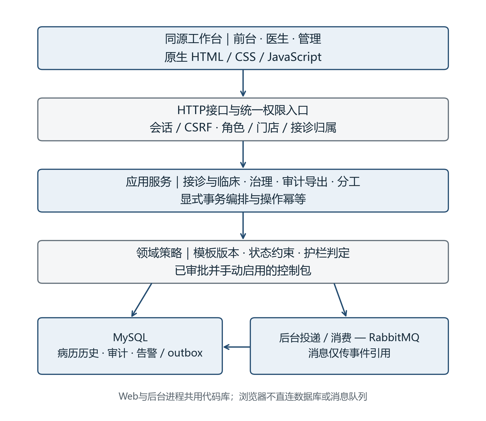
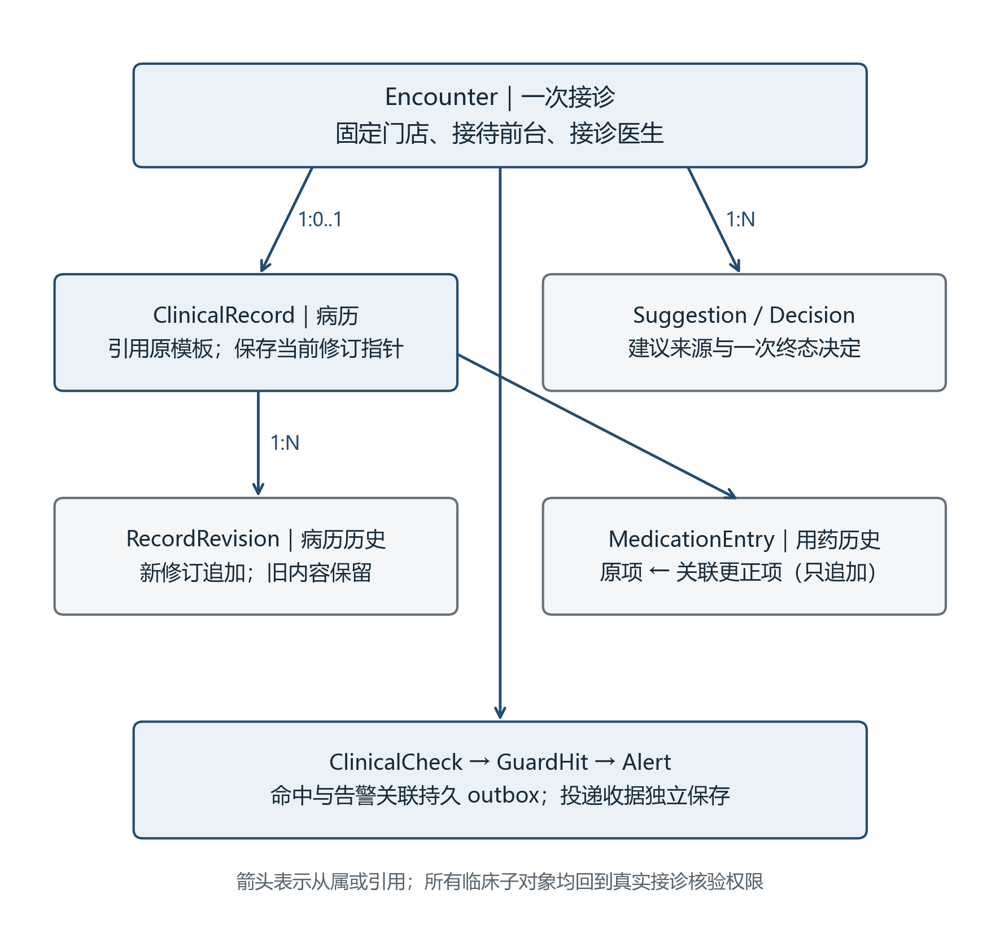
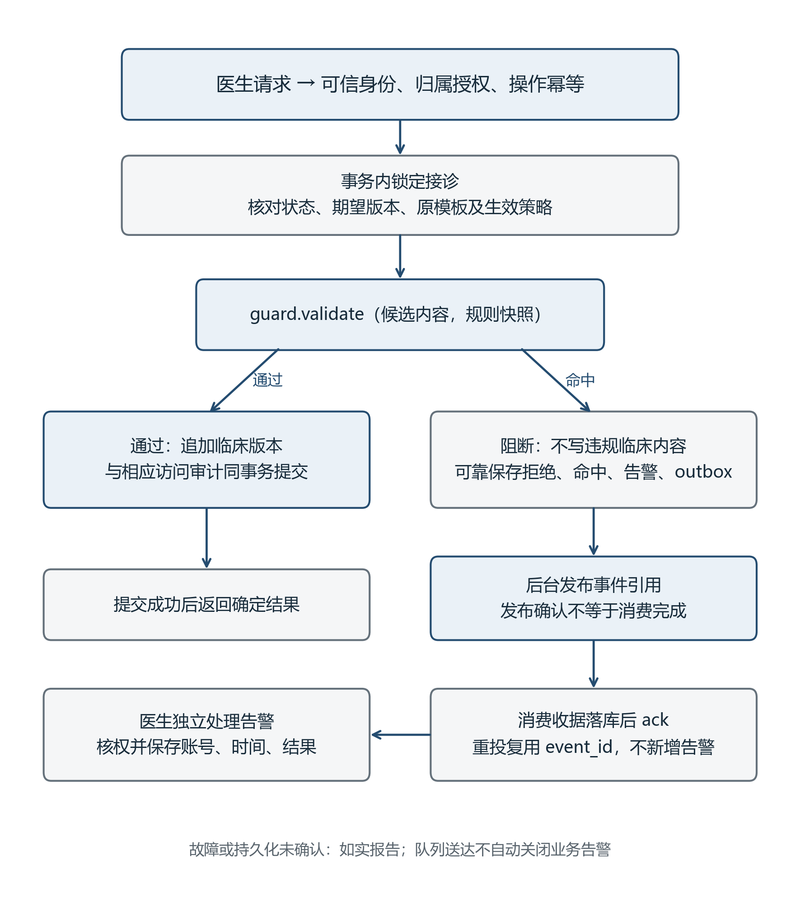

# 1 绪论

## 1.1 项目背景与问题

社区宠物医院的门诊记录同时包含接待资料、诊断、处方、人工决定和规则执行结果。将这些内容集中保存，只解决了记录位置分散的问题；如果所有登录人员都能读取全文，或者病历更正直接覆盖原值，系统仍无法回答谁有权处理、变更基于什么规则、发生异常后怎样追溯等问题。AI参与内容生成又增加了一层责任边界：建议来源、内容录入者和最终采纳人可能不同，系统需要保留这些区别，不能把生成结果直接等同于医生决定。

本项目以T22社区宠物医院门诊病历控制文件与护栏规则引擎为课程任务，围绕五家门店、约6000只宠物和约2万份病历建立可运行系统。项目重点是将确认的业务约束转成可校验、可执行、可追踪的控制机制，贯通控制包生成、人工治理、接诊建档、临床提交、护栏告警与访问审计。数据采用明确标注的合成资料，目的在于复现约定的结构、规模和操作关系，不代表真实医院调研或医疗效果验证。

## 1.2 建设目标与研究内容

系统建设目标包含三个方面。首先，建立以角色、门店和本次接诊归属为基础的服务端权限边界，使前台、医生和管理各自完成获准任务。其次，将字段模板、用药只追加、AI建议采纳以及运行护栏纳入正式提交入口，保证不合规内容不能通过其他写入路径绕过。最后，将病历、责任记录、审计和告警投递关联起来，使成功、拒绝、重试与结果未知具有可核查含义。

围绕上述目标，报告分析需求与角色边界，比较技术方案，说明单体分层结构和主要数据关系，展开权限、控制包、临床事务、消息恢复及导出的实现方法，再依据自动化回归、故障试验和正式负载解释结果。报告将设计目标与已测结果分别叙述；机器校验成功、合成账号审批、课程本人确认和教师验收是不同事实，不能相互替代。

## 1.3 系统边界与报告依据

本期运行角色只有前台、医生、管理。宠物是诊疗对象，宠物主人是线下信息提供者，没有主人登录端。AI建议源仅提供待决定内容，队列消费者和调度进程属于内部实现，不构成新增业务角色。收费、库存、预约排班、转诊换班、跨店调阅及建档后改派不在本期范围。系统采用前后端分离的分层单体、单机关系数据库和消息队列，不进行微服务拆分、多地域部署或集群编排。

需求依据为[需求规格说明书](03_需求规格说明书.md)；当前架构、模块与实现关系依据[系统设计报告](04_设计与控制文件/22_系统设计报告.md)，具体流程依据[关键流程与时序设计](04_设计与控制文件/04_关键流程与时序设计.md)。测量结果以[测试与实测报告](06_测试与实测报告.md)的最终版本章节及其原始摘要为准。早期设计文档中保留的候选状态和旧性能结果用于追踪，不能覆盖最终运行事实。本报告采用统一章节号和文字流程表，避免既有插图内部旧编号与本报告编号发生混淆。

# 2 需求分析

## 2.1 业务过程与责任交接

业务从规则准备和到院接待两条线衔接。管理账号提交本店字段、模板和规则定义，系统生成并检查候选，人工对具体内容进行审批，随后手动启用。这里的需求输入是字段和规则定义，不是既存病历正文，管理不会因治理工作取得诊断、处方或建议原文的读取权。

前台收集宠物基本信息和主诉，选择同店医生建立一次接诊。接诊的门店、接待前台和接诊医生由服务端核定，建档后固定。医生进入其负责的本次接诊，记录诊疗、追加用药、更正已有内容或决定是否采纳建议。正式临床变更均经过授权、状态、版本、模板和生效护栏检查。通过后保存新版本及审计；护栏阻断时原业务内容保持不变，另保存命中、告警和待发事件。

医生后续处理其负责病历的未处理告警。管理查看本店脱敏统计、审计及分工复核信息，有权人员按既有范围导出。上述衔接不转移病历归属：同一宠物再次到院，不使新的接待人员或医生自动获得其他接诊全文；将旧单引用到重建接诊，也不产生额外读取权。

## 2.2 功能需求分解

八项功能共同构成完整业务，不能把告警仅当作日志，也不能以病历导出代替命中记录导出。表2-1概括功能、可观察行为与关键限制。

表2-1 功能需求及验收关注点

| 编号 | 功能与主要行为 | 关键约束 |
| --- | --- | --- |
| FR-01 | 从结构化病历、处方需求生成控制包候选和校验报告 | 缺项、冲突或越过底线时可定位拒绝，生成不自动启用 |
| FR-02 | 以模板解释字段，保存模板、审批和病历修订版本 | 旧病历保持原模板含义，普通更正与误建保留历史 |
| FR-03 | 登记人机工作分工，比较同工作项的计划与实际元数据 | 来源不足显示不可比较，差异由本店管理人工复核 |
| FR-04 | 保存处方、用药和剂量，追加关联更正 | 原内容不得覆盖或删除，更正关联实际账号、时间、理由 |
| FR-05 | 执行三角色的行级与字段级隔离 | 跨店、非负责接诊、错误角色和漏挂权限均拒绝并留痕 |
| FR-06 | 登记建议来源、采纳人及理由，保留不采纳决定 | 未经人工采纳不进入正式病历，演示建议不得冒称真实模型效果 |
| FR-07 | 正式变更前执行护栏，保存命中、告警和恢复依据 | 投递与人工处理分离，命中明细及汇总按权限导出 |
| FR-08 | 完整导出获准病历，记录读取和导出访问审计 | 导出登记人、范围、用途，必需审计成功后交付数据 |

FR-03关注系统能够取得的执行信息，而非自动观察现实中所有行为。人工录入不等于人工生成，AI生成也不等于AI作最终决定。比较须限定同工作项、阶段和责任维度；没有足够来源时，应保留不可比较状态，不能推断出一致或不一致。

FR-06中，采纳是受控临床写入，而非简单更改建议状态。账号、理由、目标接诊和期望版本须在同一操作中核验，只有正式写入成功才报告采纳入病历成功。不采纳则保存建议及决定，不把内容写入病历，也不额外套用采纳的必填理由和临床写入护栏。

## 2.3 角色权限与字段范围

权限同时由可信身份、角色、门店、接诊归属、动作及字段白名单决定。医生不能凭宠物编号获取所有历史，管理也不是病历全文超级用户。账号与归属取自服务端会话和持久记录，不能采信请求体自报的医生、门店或审批人。页面按钮只表达可用操作，任何真实请求仍须服务端复核。

表2-2 三角色操作范围矩阵

| 操作 | 前台 | 医生 | 管理 |
| --- | --- | --- | --- |
| 接待资料 | 本店本人接待，读写及纠错 | 负责接诊的关联资料只读 | 不读接待正文 |
| 病历及用药 | 拒绝 | 本店本人负责，受状态与版本约束 | 拒绝全文 |
| 建议及告警 | 拒绝 | 负责接诊的决定与处理 | 仅脱敏计数 |
| 规则模板治理 | 拒绝 | 拒绝 | 本店候选、审批及手动启用 |
| 分工登记复核 | 拒绝 | 不取得管理维护权 | 本店脱敏执行信息 |
| 导出 | 拒绝 | 获准病历与命中明细 | 本店脱敏汇总 |
| 访问审计 | 不取得管理查询权 | 合法病历操作自动留痕 | 本店约定元数据 |

跨店病历请求被拒后，事件归请求账号所属门店管理查询，其返回内容仍只含规定的脱敏元数据。目标门店不因此新增事件可见权，引用也不提供正文跳转。无法确定可信身份和事件归属时，系统保留安全事件和恢复依据，不凭空将事件分配给某门店。具体权限键和字段定义见[权限矩阵与字段投影](04_设计与控制文件/02_权限矩阵与字段投影.md)。

## 2.4 状态、异常与数据约束

普通资料更正保留前后版本、账号、时间和理由，不改变固定归属。误建以错误标记及差错说明表达，不删除原记录或将宠物编号直接改成另一只宠物。标记后旧单禁止新增诊疗和采纳，但原医生仍可合法读取、纠正已有内容和处理既存告警；用药纠错仍是关联追加。误建不自动撤销处方或关闭告警，统计应把建档条数和误建条数分别说明，不能将建档数直接解释为真实就诊人数。

异常响应需区分未认证、无权限、格式错误、状态不允许、版本冲突、护栏命中和设施故障。网络超时只表示客户端未拿到确定结果，不能直接宣称事务已回滚。相同操作重试应核对最终结果；重新读取病历仍产生当次访问审计。告警或拒绝记录未能可靠保存时，应返回真实留痕故障，不能在拒绝违规写入的同时声称告警已保存。

## 2.5 质量要求与验证条件

题定容量为五家门店、约6000只宠物、约2万份病历。性能要求涉及360并发、持续10分钟、吞吐每分钟至少800次及相关操作P95不超过280ms。由于任务书没有明确并发的在途语义，报告须披露实际协议、会话数、间隔、请求在途、导出范围和完整响应计时，不能只给出“360并发通过”的概括。

一致性要求病历写入及相应审计同事务提交，恢复要求队列故障持久待发、恢复补发、重复提交和重复消费不产生重复业务。安全要求覆盖越权、无权限校验、明文口令持久化和SQL注入负例，且拒绝日志不能泄露正文或原始凭据。工程指标包括覆盖率至少80%、全量用例通过及代码规模3200—4800行；规模需要明确生产代码、迁移和前端的统计分母。维护性要求新规则或模板的文件、模块及实际投入可追踪，不能把代理操作时间直接换算为真人工日。

# 3 系统总体设计

## 3.1 技术候选比较与选择

项目比较了FastAPI、SQLAlchemy、PostgreSQL组合与Django、DRF、MySQL组合，两者均可承担单体应用与RabbitMQ告警处理。比较重点是授权、事务、模板治理和复现成本，未将框架宣传吞吐作为本项目性能结果。当前实现选择Django/DRF、MySQL和RabbitMQ，前端采用同源原生HTML、CSS和JavaScript工作台。早期比较中的Vue与Caddy属于候选及入口实验，不属于当前实际前端或默认交付部署。

表3-1 主要技术候选比较

| 维度 | FastAPI组合 | Django组合及取舍 |
| --- | --- | --- |
| 性能 | 可选择同步或异步，仍受连接、锁与审计限制 | 显式短事务及索引，工作线程与连接预算须实测 |
| 开发成本 | 身份、权限、迁移和治理需组合 | 身份、口令、ORM与迁移较集中，适合课程追踪 |
| 部署成本 | Python、数据库、MQ及相关环境 | 同样需数据库和MQ维护，不能称零部署成本 |
| 维护性 | 分层清晰时便于替换组件 | ORM与迁移统一，但须避免逻辑集中在视图 |

选择Django的直接理由是减少基础设施拼装，使账号、事务、数据模型、治理和测试证据更容易建立对应。选择并不证明其能够满足所有负载。早期统一入口及持续在途试验存在时延超标，后续改动仍需在相应版本与协议下验证，不能将活跃会话结果作为严格口径性能的自动背书。完整候选依据见[架构候选与设计说明](04_设计与控制文件/architecture.md)。

## 3.2 分层结构与模块职责

系统由同源工作台、HTTP适配、应用服务、领域策略和持久化组成。浏览器经会话与CSRF机制调用JSON或CSV接口，数据库及队列不直接暴露给浏览器。Web请求与后台告警进程共享同一代码库和数据库，不拆分独立业务服务。这里的前后端分离体现为清晰接口与独立页面逻辑，不要求引入前端框架或独立域名。

表3-2 模块划分与依赖边界

| 模块 | 主要职责 | 依赖约束 |
| --- | --- | --- |
| 身份与治理 | 可信账号上下文、候选、审批、生效指针 | 不用staff或superuser替代业务角色 |
| 接诊与临床 | 固定归属、诊疗修订、用药、建议决定 | 统一授权、事务及护栏入口 |
| 护栏与告警 | 无副作用判定、命中持久化、待发恢复 | 队列只携带引用，不携带临床正文 |
| 审计与导出 | 访问记录、完整CSV、管理脱敏投影 | 审计成功后才交付受保护数据 |
| 人机分工 | 计划与执行元数据比较、人工复核 | 不读取临床正文补齐比较依据 |

应用服务组织用例、授权和事务，领域策略负责模板、状态及规则判断，持久化层执行受限查询和数据约束。将规则判断放在无副作用函数中，有利于在不同正式写入路径复用，而是否保存业务、命中和告警由应用事务统一决定。接口层不能直接查询全文形成旁路，内部工作进程也不能借后台身份获得任意临床写入权。

图3-1 系统分层与依赖关系

## 3.3 数据模型与历史保留

Encounter是一次接诊的归属中心，保存门店、接待前台、接诊医生、基本资料快照、状态和版本。ClinicalRecord关联接诊并引用模板，RecordRevision保存不可覆盖的临床修订。MedicationEntry独立保存原用药项和更正项，引用关系必须处于同一病历，避免普通JSON更新破坏只追加约束。Suggestion及其Decision关联同次接诊，决定由待处理进入终态，不能因重复请求反复采纳。

治理侧保存需求输入、候选、审批和门店生效指针。审批绑定具体内容摘要，候选修改后必须重新形成版本与审批。运行记录引用当时模板，新版启用不改写历史定义。告警侧将评估、命中、告警、待发事件与消费收据关联；审计侧以事件和目标集合关联读取、导出及操作者。人机分工使用计划版本、执行元数据和复核记录，既能显示当前比较，又不抹去旧复核依据。

对外引用使用随机标识。固定归属、外键关系和唯一键由数据库与应用检查共同维持，随机标识本身不构成权限。稳定关系字段与版本化内容分开，使字段扩展不必把所有历史病历迁移成新格式，也避免模板灵活性变成任意字段写入权。数据关系和接口细则见[数据与接口设计](04_设计与控制文件/03_数据与接口设计.md)。

图3-2 接诊与病历历史的核心关系

## 3.4 服务端授权与过滤复杂度

授权先核对权限键、模式及可信主体，再利用目标元数据确定门店与归属，最后只读取获准字段。前台列表带门店和接待账号谓词，医生列表带门店和接诊医生谓词；建议、用药与告警沿真实父关联回到接诊验证，不能只证明子对象存在。管理汇总先限本店再聚合，审计查询直接读取脱敏投影，而非取出临床全文再隐藏。

设接诊总量为N，返回记录数为K，选取字段数为F，多目标引用数为C，历史项数为H。权限键映射查找期望为O(1)，固定属性比较为O(1)，这只描述判定步骤，不代表数据库及网络耗时为常数。存在主键或关联索引时，单目标元数据查找约为O(log N)，无适用索引最坏为O(N)。多目标逐项授权上界为O(C log N)，批量查询可减少往返，但不能省略任何目标核验。

有合适范围索引的列表及字段投影约为O(log N＋K×F)，无适用索引时最坏O(N＋K×F)。单病历历史展开仍需O((K＋H)×F)处理输出，不能将任意长更正链称为O(1)。本店汇总对筛选后S条来源聚合约为O(S)，输出G个分组还需O(G)状态及生成成本。CSV生成受实际字符量、历史和转义支配，至少与输出大小线性相关。分页适用于交互列表，不能用于静默截断要求完整的导出。上述分析用于解释索引和投影的作用，不作为固定时延保证。

## 3.5 一致性、恢复与派生读模型

临床变更使用显式事务，在事务中锁定接诊、核对期望版本及生效策略，完成规则校验后同时提交业务修订和审计。必需审计不放在响应后的清理或异步回调中。违规提交不写入临床正文，命中及待发依据通过可靠的拒绝事务保存，防止随医疗事务回滚一并丢失。

为减少完整历史重复渲染，系统引入ClinicalExportProjection派生导出投影。临床写入、用药更正和建议采纳成功后，在既有接诊锁及同一事务中维护源代数和CSV片段。导出仍验证授权、模板、源签名与片段摘要；缺失或不匹配时回退完整历史。投影不是临床事实来源，也不缓存用户权限。原始SQL导入或特权维护需要在开放服务前核对并重建，不能因已有投影忽略来源变化。

命中记录冗余保存由接诊派生的门店检索键，以门店、规则引用索引缩小聚合集合；写入时核验派生关系，管理查询仍通过真实接诊链复核门店。该优化没有缓存统计结果，也不改变告警处理状态的实时关联。性能改进必须维持相同权限与历史语义，再以负载测量判断收益。

# 4 关键功能设计与实现

## 4.1 控制包编译与人工治理

控制文件把字段模板、安全红线、编码规范、质量门禁、授权和分工约束转成结构化输入。编译器按Schema检查结构，按发行的安全底线、权限底线和事实登记表检查语义，对未知检查器、冲突引用、缺必需项或削弱底线给出可定位拒绝。输入不能替换程序发行的底线资产，也不能要求系统理解任意自然语言并自行补齐业务决定。

合法输入生成候选文件与校验报告，失败只保留报告，不切换既有生效配置。生成成功后的候选尚未提交，更不是运行规则。管理账号提交本店候选，对具体版本与摘要进行人工审批，再手动启用；启用事务复核内容、门店与审批关系，失败保留原指针。把这几个结果分别保存，可避免“编译通过即自动上线”或“需求定稿即所有规则获得批准”的错误解释。

模板版本与病历引用保持稳定。新增可选字段或规则应形成新的受控候选，旧接诊继续按原版本解释；普通临床更正生成新修订，而不是以最新模板批量重写历史。机器校验负责结构和已登记语义，规则业务含义及安全红线仍需人判断。

## 4.2 权限入口与默认拒绝

每个受保护路由绑定固定权限键和模式，客户端不能传入任意较弱键驱动授权。统一入口在执行视图前校验身份、方法、角色和登记完整性；未登记路径默认拒绝。发布检查对漏挂权限样本报出governance.E001，实际调用产生MISSING_PERMISSION_ENTRY脱敏审计并阻止执行视图。这同时覆盖开发时遗漏和运行时误调用，页面隐藏无法提供相同保证。

输入和输出采用白名单。对未知查询字段、畸形JSON、伪造身份字段和受限目标分别处理，拒绝响应不返回目标全文或原始请求内容。SQL使用参数化方式；安全负例还需区分攻击输入与合法包含引号的普通文字，避免以简单字符拦截替代实际查询安全。账号持久化路径包括受控演示初始化，正常口令经安全转换保存，试图直接持久保存明文的负例应拒绝并脱敏留痕。

## 4.3 临床提交与护栏判定

正式写入覆盖诊断和检查记录、更正、用药追加与更正及建议采纳。系统先建立可信上下文与操作身份，再在事务中锁定接诊，核对状态、期望版本、模板和生效规则。护栏判定使用候选内容和规则快照，不自行提交临床数据。表4-1给出共同执行顺序，具体错误处理仍以真实实现与回归为准。

表4-1 临床guard流程伪代码

| 步骤 | 简化伪代码 | 必须保持的结果 |
| --- | --- | --- |
| 身份与操作 | actor←trusted_session；authorize(key,target) | 使用真实账号、门店与父接诊关系 |
| 幂等核对 | compare(operation_id, digest) | 同键同意图复用结果，换内容拒绝 |
| 事务前置 | lock(encounter)；check(version,state,policy) | 过期版本不能覆盖新记录 |
| 模板与护栏 | verdict←guard.validate(candidate, policy) | 所有正式写路径执行相同约束 |
| 通过分支 | append_revision；save_audit；commit | 业务与相应审计同时成功 |
| 阻断分支 | reject_mutation；persist_hit_alert_outbox | 原临床内容不变，可靠保留拒绝依据 |

设一次判定涉及R条规则、F项事实，朴素事实匹配上界为O(RF)，条件节点G及集合、变长比较开销I需额外计入，总体可写为O(RF＋G＋I)。命中H项采用字典去重，期望为O(H)。规则数、输入长度及集合大小均影响真实耗时，不能将一次函数调用解释为固定耗时。单轮同规则、版本、字段按唯一标识保存一条命中；不同规则命中同字段分别保留，新独立提交再次命中也形成新的告警。

输入格式错误、身份拒绝和运行时病历护栏命中分开归类。前两者不能仅因都拒绝就生成临床告警，后者也不能只写普通日志代替持久告警。规则缺失或持久化设施故障时不报告通过；队列暂不可用但数据库告警及待发已成功保存，则属于可恢复投递状态。

图4-1 临床提交与告警持久化顺序

## 4.4 追加更正、建议决定与操作幂等

用药原项不可更新或删除，更正以新项引用同病历原项，保存实际医生、时间和理由。普通诊疗修订与用药追加采用不同对象，防止一次普通字段更新覆盖处方历史。读取和导出同时表达原项与更正链，使复核者能够还原变更关系，而非只看到最后显示值。

建议保存来源及待决定状态。采纳时核验负责医生、理由、接诊状态、期望版本、模板和护栏，通过后同时形成终态决定与正式病历写入。拒绝或失败不能留下“已经采纳成功”但病历未写的半结果。不采纳保留建议和决定供复盘，当前演示源不支持关于真实模型诊疗正确性的结论。

幂等结果绑定可信账号、权限键、操作标识及内容摘要，摘要包含目标、固定模式、业务输入和期望版本。同键换目标、模式或内容返回冲突，不能复用成另一次业务。返回已有结果前仍复核当前授权，不把缓存变成越权取回正文的通道。客户端断连后以同一操作核对或重试，重复用药、更正和采纳均不得重复新增。新的独立意图需使用新的操作身份，不能借幂等机制吞掉真实第二次提交。

## 4.5 告警投递与故障恢复

告警与outbox在数据库中先可靠保存，后台再领取待发事件并向RabbitMQ发布引用。消息只传事件、告警标识和必要路由元数据，不携带主诉、处方或建议正文。采用至少一次传输与消费去重，不承诺网络传输恰好一次。

表4-2 告警投递与处理伪代码

| 阶段 | 简化伪代码 | 状态含义 |
| --- | --- | --- |
| 持久化 | save(Hit, Alert(open), Outbox(event_id)) | 已记录告警，尚不等于消息已送达 |
| 发布 | claim_pending；publish_reference；wait_confirm | 未路由或确认不明保留待核对及重试依据 |
| 消费 | atomic(save_receipt_if_new(event_id))；ack | 提交后确认，重复消息复用收据 |
| 核对 | reconcile_receipt；retry_same_event | 重投不产生新的命中或告警 |
| 人工处理 | authorize_doctor；save_actor_time_result | 独立改变业务处理状态 |

发布确认仅证明发布端得到队列确认，不能证明消费者已可靠落库；消费收据成功也不表示医生完成临床处理。队列恢复后补发同一事件，消息重投复用既有收据；医生处理仍需单独授权并保存实际结果。后台批量领取有界执行，索引检索、逐条确认和网络等待另计，不能把批量事件处理称为O(1)。完整协议见[告警队列投递与恢复](04_设计与控制文件/16_告警队列投递与恢复.md)。

## 4.6 完整导出与访问审计

医生病历CSV、医生命中明细CSV、管理脱敏汇总CSV是三类不同产物。前台无导出权，医生明细限于负责接诊，管理只取本店聚合结果。病历导出登记范围及用途，显式目标集合中的任何越权都不能被静默删掉后返回一个看似完整的文件。合法空明细应按契约表达，不应误判为导出失败。

导出先确定授权集合和字段，按原模板及更正链生成完整UTF-8 CSV，复核当前授权，持久保存必需审计和目标关联，随后才开始交付临床字节。不以只导当前页、截断历史或仅测受理响应满足完整导出要求。派生投影减少重复渲染，但其失效回退、模板验证及实时权限边界保持有效。

客户端对Content-Length、实际接收字节及摘要进行核验，计时到完整响应体接收。生成成功、开始下载和完整接收是不同状态；中断后不能撤回已传字节，也不能声称完整文件已收到。重新下载应重新授权并记录实际读取。服务端审计证明访问及范围持久化，客户端核验说明传输完整，两者须分别检查。

## 4.7 AI可执行规格的用途

AI辅助开发依赖多种约束资产。需求基线、权限矩阵和追踪矩阵约束目标及边界；Schema、安全底线、权限底线、登记表及编译器对控制输入执行机器检查；接口与消息契约约束路径、字段、错误和投递语义；工作区规范约束修改和证据记录。这些资产分别服务开发、编译、对接和运行，不能统称为已经启用的临床规则。

合法定义示例是合成编译输入，生成的candidate与report用于复现检查，不是管理已审批版本。接口文档也不替代真实路由和运行时授权。规格用途及确切选件见[AI可执行规格提交索引与说明](04_设计与控制文件/21_AI可执行规格提交索引与说明.md)。AI可起草、实现和复核，但不替代真实账号采纳、人工审批及课程本人对报告事实的确认。

# 5 系统测试与结果分析

## 5.1 测试组织与证据层次

测试按控制编译、服务端功能、权限负例、事务故障、消息恢复、完整导出、浏览器流程和性能负载组织。单元及集成测试核对可重复行为，真实HTTP与CSV核对接口和传输，故障试验检查恢复边界，正式负载记录容量条件下的时延与吞吐。不同层次不能替代：语法检查不能证明流程正确，客户端文件完整也不能单独证明服务端审计逐目标完整。

当前完整MySQL/RabbitMQ后端回归275项全部通过；前端语法及14项护栏回归通过，负载工具独立回归92项通过，Django系统检查与迁移一致性检查通过。这些数字对应各自测试范围，不能相加成一个全系统用例数。预期异常注入会触发负向分支日志，是否失败以测试结果及断言为准，不能将预期模板损坏错误误写成整体运行失败。

## 5.2 功能、权限与故障结果

控制编译验证合法、缺项、冲突及越过底线输入，支持可定位拒绝；治理验证候选、提交、审批和手动启用，模板扩展验证旧接诊保持原版本解释。合成测试账号完成审批仅说明流程可执行，不代表真实医院规则已获人工业务批准。

权限测试覆盖匿名、错误角色、错误方法、跨门店、同店非负责医生、前台及管理全文请求等路径。登记路由矩阵和专有错误用例补充畸形JSON、未知查询字段、状态冲突及导出范围；漏挂样本在发布检查与实际调用均被阻断。安全红线负例同时检查拒绝与脱敏审计，固定样本通过不表示所有未来端点或输入组合已经穷尽。

事务故障测试核对临床写入与审计不会半提交，建议采纳和用药更正保持对应关系；Web及MySQL重启后核对已提交记录。队列停用、恢复和重复消费试验支持持久待发与业务去重结论，消息送达和医生处理分别计数。上述结果适用于已测故障模型，尚不能扩展为任意断电瞬间或所有存储损坏均无损恢复。

## 5.3 覆盖率与代码规模

生产Python语句覆盖率为89.97%，即2681/2980条语句，包含governance、clinic、vetapp和控制文件编译库vetcontrols，排除测试、迁移及MQ测试辅助代码。相同275项用例均通过。早先91.87%采用未含vetcontrols的较窄范围，不能作为全生产代码结论；89.97%也不等于前端覆盖率、分支覆盖率或业务场景穷尽率。

代码规模按非空且非整行注释的物理行复算，保持不同范围并列，不通过删除功能调整计数。表5-1给出当前真实范围。

表5-1 当前代码规模及统计范围

| 范围 | 行数 | 解释 |
| --- | ---: | --- |
| 后端生产Python | 3387 | 在3200—4800行区间内 |
| 数据存储迁移 | 1429 | 单列，不当作业务生产语句覆盖分母 |
| 前端JavaScript | 2952 | 实际原生工作台代码 |
| HTML与CSS | 25、591 | 页面与样式分别统计 |
| 后端加迁移 | 4816 | 超出4800，不能写作区间内 |
| 全栈不含迁移 | 6955 | 不在题定区间 |
| 全栈含迁移 | 8384 | 不等于全系统规模达标 |

因此能够支持的结论是后端生产Python范围落入区间；教师未明确统一分母时，不能宣称整个系统都满足规模指标。历史4163、7731等数字对应旧代码，不再作为当前规模。范围透明比选择一个有利分母更能反映工程实际。

## 5.4 正式性能环境与协议

最终产品与运行源码为2b3c422，完成双机私网负载。接收端32核、约64GiB，发送端4核、8GiB，私网16端口直接连接；应用16进程×24线程，输出缓冲8MiB。MySQL使用3307端口、E盘、512连接、8GiB缓冲池和4GiB redo，提交持久化配置1/1。源码118个文件摘要与预检一致，运行中未改变产品代码和配置。上述配置是本次实验条件，不是最低部署配置或生产容量承诺。

固定种子20261024重建新库，包含5店、6000宠物、20000病历、106640条演示建议及20000个导出投影。course-v1.1.3协议以360独立登录会话参与，复用19个业务账号；每次操作后等待15—25秒，导出采用1—100条范围分布，60秒预热后进入600秒正式窗口。正式请求包括查询、护栏、接诊、病历写入和三类CSV，均计至完整响应体收到，不只统计响应头或任务受理时间。

## 5.5 七类P95与逐分钟吞吐

正式窗口共完成10778次请求，失败0次，七类样本均不少于100。表5-2列出同一窗口的结果，避免将不同轮次最优值拼成一个成绩。

表5-2 最终正式窗口分项结果

| 操作类别 | 样本数 | 完整响应P95/ms |
| --- | ---: | ---: |
| 病历查询 | 3690 | 9.997 |
| 护栏校验 | 1576 | 21.248 |
| 接诊 | 2168 | 15.796 |
| 病历写入 | 2721 | 21.363 |
| 病历CSV | 211 | 16.019 |
| 命中明细CSV | 205 | 13.660 |
| 管理汇总CSV | 207 | 50.034 |

七类P95均小于280ms；P95反映样本分位数，不表示每个请求都低于门槛。表5-3给出十个分钟的成功数，每分钟均达到800次要求，其总和与正式请求数一致。

表5-3 正式窗口逐分钟成功请求

| 分钟 | 成功数 | 分钟 | 成功数 |
| --- | ---: | --- | ---: |
| 1 | 1063 | 6 | 1092 |
| 2 | 1091 | 7 | 1087 |
| 3 | 1074 | 8 | 1079 |
| 4 | 1091 | 9 | 1078 |
| 5 | 1067 | 10 | 1056 |

正式CSV共623次，含预热共692次，客户端长度、摘要及内容计数核对通过；现场又与5626个服务端精确审计目标匹配，并核对账号、门店、动作、字节和重复目标。逐请求独立复算与驱动摘要一致。接收端247条Windows及201条MySQL采样均无记录错误；发送端摘要中的Web和MySQL RSS未采集，不能将空值当成接收端内存证据。精选摘要见[最终课程活跃会话原始结果](10_验收证据/21_最终整体验收与提交整理/原始结果/09_最终课程活跃会话20261117.json)。

## 5.6 实际在途与严格负载边界

本轮采样在途P95为1，采样峰值为3；依据请求起止区间精确重建的峰值为5。360表示全部参与正式窗口的独立活跃会话，并不表示360个HTTP请求持续同时在途。15—25秒操作间隔和1—100条导出范围是结果成立的重要条件，19个账号复用也需要披露。

旧持续360请求在途试验采用不同压力与大范围导出，七类P95约12—34秒，未达到280ms，优化后未按同一严格协议完成最终源码复测。因此本轮可以判定为明确披露的课程活跃会话协议内达到预定门槛，不能写成严格360在途通过或教师已验收通过。对于1000—4000条大导出，也不能直接沿用小范围导出P95。硬件、并发模型和导出分布共同变化时，不能把差异收益全部归因于某一个代码优化。

## 5.7 审计离线复核与维护性限制

服务端692次导出、5626个目标的结论来自运行现场核验程序。交付材料提供执行脚本、客户端预期索引和核验摘要，但没有采集逐笔数据库审计行快照；离线审阅者不能仅凭现有文件重新从原始服务端记录建立全部目标匹配。客户端逐请求数据可重算P95、分钟数、会话参与及文件核验，服务端审计需要单独证据。这一限制不等于审计实现失败，也不能被表述为离线逐笔重建已经完成。

维护性试验在已登记检查器语法内新增规则和模板，记录1个配置文件、0个产品模块及1个测试模块的变化，支持文件与产品模块数量方面的结论。代理操作约5分30秒不等于真人完成所需工日，实际真人≤1人日尚无测量，故维护性属于部分验证。新增未知检查器、全新事实类型或复杂模板不能直接套用已有扩展成本。

项目已建立覆盖需求、设计、实现和测试的证据链，支持当前功能、权限、事务、队列恢复及活跃会话性能结论；严格持续在途、所有异常输入穷尽、真人维护投入和服务端离线逐笔审计仍有明确边界。最终交付应保留这些边界及原始摘要，使报告能够被复核，而不是将不同分母、不同版本或不同负载的结果统一写为全部通过。

# 6 AI辅助开发实践与个人分析

## 6.1 AI对软件开发的影响

从这次作业的对话和开发过程看，AI能很快把任务书整理成需求草案、设计候选、接口、代码、测试和Word材料，也能连续处理前后端PR。但“写得快”和“判断得对”不是一回事。最早的需规曾用“本人”描述医生的病历范围，容易把业务账号和课程开发者混为一谈；技术规划又一度把旧作业的本地“仅Python标准库”约束当成本次T22的限制。这两处都需要我回到任务书和实际使用场景作决定，AI再据此修订。

我认为，人在AI参与开发时要首先守住需求边界、角色权限、规则红线和验收口径：提出可检验的问题，指出含混或越界的地方，要求AI用来源、代码差异和真实测试回答，再决定是否接受。AI适合加速初稿和重复性实现，不能替我批准业务规则、代替医生作诊疗决定，也不能把模拟数据或绿色CI说成老师已经验收。性能测试中，我要求先区分“360个活跃会话”与“360个请求持续在途”的含义；[课程口径实测](10_%E9%AA%8C%E6%94%B6%E8%AF%81%E6%8D%AE/19_%E5%90%8E%E7%AB%AF%E7%BB%BC%E5%90%88%E9%AA%8C%E6%94%B6/24_AC06%E8%AF%BE%E7%A8%8B%E5%8F%A3%E5%BE%84v1.1%E5%AE%8C%E6%95%B4%E9%AA%8C%E6%94%B6.md)在前一种解释下达到预定时延和吞吐，同时如实报告实际在途请求数。我更重视对整个交付结果及其测量条件的复核，而非只看某一环节的“通过”字样。本段是对已记录判断的归纳，最后措辞由本人审定。

## 6.2 开发各阶段的质量控制

下表把我在聊天中提出的任务或选择，与AI的主要操作、可验证出口对应起来。引号内尽量保留真实提问短句；原始较长提示词与版本变化见[阶段留痕](07_AI%E4%BD%BF%E7%94%A8%E7%95%99%E7%97%95/)和[首轮子代理提示词](07_AI%E4%BD%BF%E7%94%A8%E7%95%99%E7%97%95/02_%E5%AD%90%E4%BB%A3%E7%90%86%E5%8E%9F%E5%A7%8B%E4%BB%BB%E5%8A%A1%E6%8F%90%E7%A4%BA%E8%AF%8D.md)。表中没有把AI自动修错写成我手工编码。

| 阶段 | 我的指令/主要操作及AI协作 | 质量检查与当前证据 | 我的判断边界 |
| --- | --- | --- | --- |
| 要求与需求 | 我要求先分析“老师对作业的各种各方面各细节的要求”，又指出“需规是前期最重要的文档”“边界需明确，用户角色要清晰”；AI对任务书、可信课程汇总和课堂原文分层，反复修订三角色[需规v1.0](03_%E9%9C%80%E6%B1%82%E8%A7%84%E6%A0%BC%E8%AF%B4%E6%98%8E%E4%B9%A6.md) | [要求清单](01_T22%E8%A6%81%E6%B1%82%E6%A0%B8%E5%AF%B9%E4%B8%8E%E9%AA%8C%E6%94%B6%E6%B8%85%E5%8D%95.md)、[术语纠正记录](07_AI%E4%BD%BF%E7%94%A8%E7%95%99%E7%97%95/03_%E9%9C%80%E8%A7%84%E7%BB%93%E6%9E%84%E4%BF%AE%E8%AE%A2%E4%B8%8E%E8%B0%83%E7%A0%94%E8%AE%B0%E5%BD%95.md)、[定稿记录](10_%E9%AA%8C%E6%94%B6%E8%AF%81%E6%8D%AE/05_%E9%9C%80%E6%B1%82%E5%9F%BA%E7%BA%BF%E4%B8%8E%E9%A6%96%E8%BD%AE%E8%AE%BE%E8%AE%A1/01_%E9%9C%80%E6%B1%82v1.0%E5%AE%9A%E7%A8%BF%E8%AE%B0%E5%BD%95.md) | 我确认按任务书三类内部角色，不增设主人端；AI审查不能代我批准边界 |
| 设计与AI可执行规格 | 我选择“B：Django/DRF＋MySQL＋RabbitMQ”作为优先预研方向，AI比较[架构候选](04_%E8%AE%BE%E8%AE%A1%E4%B8%8E%E6%8E%A7%E5%88%B6%E6%96%87%E4%BB%B6/architecture.md)、写[权限矩阵](04_%E8%AE%BE%E8%AE%A1%E4%B8%8E%E6%8E%A7%E5%88%B6%E6%96%87%E4%BB%B6/02_%E6%9D%83%E9%99%90%E7%9F%A9%E9%98%B5%E4%B8%8E%E5%AD%97%E6%AE%B5%E6%8A%95%E5%BD%B1.md)和[机器契约](04_%E8%AE%BE%E8%AE%A1%E4%B8%8E%E6%8E%A7%E5%88%B6%E6%96%87%E4%BB%B6/08_%E6%8E%A7%E5%88%B6%E5%8C%85%E6%9C%BA%E5%99%A8%E5%A5%91%E7%BA%A6%E4%B8%8E%E9%9D%99%E6%80%81%E7%BC%96%E8%AF%91.md) | 缺项/冲突编译失败、发行底线与接口约束；[规格说明](04_%E8%AE%BE%E8%AE%A1%E4%B8%8E%E6%8E%A7%E5%88%B6%E6%96%87%E4%BB%B6/21_AI%E5%8F%AF%E6%89%A7%E8%A1%8C%E8%A7%84%E6%A0%BC%E6%8F%90%E4%BA%A4%E7%B4%A2%E5%BC%95%E4%B8%8E%E8%AF%B4%E6%98%8E.md)标明演示样例、待审候选和系统内生效版本 | 红线与数据范围由人确认；编译器通过不是管理账号审批，更不是老师认可 |
| 实现与协作 | 我要求前端先保留接口、后端持续开发，并要求按GitHub PR流程复审、及时处理前端需求；AI按分支/PR/CI、接口契约和独立测试库实施 | [AI工作记录](07_AI%E4%BD%BF%E7%94%A8%E7%95%99%E7%97%95/)、[代码运行说明](../backend/README.md)及PR审查保留修改/回归；同账号COMMENT不冒充独立批准 | 我提出范围和验收要求；具体代码与多数测试由AI执行，需按结果复核 |
| 测试与验收 | 我批准既有正式负载协议，要求继续开发、验收并审核前端PR；后又要求准确理解280ms目标、制定可说明的课程活跃会话口径；AI执行多角色API、事务/队列故障、覆盖率和两种负载试验 | [最终源码复验](10_%E9%AA%8C%E6%94%B6%E8%AF%81%E6%8D%AE/21_%E6%9C%80%E7%BB%88%E6%95%B4%E4%BD%93%E9%AA%8C%E6%94%B6%E4%B8%8E%E6%8F%90%E4%BA%A4%E6%95%B4%E7%90%86/02_%E6%9C%80%E7%BB%88%E6%BA%90%E7%A0%81%E5%89%8D%E5%90%8E%E7%AB%AF%E5%A4%8D%E9%AA%8C.md)为最终275项通过、含控制文件编译库的生产Python语句覆盖率89.97%；[课程口径](10_%E9%AA%8C%E6%94%B6%E8%AF%81%E6%8D%AE/19_%E5%90%8E%E7%AB%AF%E7%BB%BC%E5%90%88%E9%AA%8C%E6%94%B6/24_AC06%E8%AF%BE%E7%A8%8B%E5%8F%A3%E5%BE%84v1.1%E5%AE%8C%E6%95%B4%E9%AA%8C%E6%94%B6.md)最终10分钟10778次请求零失败，七类P95为9.997—50.034ms，报告采样在途P95=1、采样峰值3；请求区间精确重建峰值5 | 任务书没有定义“并发”的在途语义；报告同时披露活跃会话和旧严格在途试验，不混用成绩 |
| 交付 | 我提供《作业提交注意事项》并要求参照；AI按四类提交物整理[运行与提交说明](09_%E8%BF%90%E8%A1%8C%E4%B8%8E%E6%8F%90%E4%BA%A4%E8%AF%B4%E6%98%8E.md)、设计报告和规格说明 | Markdown源→Word、链接和结构校验；最终仍须本人核对身份、真实经历、T22§12留痕与提交渠道 | 项目仓库与个人报告分开；个人经历和课程意见由我确认，不能从AI执行记录直接推定 |

这张表的可定位过程索引：需求澄清在2026-10-19的[DEC-05与SRS-R01](07_AI%E4%BD%BF%E7%94%A8%E7%95%99%E7%97%95/03_%E9%9C%80%E8%A7%84%E7%BB%93%E6%9E%84%E4%BF%AE%E8%AE%A2%E4%B8%8E%E8%B0%83%E7%A0%94%E8%AE%B0%E5%BD%95.md)；自由选型在同日[DEC-01](07_AI%E4%BD%BF%E7%94%A8%E7%95%99%E7%97%95/01_%E9%9C%80%E6%B1%82%E9%98%B6%E6%AE%B5%E5%8D%8F%E4%BD%9C%E8%AE%B0%E5%BD%95.md)，B方案仅作为优先预研方向见[DEC-13](07_AI%E4%BD%BF%E7%94%A8%E7%95%99%E7%97%95/05_B%E6%96%B9%E6%A1%88%E9%A2%84%E7%A0%94%E5%8D%8F%E4%BD%9C%E4%B8%8E%E5%AE%9E%E9%99%85%E7%BB%93%E6%9E%9C.md)；实现与集成的操作、PR及回归见[后端综合验收记录](07_AI%E4%BD%BF%E7%94%A8%E7%95%99%E7%97%95/19_%E5%90%8E%E7%AB%AF%E7%BB%BC%E5%90%88%E9%AA%8C%E6%94%B6%E4%B8%8E%E8%81%94%E8%B0%83%E8%BE%B9%E7%95%8C%E8%AE%B0%E5%BD%95.md)和[测试报告](06_%E6%B5%8B%E8%AF%95%E4%B8%8E%E5%AE%9E%E6%B5%8B%E6%8A%A5%E5%91%8A.md)。这些是对应阶段的主要操作与结果索引，不把阶段摘要伪装成本人逐字提示词。

## 6.3 需求澄清与协作纠偏

案例一：需规把“本人”写进业务角色范围。我让AI结合任务书、旧作业和课堂材料分析要求并起草需规。AI产出的旧措辞是“医生仅看本人接诊病历”；审阅时我直接问：“医生仅看本人接诊病历是啥玩意……这个系统内部跟我可没关系”，又强调“边界需明确，用户角色要清晰”。问题并非要给宠物主人新增登录，而是“本人”把当前医生账号与课程开发者混在一起，读者可能误解谁能看哪条病历。AI随后提出澄清选项，我确认按任务书的前台、医生、管理三类内部角色；需规把权限改写为该医生账号在所属店负责接诊的关联病历，并把宠物主人列为相关方而非首版系统用户。可用[2026-10-19的DEC-05与SRS-R01](07_AI%E4%BD%BF%E7%94%A8%E7%95%99%E7%97%95/03_%E9%9C%80%E8%A7%84%E7%BB%93%E6%9E%84%E4%BF%AE%E8%AE%A2%E4%B8%8E%E8%B0%83%E7%A0%94%E8%AE%B0%E5%BD%95.md)对照我的反馈、AI修订和复核；最终落点见[需规权限矩阵C-03](03_%E9%9C%80%E6%B1%82%E8%A7%84%E6%A0%BC%E8%AF%B4%E6%98%8E%E4%B9%A6.md)。这是需求表达与权限边界的失误，不把它冒充一次已经发生的线上越权事故。

案例二：把旧作业的本地技术限制错套到T22。在最初的要求核对中，AI把课程工作区旧作业的“仅Python标准库”约定带进T22讨论，而T22任务书允许自由选型。我追问“Python标准库约束是啥”，并说明同学提供的完整汇总根据课堂录音整理、可以作为可信来源；随后明确选择“按任务书自由选型”。AI于是在T22目录写入局部例外，再比较技术候选并优先预研Django/DRF＋MySQL＋RabbitMQ。可用[2026-10-19的DEC-01](07_AI%E4%BD%BF%E7%94%A8%E7%95%99%E7%97%95/01_%E9%9C%80%E6%B1%82%E9%98%B6%E6%AE%B5%E5%8D%8F%E4%BD%9C%E8%AE%B0%E5%BD%95.md)核对我的选择与处理，用[本目录约定](../AGENTS.md)核对修正，用[DEC-13](07_AI%E4%BD%BF%E7%94%A8%E7%95%99%E7%97%95/05_B%E6%96%B9%E6%A1%88%E9%A2%84%E7%A0%94%E5%8D%8F%E4%BD%9C%E4%B8%8E%E5%AE%9E%E9%99%85%E7%BB%93%E6%9E%9C.md)核对后续选型范围。如果不先辨清“老师题定要求”和“本地旧项目规则”，后续设计与代码可能会在错误约束下展开。这同样是规划阶段的AI误判，不计作T22§12要求的护栏规则/权限代码幻觉。

两例的共同教训是：给AI上下文时要注明来源适用范围；读AI成稿时要把“谁操作、看什么数据、在哪个版本、由谁批准”逐项说清。案例以本人的真实提问与选择为依据；文档修改、代码实现和测试执行的操作者仍应按[过程留痕](07_AI%E4%BD%BF%E7%94%A8%E7%95%99%E7%97%95/)分别署明。提示词能找到原文的保留原文位置；只有阶段摘要的明确标“摘要”，不补造逐字提示词。

## 6.4 上下文、人工修改与错误纠正

专项核验需结合随包材料检查一张交叉索引，逐项指向真实证据：至少5处“给AI的上下文包→最终代码”，并逐处写人工改了什么、为什么；至少3条护栏规则或权限代码领域的真实不实/不可行AI建议、人工识别与纠正；明确护栏红线、角色数据范围、越权最终核对不能交给AI，以及课件“能做/不能做”的逐条映射；另列每条规则/权限来源、真实评审人、生效时间。AC-08另外要求提示词演进、至少12条人工修改对照。[本人干预、代码映射与三例真实AI缺陷的核对候选](10_%E9%AA%8C%E6%94%B6%E8%AF%81%E6%8D%AE/21_%E6%9C%80%E7%BB%88%E6%95%B4%E4%BD%93%E9%AA%8C%E6%94%B6%E4%B8%8E%E6%8F%90%E4%BA%A4%E6%95%B4%E7%90%86/04_%E4%B8%AA%E4%BA%BAAI%E7%95%99%E7%97%95%E6%A0%B8%E5%AF%B9%E5%80%99%E9%80%89.md)已经按原始记录组织；其中AI自行发现/修复的案例不能自动算作本人的人工识别。当前[要求清单§6](01_T22%E8%A6%81%E6%B1%82%E6%A0%B8%E5%AF%B9%E4%B8%8E%E9%AA%8C%E6%94%B6%E6%B8%85%E5%8D%95.md)与[AI记录](07_AI%E4%BD%BF%E7%94%A8%E7%95%99%E7%97%95/)是材料入口，数量和真人身份仍由本人审定；不能用代理修改或虚构幻觉凑数。

### 6.4.1 三项代码案例的判断与修正

在2026年11月17日收尾回顾中，我确认参与了以下问题的判断与修正。具体操作顺序已不能完整回忆，因此下面依据保存的技术记录说明问题和修复，不把AI的技术发现改写为我首先发现，也不编造当时的逐字提示词。我的参与确认与可定位的复现、代码修改和回归记录分开保留。

| AI产出中的实际偏差 | 判断依据与修正要点 | 复核入口 |
| --- | --- | --- |
| 控制包编译成功，但展开后的输出超过复核器边界而被verify拒绝 | “能生成”不能代替“符合控制契约”；应在编译输出阶段检查树结构与字节预算，使生成与复核边界一致 | [控制编译实现与审查](07_AI使用留痕/06_控制编译实现与审查记录.md)、`backend/vetcontrols/compiler.py` |
| 跨店生成请求被拒绝后，拒绝审计的归店不符合已确认规则 | 拒绝访问还不够，事件必须归请求账号所属门店，目标引用不能扩大目标店正文可见范围；按来源门店与脱敏字段验证 | [端点错误码与拒绝审计](10_验收证据/19_后端综合验收/16_端点专有错误码与拒绝审计增量.md)、`backend/governance/services.py` |
| 直接Account.save曾能保存明文口令 | Web入口的校验不能覆盖所有持久化入口；账号模型与管理器需拒绝非法口令写入，并留下不含原始口令的审计 | [安全负例与凭据持久化修复](10_验收证据/19_后端综合验收/18_安全红线负例与凭据持久化修复.md)、`backend/governance/models.py` |

这三例提醒我：AI写出的代码即使在正常页面流程中可用，也可能遗漏编译后边界、拒绝分支或直接持久化入口。人需要检查规则是否覆盖这些路径，要求AI用负例复现并验证修复。现有记录中的技术诊断、实现与自动回归由AI辅助执行；这不减轻我对边界判断和最终验收的责任。

## 6.5 个人贡献与实践认识

从这次实际对话看，我没有把需规当作写完就算的文档，而是先追问业务角色与数据边界，再要求代理读课堂材料、复核全文，最后由我确认基线。开发阶段则把规则/模板候选的机器校验与系统内管理审批分开，按PR和回归处理前后端集成。遇到性能数据与目标不一致时，我要求先核对任务书原文、测量协议和完整响应数据，再由AI实施可回滚的小范围优化并重测，保留两种负载的各自记录。我把“先把边界讲清、再让AI做可复核的实现”作为本项目值得保留的方法；这段评价是AI根据本人行为整理，最终是否作为“我做得好的地方”须本人审定。

## 6.6 课程建议

我的具体建议是：大作业不要等到课程最后才开始做，而应随着授课进度一起做成一个持续开发的项目。例如讲需求与需规时确定本项目的角色、场景和边界；讲设计时把同一项目的控制文件、权限矩阵和关键时序补齐；讲实现、测试时持续提交代码、PR、失败用例与修复记录。每一阶段形成可回看的小版本，老师或同学可以针对真实产物及时反馈。这样也更容易看到AI提示词怎样演进、哪些错误由人发现、一次设计决定如何影响最终代码和测试，而不必在期末倒补全过程。此建议依据本人本轮直接表达；具体课堂安排举例是AI据此展开的提案，本人可按实际体验复核。

## 6.7 协作边界与个人复核

本人最后核对本稿第一人称观点、两例解释与封面身份，并对照[最终候选提交清单](09_%E8%BF%90%E8%A1%8C%E4%B8%8E%E6%8F%90%E4%BA%A4%E8%AF%B4%E6%98%8E.md)检查数字和附件。T22§12的5处上下文到代码映射、3条真实规则/权限代码不实建议及AC-08的12条人工修改对照须用可定位的真人证据逐项审定；上文两条规划/需规案例只用于个人协作反思，不冒充其中的代码幻觉。本稿供本人验收，封面身份采用本人提供的信息；个人参与事实以已记录的反馈及事后复核为依据，仍缺少原始逐项凭据的内容不计作已补齐的证据。

# 7 总结与展望

## 7.1 项目完成情况

本项目形成了从需求、可执行规格、服务端实现到验收证据的完整交付链。前台、医生与管理在同一业务边界中完成接待、诊疗、更正、治理及审计，权限与护栏由服务端执行。单体架构降低了部署和排查复杂度，同时保留后台消息补发与逐记录审计。功能、异常和性能证据各自标明环境、版本和统计范围，使结果能够回查。

## 7.2 主要认识与后续工作

本次实践的主要认识是，业务边界与验证口径决定了测试结果能说明什么。机器校验通过不能替代人工批准，页面上的不可见不能替代服务端拒绝，活跃会话成绩也不能推导出持续同量HTTP在途的成绩。后续应在冻结需求与证据协议的前提下，进一步完善逐规则人工评审记录、缩短关键链路等待，并优化大范围导出的取数与审计开销。未经完整复测的改进仅列为后续工作。

# 参考文献

[1] 课程教学材料. T22门诊护栏规则学生版任务书[Z]. 本课程原始任务书.

[2] 课程教学材料. 作业提交注意事项[Z]. 本课程提交与个人报告要求.

[3] Django Software Foundation. Django Documentation[EB/OL]. https://docs.djangoproject.com/en/5.2/ .

[4] Oracle. MySQL 8.4 Reference Manual[EB/OL]. https://dev.mysql.com/doc/refman/8.4/en/ .

[5] RabbitMQ. Reliability Guide[EB/OL]. https://www.rabbitmq.com/docs/reliability .

# 附录A 系统运行与演示说明

启动环境、依赖、初始化命令及停止方法见随包[运行说明](09_运行与提交说明.md)及[代码运行说明](../backend/README.md)。使用合成账号与隔离库，先运行迁移和固定种子夹具，再启动Web与后台消息进程；不将数据库或消息队列端口对浏览器公开。

演示顺序为：前台创建本店接待→医生查看关联病历并提交→触发护栏拒绝与告警→修正后提交→追加更正并查看历史→记录建议采纳理由→管理查看本店脱敏统计→导出授权范围并核对审计。分别使用其他门店与其他医生账号验证拒绝。管理端不得展示诊断、处方和建议正文。

队列异常演示采用隔离环境停止消息通道，确认告警与待发事件已持久化，再恢复投递并核对收据和重复消息去重。演示结束后停止自建服务与发压进程。完整参数、预期错误和测试入口由随包说明提供，报告不重复铺陈全部命令。

# 附录B 需求与验收证据索引

表B-1 需求及提交材料对应关系

| 要求 | 本报告位置 | 随包材料 |
| --- | --- | --- |
| FR-01—08与权限边界 | 第2、4章 | [完整需求](03_需求规格说明书.md) |
| 架构、数据、时序与选型 | 第3、4章 | [详细设计](04_设计与控制文件/22_系统设计报告.md) |
| AI可执行规格及说明 | 第4、6章 | [规格文件说明](04_设计与控制文件/21_AI可执行规格提交索引与说明.md) |
| 功能、可靠性与性能 | 第5章 | [测试报告](06_测试与实测报告.md) |
| 原题§12与个人分析 | 第6章 | [个人分析源稿](08_个人研究分析报告.md)、AI过程记录 |
| 安装运行与演示 | 附录A | [运行说明](09_运行与提交说明.md) |

表B-2 原始证据阅读顺序

| 证据 | 核验内容 | 位置 |
| --- | --- | --- |
| 最终本地回归 | 完整测试与覆盖率统计范围 | docs/10_验收证据/21_最终整体验收与提交整理/原始结果/07_最终版本本地回归20261116.json |
| 最终云端窗口 | 七类延迟、逐分钟成功数、原始请求与审计摘要 | 同目录09_最终课程活跃会话20261117.json及负载原始结果 |
| 代码规模 | 后端、前端与迁移的分别统计 | 同目录08_最终版本代码规模20261116.json |
| 包内摘要清单 | 文件完整性与源码版本 | 提交包根目录manifest.json |

读者可先按第5章核验量化结果，再由本索引进入原始记录。设计文档、测试数据与个人决策的证据作用不同，不能互相替代。项目源码、依赖、迁移与接口约束随最终包提供。
